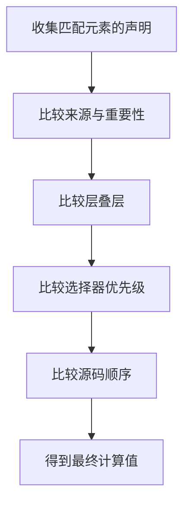

# CSS 选择器与层叠

> 本专题解决三个问题：规则会匹配谁、同一元素有多条规则时谁生效、为什么写了样式却看不到效果。

## 学习目标

- 能根据元素结构选择合适的选择器。
- 能解释层叠、继承、优先级和源码顺序的关系。
- 遇到样式不生效时，能用开发者工具定位原因，而不是不断追加选择器。

## 1. CSS 规则的基本结构

```css
.card > .title {
  color: #183153;
  font-size: 1.25rem;
}
```

- `.card > .title` 是选择器，匹配作为 `.card` 直接子元素的 `.title`。
- `color` 是属性，`#183153` 是属性值。
- 声明块由花括号包围，多个声明用分号分隔。

## 2. 常用选择器

| 类型 | 示例 | 匹配范围 |
|---|---|---|
| 类型 | `p` | 所有段落 |
| 类 | `.notice` | 带有 notice 类的元素 |
| ID | `#main` | ID 为 main 的元素；页面中应保持唯一 |
| 后代 | `.article p` | article 内任意层级的段落 |
| 子元素 | `.menu > li` | menu 的直接 li 子元素 |
| 属性 | `input[required]` | 带 required 属性的输入框 |
| 伪类 | `a:hover`、`:focus-visible` | 处于特定状态的元素 |
| 伪元素 | `p::first-line` | 元素生成内容的特定部分 |
| 分组 | `h1, h2` | 同时匹配多个选择器 |

选择原则：优先使用语义清晰、作用范围稳定的类选择器。不要为了覆盖一条规则而无节制地增加嵌套层级或使用 ID。

## 3. 层叠如何决定最终样式



这是学习用的简化图。真实层叠还涉及用户代理、用户和作者来源、动画、过渡、`!important` 以及 cascade layers。不能把所有情况都简化成“谁写在最后谁生效”。

### 优先级的直观理解

在同一来源、重要性和层叠层等条件下，选择器优先级可粗略比较为：

1. ID 选择器的数量；
2. 类、属性、伪类选择器的数量；
3. 类型、伪元素选择器的数量。

例如，`#app .title` 通常比 `.panel .title` 更具体。但优先级不是唯一决定因素：层叠层、重要性和来源也可能先决定胜负。

## 4. 继承与初始值

- `color`、`font-family` 等许多文本相关属性通常可以继承。
- `margin`、`padding`、`border` 等布局属性通常不会继承。
- 未设置属性时，浏览器会根据继承规则、初始值和层叠结果确定值。
- `inherit` 强制继承父元素的计算值；`initial` 使用属性初始值；`unset` 根据属性是否可继承来选择继承或初始行为。

## 5. 可运行练习

将以下内容保存为 `cascade.html`，用浏览器打开：

```html
<!doctype html>
<html lang="zh-CN">
<head>
  <meta charset="UTF-8">
  <meta name="viewport" content="width=device-width, initial-scale=1">
  <title>CSS 层叠练习</title>
  <style>
    p { color: #555; }
    .note { color: #146c43; }
    .panel .note { color: #0d6efd; }
    .panel p { font-size: 1.1rem; }
  </style>
</head>
<body>
  <main class="panel">
    <p class="note">观察我的颜色与字号，然后在开发者工具中禁用某条规则。</p>
  </main>
</body>
</html>
```

预期：段落为蓝色，字号增大。请逐条禁用规则，观察层叠结果。

## 6. 排错流程

1. 确认 CSS 文件是否成功加载，检查 Network。
2. 确认选择器是否匹配目标元素。
3. 在 Styles 面板查看被覆盖或无效的声明。
4. 检查语法错误、拼写、单位和媒体查询条件。
5. 理解优先级后再调整规则；避免首先添加 `!important`。

## 7. 练习与验收

- [ ] 写出类型、类、后代、子元素、属性和伪类选择器。
- [ ] 给导航链接添加 hover 与键盘焦点样式。
- [ ] 解释 `.panel p` 与 `.panel > p` 的区别。
- [ ] 构造两条冲突规则，使用开发者工具说明最终颜色的来源。

## 面试自测

**问：为什么 CSS 规则写在后面却没有生效？**

答题要点：先看是否匹配、声明是否有效，再看来源与重要性、层叠层、选择器优先级和源码顺序；还要检查媒体查询、继承及浏览器实际加载的文件。

## 延伸阅读

- [MDN：CSS 选择器](https://developer.mozilla.org/zh-CN/docs/Web/CSS/CSS_selectors)
- [MDN：层叠与继承](https://developer.mozilla.org/zh-CN/docs/Web/CSS/Cascade)
