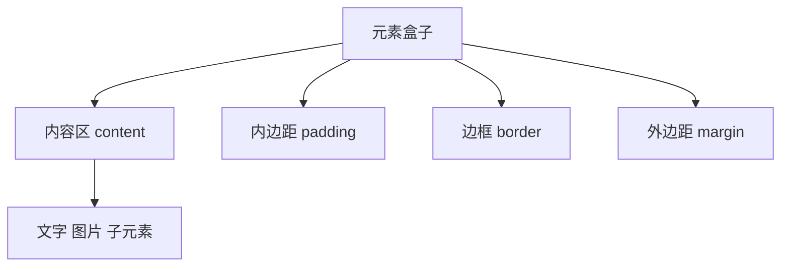

# CSS 盒模型

> 页面布局中的宽度、高度、间距和溢出问题，大多可以从盒模型开始排查。

## 学习目标

- 说清 content、padding、border、margin 的区别。
- 理解 `content-box` 与 `border-box` 的尺寸计算。
- 能处理外边距、溢出、最小尺寸和常见布局偏差。

## 1. 盒模型结构



- **content**：内容本身的布局区域。
- **padding**：内容与边框之间的空间；背景通常绘制到 padding 区域。
- **border**：围绕内容和内边距的边框。
- **margin**：元素与周围盒子之间的外部间距，透明且不属于元素背景绘制区域。

## 2. 两种尺寸计算方式

假设 CSS 设置 `width: 300px`、左右 padding 各 20px、左右 border 各 2px：

| `box-sizing` | width 表示 | 实际外框宽度（不含 margin） |
|---|---|---:|
| `content-box` | 内容区宽度 | 344px |
| `border-box` | 内容 + padding + border | 300px |

现代项目常采用统一规则：

```css
*, 
*::before,
*::after {
  box-sizing: border-box;
}
```

这会让显式设置的宽度更接近肉眼理解的外框宽度。但要注意：子元素仍可能因最小内容尺寸、固定宽度或长字符串而溢出。

## 3. 尺寸与间距示例

```html
<div class="card">
  <h2>盒模型</h2>
  <p>宽度、内边距与边框共同影响布局。</p>
</div>
```

```css
*,
*::before,
*::after {
  box-sizing: border-box;
}

.card {
  width: min(100%, 24rem);
  padding: 1.25rem;
  border: 1px solid #cbd5e1;
  margin-block: 1rem;
  border-radius: 0.75rem;
}
```

## 4. 常见布局问题

### 外边距折叠

在普通块级布局中，某些相邻垂直外边距会发生折叠，最终间距不一定等于两者之和。Flex、Grid 容器中的项目外边距不会以同样方式发生垂直折叠。需要稳定控制间距时，可考虑容器的 `gap`。

### 溢出与最小尺寸

- `overflow: auto`：内容溢出时按需提供滚动。
- `overflow: hidden`：裁剪溢出内容，使用前确认不会隐藏必要信息。
- `min-width: 0`：常用于 Flex/Grid 子项，允许其收缩到内容最小宽度以下。
- `minmax(0, 1fr)`：网格布局中常用来避免轨道被长内容撑宽。
- `width: 100%` 不一定能解决溢出；如果还存在 padding、border 或固定宽度，需结合盒模型分析。

## 5. 练习：修复卡片横向溢出

```html
<div class="row">
  <article class="card">
    <h2>一段特别特别长且没有空格的标识符 ABCDEFGHIJKLMNOPQRSTUVWXYZ123456789</h2>
    <p>尝试观察窄屏时卡片是否撑破容器。</p>
  </article>
</div>
```

```css
*,
*::before,
*::after { box-sizing: border-box; }

.row {
  display: grid;
  grid-template-columns: minmax(0, 1fr);
  max-width: 40rem;
}

.card {
  min-width: 0;
  padding: 1rem;
  border: 1px solid #cbd5e1;
  overflow-wrap: anywhere;
}
```

## 6. 调试步骤

1. 在 Elements 面板查看 Box Model 可视化。
2. 核对元素的 computed width、padding、border 和 margin。
3. 检查父容器宽度、Flex/Grid 的最小尺寸与固定宽度。
4. 检查长单词、图片、表单控件是否撑开布局。
5. 仅在明确需要时使用裁剪或滚动，避免用 `overflow: hidden` 掩盖根因。

## 练习与验收

- [ ] 分别使用 `content-box` 与 `border-box`，计算并验证实际宽度。
- [ ] 制作带边框、内边距和外边距的卡片。
- [ ] 在窄屏下修复长文本导致的横向溢出。
- [ ] 解释 margin 与 padding 的区别，以及何时优先使用 gap。

## 面试自测

**问：为什么设置了 width: 100%，元素仍然超出父容器？**

答题要点：检查默认盒模型、padding/border、固定最小尺寸、长内容、Flex/Grid 项目的 min-width，以及子元素的固定宽度。

## 延伸阅读

- [MDN：盒模型](https://developer.mozilla.org/zh-CN/docs/Web/CSS/CSS_box_model/Introduction_to_the_CSS_box_model)
- [MDN：box-sizing](https://developer.mozilla.org/zh-CN/docs/Web/CSS/box-sizing)
