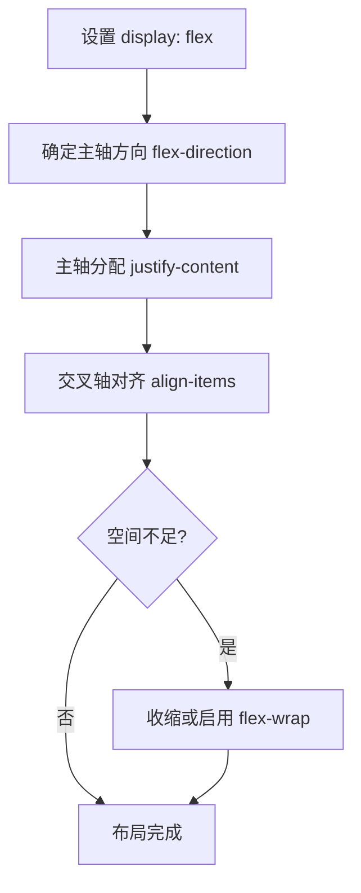

# Flexbox 布局

> Flexbox 适合沿一个主轴排列项目，并控制对齐、分配空间和换行。它不是所有布局问题的万能解，但非常适合导航栏、工具条、按钮组和卡片行。

## 学习目标

- 理解 flex 容器、项目、主轴和交叉轴。
- 掌握 `justify-content`、`align-items`、`gap`、`flex-wrap`。
- 能解释 `flex-grow`、`flex-shrink`、`flex-basis` 的作用。
- 能排查项目不收缩、对齐方向错误和间距异常。

## 1. Flexbox 的布局思路



- 主轴由 `flex-direction` 决定，默认是水平方向的 `row`。
- 交叉轴与主轴垂直。
- `justify-content` 控制主轴上的分布。
- `align-items` 控制每一行/列的交叉轴对齐；多行的整体分布通常由 `align-content` 控制。

## 2. 常用属性速查

| 属性 | 常见值 | 作用 |
|---|---|---|
| `display` | `flex`、`inline-flex` | 建立 Flex 格式化上下文 |
| `flex-direction` | `row`、`column` | 设置主轴方向 |
| `justify-content` | `start`、`center`、`space-between` | 主轴分布 |
| `align-items` | `stretch`、`center`、`start` | 单行交叉轴对齐 |
| `gap` | 长度值 | 项目之间的间距 |
| `flex-wrap` | `nowrap`、`wrap` | 是否换行 |
| `flex-grow` | 非负数 | 分配剩余空间的比例 |
| `flex-shrink` | 非负数 | 空间不足时参与收缩的比例 |
| `flex-basis` | 长度或 `auto` | 分配空间前的基准尺寸 |
| `align-self` | 对齐值 | 覆盖单个项目的交叉轴对齐 |

## 3. 实战：响应式导航栏

```html
<header class="site-header">
  <a class="brand" href="/">我的站点</a>
  <nav class="nav" aria-label="主导航">
    <a href="#notes">笔记</a>
    <a href="#projects">项目</a>
    <a href="#about">关于</a>
  </nav>
</header>
```

```css
*,
*::before,
*::after {
  box-sizing: border-box;
}

.site-header {
  display: flex;
  align-items: center;
  justify-content: space-between;
  gap: 1rem;
  flex-wrap: wrap;
  padding: 1rem clamp(1rem, 4vw, 2rem);
  border-bottom: 1px solid #dbe2ea;
}

.brand {
  font-weight: 700;
  text-decoration: none;
}

.nav {
  display: flex;
  align-items: center;
  gap: 1rem;
  flex-wrap: wrap;
}

.nav a {
  padding: 0.4rem 0.6rem;
  border-radius: 0.4rem;
}

.nav a:focus-visible {
  outline: 2px solid currentColor;
  outline-offset: 3px;
}
```

说明：容器在空间不足时允许换行；导航项之间用 `gap` 控制距离，不需要给每个链接添加左右 margin。

## 4. 实战：等宽卡片行

```html
<section class="cards" aria-label="学习模块">
  <article class="card">HTML：内容结构</article>
  <article class="card">CSS：布局样式</article>
  <article class="card">JavaScript：交互行为</article>
</section>
```

```css
.cards {
  display: flex;
  flex-wrap: wrap;
  gap: 1rem;
}

.card {
  flex: 1 1 14rem;
  min-width: 0;
  padding: 1rem;
  border: 1px solid #dbe2ea;
  border-radius: 0.75rem;
}
```

`flex: 1 1 14rem` 是常用简写，表示项目可以增长、可以收缩，基准尺寸为 14rem。它不保证每一列在所有情况下都绝对等宽；最终结果还受容器空间、间距和最小尺寸影响。

## 5. 常见问题

- **交叉轴方向弄反**：先确认 `flex-direction`，再决定使用哪个对齐属性。
- **项目挤不动**：检查长文本和项目的最小尺寸；必要时设置 `min-width: 0` 或合理的换行规则。
- **用空格制造间距**：优先使用 `gap`，避免维护复杂的 margin。
- **把 Flexbox 用于复杂二维布局**：若需要同时控制行与列轨道，考虑 CSS Grid。
- **滥用固定高度**：内容变长或字体放大时容易被裁剪；优先让内容自然撑开。
- **隐藏焦点轮廓**：键盘用户需要可见的焦点反馈。

## 6. 练习与验收

- [ ] 实现左侧品牌、右侧导航的工具栏。
- [ ] 让导航在窄屏下自然换行，且无横向溢出。
- [ ] 用 `flex` 简写制作可伸缩的卡片组。
- [ ] 分别尝试 `justify-content: center`、`space-between` 和 `gap`。
- [ ] 使用开发者工具检查主轴方向、项目尺寸和收缩结果。

## 面试自测

**问：Flexbox 和 Grid 应该如何选择？**

答题要点：Flexbox 更适合一维排列和内容驱动的对齐；Grid 更适合同时规划行列的二维布局。二者可以组合使用，不是互斥关系。

**问：`flex: 1` 表示什么？**

答题要点：常见浏览器计算中相当于增长因子为 1、收缩因子为 1、基准尺寸为 0% 的简写效果；具体简写展开与计算要结合规范和布局上下文理解，不应简单说成“宽度永远相等”。

## 延伸阅读

- [MDN：Flexbox 基本概念](https://developer.mozilla.org/zh-CN/docs/Web/CSS/CSS_flexible_box_layout/Basic_concepts_of_flexbox)
- [MDN：对齐 Flex 项目](https://developer.mozilla.org/zh-CN/docs/Web/CSS/CSS_flexible_box_layout/Aligning_items_in_a_flex_container)
