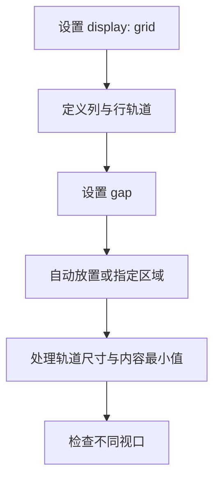

# CSS Grid 二维布局

> Grid 擅长同时规划行与列，适合页面骨架、卡片墙、仪表盘和需要明确二维关系的布局。

## 学习目标

- 理解 Grid 容器、轨道、单元格、区域和间距。
- 使用 `grid-template-columns`、`grid-template-rows`、`gap` 与 `grid-area`。
- 构建会随容器宽度变化的响应式卡片网格。
- 排查内容撑宽轨道、固定尺寸导致溢出等问题。

## 1. Grid 的布局模型



- **容器**：设置 `display: grid` 的元素。
- **项目**：Grid 容器的直接子元素。
- **轨道**：一整行或一整列。
- **单元格**：一行与一列交叉形成的区域。
- **区域**：由一个或多个单元格组成的矩形区域。
- **间距**：使用 `gap` 设置轨道之间的空间。

## 2. 常见轨道定义

```css
.grid {
  display: grid;
  grid-template-columns: 16rem minmax(0, 1fr);
  gap: 1rem;
}
```

- `px`、`rem` 等固定或相对长度可控制轨道尺寸。
- `fr` 将可分配空间按比例分配。
- `repeat(3, 1fr)` 表示重复三条等比例轨道。
- `minmax(0, 1fr)` 允许轨道收缩到 0 的最小值，常用于避免长内容撑宽布局。
- `auto-fit` 与 `auto-fill` 可配合 `minmax()` 自动安排重复轨道。

## 3. 实战：自适应卡片墙

```html
<section class="learning-grid" aria-label="学习专题">
  <article class="topic-card"><h2>HTML</h2><p>组织语义化内容。</p></article>
  <article class="topic-card"><h2>CSS</h2><p>构建布局与视觉。</p></article>
  <article class="topic-card"><h2>JavaScript</h2><p>实现页面交互。</p></article>
  <article class="topic-card"><h2>浏览器</h2><p>理解运行与调试。</p></article>
</section>
```

```css
*,
*::before,
*::after {
  box-sizing: border-box;
}

.learning-grid {
  display: grid;
  grid-template-columns: repeat(auto-fit, minmax(min(100%, 15rem), 1fr));
  gap: 1rem;
}

.topic-card {
  min-width: 0;
  padding: 1.25rem;
  border: 1px solid #d8e0ea;
  border-radius: 0.75rem;
}

.topic-card h2 {
  margin-block-start: 0;
}
```

这里不必写死“桌面三列、平板两列、手机一列”。浏览器会根据容器宽度与最小轨道尺寸自动决定能放几列。

## 4. 实战：页面骨架与命名区域

```html
<div class="page">
  <header class="header">页头</header>
  <nav class="sidebar" aria-label="侧边导航">导航</nav>
  <main class="main">主要内容</main>
  <footer class="footer">页脚</footer>
</div>
```

```css
.page {
  display: grid;
  grid-template-columns: 14rem minmax(0, 1fr);
  grid-template-areas:
    "header header"
    "sidebar main"
    "footer footer";
  gap: 1rem;
}

.header { grid-area: header; }
.sidebar { grid-area: sidebar; }
.main { grid-area: main; min-width: 0; }
.footer { grid-area: footer; }

@media (max-width: 48rem) {
  .page {
    grid-template-columns: minmax(0, 1fr);
    grid-template-areas:
      "header"
      "sidebar"
      "main"
      "footer";
  }
}
```

`grid-template-areas` 中的字符串需要形成规则矩形区域；同一区域的名称应连续且组成矩形。

## 5. Grid 与 Flexbox 如何选择

| 场景 | 建议 |
|---|---|
| 导航项沿一条轴排列 | Flexbox |
| 卡片自动形成多行多列 | Grid |
| 页面需要明确的侧栏与主内容列 | Grid |
| 按钮内部图标和文字对齐 | Flexbox |
| 复杂卡片布局，内部也需横向对齐 | Grid 与 Flexbox 组合 |

两者可以组合使用。不要因为一个布局“能用 Grid”就强行用 Grid；选择最容易表达意图、最易维护的方案。

## 6. 常见问题与排错

- **内容撑宽页面**：检查长单词、图片和子项的最小尺寸；使用 `minmax(0, 1fr)`、`min-width: 0` 或合理的换行策略。
- **网格列数不符合预期**：核对容器可用宽度、gap 与最小轨道宽度。
- **卡片高度不一致**：检查默认拉伸行为、内容高度及是否确实需要统一高度。
- **区域定义无效**：检查命名是否拼写一致、区域是否为矩形。
- **手机端横向溢出**：检查固定列宽与视口断点，使用真实窄屏测试。

## 7. 练习与验收

- [ ] 用 `repeat(3, 1fr)` 建立三列布局。
- [ ] 改成 `auto-fit + minmax()`，观察窗口变化。
- [ ] 用命名区域实现页头、侧栏、正文和页脚。
- [ ] 在窄屏下把双栏改为单栏。
- [ ] 解释 `1fr` 与 `minmax(0, 1fr)` 的差异。

## 面试自测

**问：为什么 Grid 中的 `1fr` 轨道仍可能被长内容撑大？**

答题要点：轨道最小尺寸默认可能受内容的 min-content 尺寸影响。可视情况使用 `minmax(0, 1fr)`、项目的 `min-width: 0` 和换行规则。

## 延伸阅读

- [MDN：CSS Grid 布局](https://developer.mozilla.org/zh-CN/docs/Web/CSS/CSS_grid_layout)
- [MDN：Grid 布局基本概念](https://developer.mozilla.org/zh-CN/docs/Web/CSS/CSS_grid_layout/Basic_concepts_of_grid_layout)
