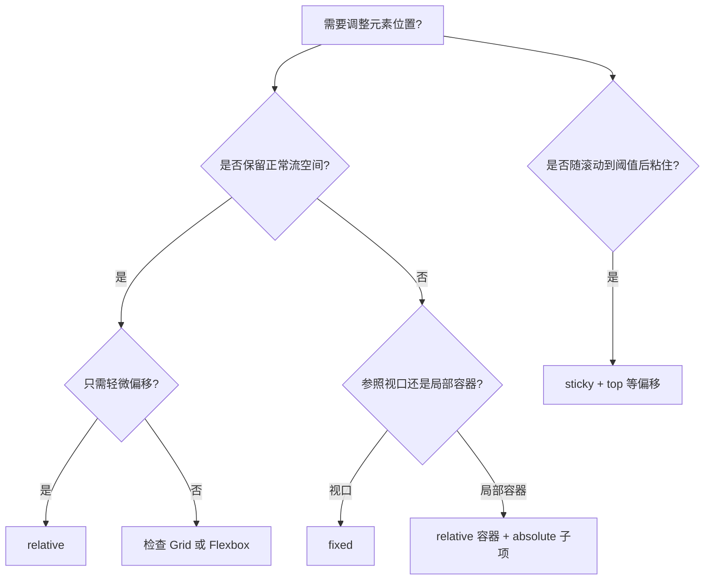

# CSS 定位与层叠上下文

> 当菜单需要浮在内容上方、按钮需要贴着卡片角落，或弹层被其他区域遮挡时，就需要理解定位与层叠上下文。

## 学习目标

- 区分 static、relative、absolute、fixed 与 sticky。
- 理解定位包含块和常用偏移属性。
- 知道 `z-index` 为什么有时看起来“不起作用”。
- 用合理的结构构建徽标、固定工具栏和粘性导航。

## 1. 定位方式总览

| 值 | 行为 | 常见用途 |
|---|---|---|
| `static` | 默认定位，按正常流布局 | 普通内容 |
| `relative` | 保留原布局位置，可做偏移与定位参考 | 局部定位容器 |
| `absolute` | 脱离正常流，相对定位包含块放置 | 角标、下拉菜单 |
| `fixed` | 通常相对视口定位，不随页面滚动 | 返回顶部、固定工具栏 |
| `sticky` | 在滚动容器中达到阈值后粘住 | 分组标题、粘性导航 |

## 2. 定位选择流程



## 3. 实战：卡片角标

```html
<article class="course-card">
  <span class="course-card__badge">推荐</span>
  <h2>CSS 布局</h2>
  <p>理解正常流、定位和层叠。</p>
</article>
```

```css
.course-card {
  position: relative;
  padding: 1.5rem;
  border: 1px solid #d5deea;
  border-radius: 0.75rem;
}

.course-card__badge {
  position: absolute;
  inset-block-start: 0.75rem;
  inset-inline-end: 0.75rem;
  padding: 0.25rem 0.5rem;
  border-radius: 999px;
  background: #e8f1ff;
  color: #164a8a;
}
```

逻辑属性 `inset-block-start` 和 `inset-inline-end` 可以适配不同书写方向；简单页面也常见 `top`、`right` 等属性。

## 4. 实战：粘性导航

```css
.site-nav {
  position: sticky;
  top: 0;
  z-index: 10;
  background: white;
  border-bottom: 1px solid #dbe2ea;
}
```

注意：sticky 依赖滚动容器与阈值设置。祖先元素的 `overflow`、容器高度以及布局环境都可能影响粘性行为。测试时应在实际页面滚动，而不只看静态预览。

## 5. z-index 与层叠上下文

`z-index` 并非全页面通用的“越大越靠前”数字。元素所在的层叠上下文会影响比较范围；一个子元素即使设为很大的 `z-index`，也无法简单越过其父级层叠上下文中的其他兄弟层。

可能创建层叠上下文的情况包括：

- 根元素；
- 定位元素搭配非 `auto` 的 `z-index`；
- `position: fixed` 或 `sticky` 元素；
- `opacity` 小于 1；
- 某些 `transform`、`filter`、`isolation: isolate` 等属性和值。

不要依赖死记清单处理复杂情况。用开发者工具检查祖先层叠上下文，并让相关组件的层级约定保持简单。

## 6. 常见问题

- **absolute 跑到意料之外的位置**：检查最近的定位祖先和实际包含块。
- **z-index 很大仍被遮挡**：检查祖先层叠上下文，而非继续无限增大数字。
- **sticky 不生效**：检查偏移阈值、滚动容器、祖先 overflow 与容器高度。
- **fixed 遮住正文**：为页面内容预留合理空间，避免固定导航覆盖锚点目标。
- **误用定位完成整页布局**：优先用正常流、Flexbox 或 Grid 组织主要结构，再用定位处理局部叠放。

## 7. 练习与验收

- [ ] 在卡片右上角添加角标。
- [ ] 实现粘性导航，并验证滚动行为。
- [ ] 创建两个嵌套层叠上下文，解释 z-index 的表现。
- [ ] 检查键盘焦点和弹层是否遮挡重要内容。

## 面试自测

**问：为什么子元素设置 `z-index: 9999` 仍然被遮挡？**

答题要点：`z-index` 在层叠上下文中参与排序；先检查元素及祖先创建的层叠上下文，再检查定位、绘制顺序和相关 CSS 属性。

## 延伸阅读

- [MDN：position](https://developer.mozilla.org/zh-CN/docs/Web/CSS/position)
- [MDN：层叠上下文](https://developer.mozilla.org/zh-CN/docs/Web/CSS/CSS_positioned_layout/Stacking_context)
