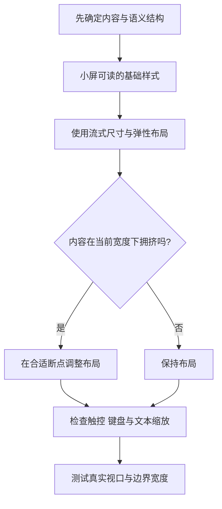

# CSS 响应式设计与媒体查询

> 响应式不是“给手机单独缩小一版”，而是让内容、布局和交互根据可用空间与用户环境合理调整。

## 学习目标

- 理解移动优先、流式尺寸和断点设计。
- 使用媒体查询适配布局、偏好和能力。
- 用相对单位、Flexbox 和 Grid 减少不必要的固定尺寸。
- 建立多视口验证清单。

## 1. 响应式设计流程



## 2. 视口基础

在页面 head 中包含：

```html
<meta name="viewport" content="width=device-width, initial-scale=1">
```

这能让移动浏览器按设备视口宽度布局。它不是响应式设计本身，仍需要 CSS 布局规则配合。

## 3. 移动优先与断点

先编写适用于窄屏的基础样式，再在空间足够时逐步增强：

```css
.page {
  display: grid;
  grid-template-columns: minmax(0, 1fr);
  gap: 1rem;
  padding: 1rem;
}

@media (min-width: 48rem) {
  .page {
    grid-template-columns: 15rem minmax(0, 1fr);
    padding: 1.5rem;
  }
}

@media (min-width: 72rem) {
  .page {
    gap: 1.5rem;
    padding: 2rem;
  }
}
```

断点应由内容何时变得拥挤来决定，而不是机械照搬某个设备型号。示例中的 48rem 和 72rem 只是起点。

## 4. 流式尺寸与容器限制

```css
.hero-title {
  font-size: clamp(2rem, 5vw, 4rem);
}

.content {
  width: min(100% - 2rem, 72rem);
  margin-inline: auto;
}

.cards {
  display: grid;
  grid-template-columns: repeat(auto-fit, minmax(min(100%, 16rem), 1fr));
  gap: 1rem;
}
```

- `rem` 适合跟随根字号缩放的间距和字体尺寸。
- `%` 常用于相对容器尺寸。
- `vw` 代表视口宽度的百分比；不宜不加限制地用于所有字体。
- `clamp(min, preferred, max)` 可为流式尺寸设定上下限。
- `min()`、`max()`、`calc()` 可组合表达尺寸约束。

## 5. 其他媒体特征

### 减少动态效果

```css
@media (prefers-reduced-motion: reduce) {
  *,
  *::before,
  *::after {
    scroll-behavior: auto;
    animation-duration: 0.01ms;
    animation-iteration-count: 1;
    transition-duration: 0.01ms;
  }
}
```

对复杂动画还应考虑直接关闭非必要动效，避免只缩短时长仍产生不适。

### 深色模式偏好

```css
@media (prefers-color-scheme: dark) {
  :root {
    color-scheme: dark;
  }
}
```

这只是浏览器控件与颜色方案的提示。完整深色主题仍需为背景、文字、边框、图像和交互状态提供合适颜色。

### 悬停能力

```css
@media (hover: hover) and (pointer: fine) {
  .card:hover {
    transform: translateY(-2px);
  }
}
```

不要把重要信息或唯一操作入口只放在 hover 状态中，因为触屏设备未必支持悬停。

## 6. 响应式检查清单

- [ ] 检查 320px、375px、768px、1024px 和宽屏视口。
- [ ] 在断点前后各检查一次，确认没有突然溢出。
- [ ] 使用浏览器缩放或放大文本，确认内容仍可阅读。
- [ ] 确认导航、按钮和表单在触屏下可操作。
- [ ] 检查图片是否按容器缩放，且不会被意外拉伸。
- [ ] 检查长单词、代码块和表格的溢出策略。
- [ ] 检查键盘焦点、对比度和减少动态效果偏好。
- [ ] 不要通过禁用用户缩放来掩盖布局问题。

## 7. 练习与验收

把已有个人介绍页改成响应式作品集：

1. 小屏使用单列布局。
2. 中等宽度时显示侧栏与正文。
3. 大屏使用自适应卡片网格。
4. 标题使用 `clamp()` 控制流式字号。
5. 加入 `prefers-reduced-motion` 支持。
6. 使用开发者工具逐个验证视口，并记录发现的问题和修复原因。

## 面试自测

**问：响应式布局的断点应该如何确定？**

答题要点：根据内容布局在何处开始拥挤或失去可读性来选择断点，使用内容优先的测试方法；设备尺寸可以作为参考，但不应成为唯一依据。

## 延伸阅读

- [MDN：响应式设计](https://developer.mozilla.org/zh-CN/docs/Learn_web_development/Core/CSS_layout/Responsive_Design)
- [MDN：媒体查询](https://developer.mozilla.org/zh-CN/docs/Web/CSS/CSS_media_queries/Using_media_queries)
- [web.dev：Learn Responsive Design](https://web.dev/learn/design/)
