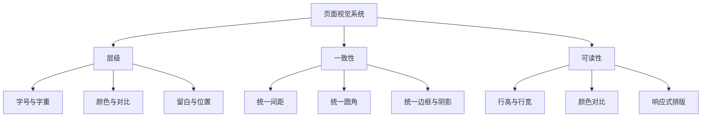

# CSS 07｜视觉设计与排版

> 从“把元素摆好”进阶到“让页面看起来有秩序”：建立颜色、字体、间距、边框和阴影的一致规则。

## 学习目标

- 解释视觉层级如何帮助用户理解页面。
- 使用统一的颜色、字号、间距和圆角，而不是随意写值。
- 用 CSS 自定义属性建立可维护的设计令牌。
- 通过排版、留白、对比和一致性改善卡片式页面。

## 1. 视觉设计的基本关系

视觉设计不是给每个元素添加装饰，而是通过差异与一致性表达信息层级。



一个实用原则：**先建立规则，再处理例外。** 如果每张卡片的间距、圆角、标题字号都不一样，页面会显得嘈杂。

## 2. 颜色：角色比单个色值更重要

不要只记住某个蓝色的色号，先定义颜色的用途：

- **页面背景**：页面整体底色。
- **表面颜色**：卡片、弹窗、导航等容器。
- **正文颜色**：主要阅读内容。
- **次级文字**：说明、时间、辅助信息。
- **边框颜色**：分隔结构。
- **强调色**：链接、主要操作和选中状态。
- **状态色**：成功、警告、错误；不能只靠颜色传递状态。

## 3. 字体、字号与行高

```css
:root {
  --font-body: system-ui, -apple-system, BlinkMacSystemFont, "Segoe UI", sans-serif;
  --text-sm: 0.875rem;
  --text-base: 1rem;
  --text-lg: 1.25rem;
  --text-title: clamp(1.75rem, 4vw, 3rem);
  --line-body: 1.7;
  --line-heading: 1.2;
}

body {
  font-family: var(--font-body);
  font-size: var(--text-base);
  line-height: var(--line-body);
}

h1, h2, h3 {
  line-height: var(--line-heading);
  letter-spacing: -0.02em;
}
```

注意事项：

- 正文行高通常需要比标题更宽松。
- 标题字号可用 `clamp()` 在最小值与最大值之间流动。
- 长段落应控制行宽；过长的单行会增加阅读负担。
- 字体回退列表应合理，不能假定每台设备都安装同一字体。
- 不要把所有内容都加粗；字重应服务于层级。

## 4. 用间距建立节奏

优先使用一组有限的间距令牌，例如 4、8、12、16、24、32、48 像素对应的 rem 值。相邻元素的距离应体现关系：标题与正文较近，两个独立内容区块之间较远。

```css
:root {
  --space-1: 0.25rem;
  --space-2: 0.5rem;
  --space-3: 0.75rem;
  --space-4: 1rem;
  --space-6: 1.5rem;
  --space-8: 2rem;
  --space-12: 3rem;
}

.page {
  width: min(100% - 2rem, 72rem);
  margin-inline: auto;
  padding-block: var(--space-8);
}

.section + .section {
  margin-block-start: var(--space-12);
}
```

## 5. 边框、圆角与阴影

```css
:root {
  --border-subtle: 1px solid #dce3ed;
  --radius-sm: 0.5rem;
  --radius-card: 1rem;
  --shadow-card: 0 8px 24px rgb(20 35 60 / 8%);
}

.card {
  border: var(--border-subtle);
  border-radius: var(--radius-card);
  box-shadow: var(--shadow-card);
  background: #fff;
}
```

- 边框用于划分结构，不必每个容器都同时使用粗边框和重阴影。
- 阴影应表现层级，而不是让所有元素都像悬浮窗。
- 圆角尽量建立有限的尺寸体系。
- 如果阴影被移除，内容分组仍应通过间距、边框或标题保持清晰。

## 6. 完整示例：学习资源卡片

将以下内容保存为 HTML 文件即可查看效果。

```html
<!doctype html>
<html lang="zh-CN">
<head>
  <meta charset="UTF-8">
  <meta name="viewport" content="width=device-width, initial-scale=1">
  <title>学习资源卡片</title>
  <style>
    :root {
      color-scheme: light;
      --page: #f4f7fb;
      --surface: #fff;
      --text: #172033;
      --muted: #5e6b80;
      --accent: #315ee7;
      --border: #dce4f0;
      --radius: 1rem;
      --space: 1rem;
    }

    * { box-sizing: border-box; }

    body {
      margin: 0;
      background: var(--page);
      color: var(--text);
      font-family: system-ui, sans-serif;
      line-height: 1.65;
    }

    main {
      width: min(100% - 2rem, 68rem);
      margin-inline: auto;
      padding-block: 3rem;
    }

    .eyebrow {
      color: var(--accent);
      font-size: .875rem;
      font-weight: 700;
      letter-spacing: .08em;
      text-transform: uppercase;
    }

    h1 { margin-block: .25rem .75rem; line-height: 1.2; }
    .intro { max-width: 42rem; color: var(--muted); }

    .cards {
      display: grid;
      grid-template-columns: repeat(auto-fit, minmax(min(100%, 16rem), 1fr));
      gap: var(--space);
      margin-block-start: 2rem;
    }

    .card {
      padding: 1.25rem;
      background: var(--surface);
      border: 1px solid var(--border);
      border-radius: var(--radius);
      box-shadow: 0 8px 24px rgb(20 35 60 / 6%);
    }

    .card h2 { margin-block: 0 .5rem; font-size: 1.125rem; }
    .card p { margin-block: 0 1rem; color: var(--muted); }
    .card a { color: var(--accent); font-weight: 650; text-underline-offset: .2em; }
    .card a:focus-visible { outline: 3px solid currentColor; outline-offset: 3px; }
  </style>
</head>
<body>
  <main>
    <p class="eyebrow">Learning library</p>
    <h1>把知识变成可复用的能力</h1>
    <p class="intro">从一个清晰的主题开始，阅读、实践，再把真正理解的内容沉淀为自己的笔记。</p>
    <section class="cards" aria-label="学习主题">
      <article class="card">
        <h2>HTML 基础</h2>
        <p>用语义化结构组织页面内容。</p>
        <a href="#html">查看学习路径</a>
      </article>
      <article class="card">
        <h2>CSS 布局</h2>
        <p>使用 Flexbox、Grid 和响应式规则建立页面结构。</p>
        <a href="#css">查看学习路径</a>
      </article>
      <article class="card">
        <h2>JavaScript</h2>
        <p>用事件和数据处理为页面添加交互。</p>
        <a href="#javascript">查看学习路径</a>
      </article>
    </section>
  </main>
</body>
</html>
```

## 7. 常见问题排查

| 现象 | 可能原因 | 建议检查 |
|---|---|---|
| 页面显得杂乱 | 色值、字号、间距种类过多 | 先统一设计令牌 |
| 正文难读 | 行高不足、行宽过长、对比度不足 | 调整 line-height、max-width 和文字颜色 |
| 卡片像一堆浮窗 | 阴影过重且使用范围太广 | 减弱阴影，使用边框和留白分组 |
| 标题在手机上过大 | 使用固定的大字号 | 用 clamp() 或媒体查询 |
| 辅助文字看不清 | 过浅颜色或过小字号 | 提高对比度，不要只靠颜色区分 |

## 8. 动手练习与验收

### 练习 A：建立视觉令牌

- [ ] 定义页面背景、表面、正文、次级文字、边框、强调色。
- [ ] 定义至少 5 个间距级别、2～3 种圆角。
- [ ] 把重复出现的颜色和尺寸改为 CSS 自定义属性。

### 练习 B：优化一组卡片

- [ ] 统一标题、描述和链接的间距。
- [ ] 使用 Grid 实现自动换列。
- [ ] 在窄屏下不出现横向滚动。
- [ ] 键盘聚焦链接时有清晰可见的焦点样式。

## 9. 面试自测

1. 为什么设计令牌比在每个选择器中直接写色值更容易维护？
2. `clamp(min, preferred, max)` 三个参数分别表示什么？
3. 为什么不能只通过颜色传递错误或成功状态？
4. 什么时候边框比阴影更合适？
5. 字体、行高和行宽分别如何影响可读性？

## 延伸阅读

- [MDN：CSS 基础文本与字体样式](https://developer.mozilla.org/zh-CN/docs/Learn_web_development/Core/Text_styling)
- [MDN：CSS 自定义属性](https://developer.mozilla.org/zh-CN/docs/Web/CSS/Using_CSS_custom_properties)
- [web.dev：Learn CSS](https://web.dev/learn/css)
