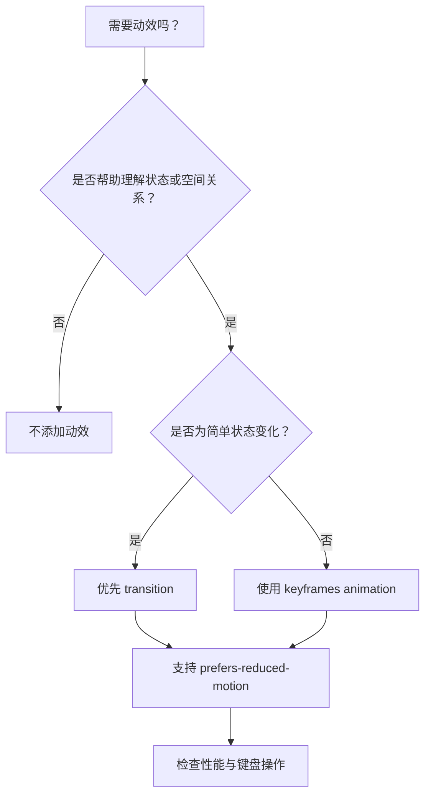

# CSS 08｜过渡与动画

> 动效的价值是解释状态变化、提供反馈和引导注意力，而不是让页面一直动。

## 学习目标

- 区分 transition、transform 与 @keyframes animation。
- 为交互状态添加轻量、可预测的反馈。
- 理解动效的可访问性、性能和减少动态效果偏好。
- 能排查动画不触发、闪烁、布局抖动等常见问题。

## 1. 动效决策流程



## 2. transition：状态之间平滑过渡

`transition` 适合 hover、focus、展开状态等由一个状态变为另一个状态的场景。

```css
.button {
  background: #315ee7;
  color: white;
  transform: translateY(0);
  box-shadow: 0 2px 5px rgb(0 0 0 / 12%);
  transition:
    transform 160ms ease,
    box-shadow 160ms ease,
    background-color 160ms ease;
}

.button:hover {
  background: #244bc2;
  transform: translateY(-2px);
  box-shadow: 0 8px 18px rgb(0 0 0 / 14%);
}

.button:active {
  transform: translateY(0);
}

.button:focus-visible {
  outline: 3px solid #91a9ff;
  outline-offset: 3px;
}
```

关键点：

- transition 写在基础状态上，进入和离开状态都能平滑过渡。
- 明确列出需要过渡的属性，避免无意中动画化所有属性。
- 时长应简短、符合操作反馈；并非越慢越高级。
- 触屏设备没有传统 hover，不能把重要信息只放在 hover 状态。

## 3. transform：移动、缩放、旋转

```css
.thumbnail {
  transform: scale(1);
  transition: transform 180ms ease;
}

.thumbnail:hover {
  transform: scale(1.03);
}
```

常用变换：

- `translate()`：移动元素视觉位置。
- `scale()`：缩放。
- `rotate()`：旋转。
- `transform-origin`：设置变换参考点。

transform 通常不会像修改布局尺寸那样推动周围元素重新排版，但变换后的元素可能覆盖相邻内容，因此仍要检查层叠与可视区域。

## 4. @keyframes：定义多阶段动画

```css
@keyframes appear {
  from {
    opacity: 0;
    transform: translateY(12px);
  }
  to {
    opacity: 1;
    transform: translateY(0);
  }
}

.notice {
  animation: appear 260ms ease-out both;
}
```

- `from` 与 `to` 可分别写成 `0%` 和 `100%`。
- `animation-duration` 定义时长，`animation-delay` 定义延迟。
- `animation-iteration-count` 控制播放次数；谨慎使用无限循环。
- `animation-fill-mode: both` 会让动画在延迟阶段和结束后保留相应关键帧样式，使用前应确认符合预期。

## 5. 完整示例：带反馈的资源卡片

```html
<!doctype html>
<html lang="zh-CN">
<head>
  <meta charset="UTF-8">
  <meta name="viewport" content="width=device-width, initial-scale=1">
  <title>CSS 动效练习</title>
  <style>
    * { box-sizing: border-box; }
    body {
      margin: 0;
      padding: 2rem;
      font-family: system-ui, sans-serif;
      background: #f4f7fb;
      color: #172033;
    }
    .card {
      max-width: 30rem;
      margin-inline: auto;
      padding: 1.5rem;
      background: white;
      border: 1px solid #dce4f0;
      border-radius: 1rem;
      box-shadow: 0 5px 18px rgb(20 35 60 / 7%);
      animation: appear 260ms ease-out both;
      transition: transform 180ms ease, box-shadow 180ms ease;
    }
    .card:hover {
      transform: translateY(-3px);
      box-shadow: 0 12px 28px rgb(20 35 60 / 12%);
    }
    .card h1 { margin-block: 0 .5rem; font-size: 1.4rem; }
    .card p { color: #5e6b80; line-height: 1.7; }
    .card a { color: #315ee7; font-weight: 650; }
    .card a:focus-visible { outline: 3px solid #91a9ff; outline-offset: 3px; }

    @keyframes appear {
      from { opacity: 0; transform: translateY(10px); }
      to { opacity: 1; transform: translateY(0); }
    }

    @media (prefers-reduced-motion: reduce) {
      *, *::before, *::after {
        animation-duration: 0.01ms !important;
        animation-iteration-count: 1 !important;
        scroll-behavior: auto !important;
        transition-duration: 0.01ms !important;
      }
    }
  </style>
</head>
<body>
  <article class="card">
    <h1>给知识一点结构</h1>
    <p>轻量动效可以让卡片的出现与交互更容易被感知，但正文仍应在没有动效时完整可用。</p>
    <a href="#learn">开始学习</a>
  </article>
</body>
</html>
```

## 6. 性能与可访问性

优先尝试动画 `transform` 和 `opacity`，因为它们通常更容易避免频繁布局；但实际性能仍取决于设备、效果和页面复杂度，应使用开发者工具验证。

尽量避免持续动画这些可能反复触发布局或绘制的属性：

- `width`、`height`、`top`、`left` 等布局相关属性。
- 大面积模糊、复杂滤镜或高成本阴影。
- 无必要的全屏循环动画。

无障碍要求：

- 尊重 `prefers-reduced-motion: reduce`。
- 不用闪烁动效表达唯一信息。
- 动效不能阻止用户操作或掩盖焦点。
- 对自动播放、循环和视差效果保持克制。
- 关闭或减少动效后，信息层级与功能仍然完整。

## 7. 常见问题排查

| 问题 | 排查方向 |
|---|---|
| 过渡没有生效 | 检查属性是否可动画、状态选择器是否匹配、transition 是否在基础状态 |
| 进入时有动画但退出没有 | 检查是否只在 hover 规则里声明 transition |
| 元素移动后盖住邻居 | 检查 transform、position 和 z-index |
| 页面滚动或点击变卡 | 减少动画数量，优先测试 transform/opacity，使用 Performance 面板 |
| 手机没有 hover 效果 | 确保关键功能不依赖 hover |
| 用户偏好减少动态效果时仍大幅运动 | 检查 prefers-reduced-motion 媒体查询是否覆盖相关动画 |

## 8. 动手练习与验收

### 练习 A：交互反馈

- [ ] 给按钮添加 hover、active 和 focus-visible 状态。
- [ ] 过渡只涉及明确需要的属性。
- [ ] 不依赖 hover 才能看到重要内容。

### 练习 B：入场动效

- [ ] 用 @keyframes 实现一次性淡入。
- [ ] 增加 prefers-reduced-motion 处理。
- [ ] 关闭动效后，内容仍能直接阅读。
- [ ] 避免让所有卡片同时以夸张的方式飞入。

## 9. 面试自测

1. transition 与 animation 的核心区别是什么？
2. 为什么 transition 通常应写在基础状态？
3. transform 与修改 top/left 对布局的影响有什么区别？
4. prefers-reduced-motion 解决什么问题？
5. 为什么不能认为所有 transform 动画一定没有性能问题？

## 延伸阅读

- [MDN：使用 CSS transitions](https://developer.mozilla.org/zh-CN/docs/Web/CSS/CSS_transitions/Using_CSS_transitions)
- [MDN：CSS animations](https://developer.mozilla.org/zh-CN/docs/Web/CSS/CSS_animations/Using_CSS_animations)
- [MDN：prefers-reduced-motion](https://developer.mozilla.org/zh-CN/docs/Web/CSS/@media/prefers-reduced-motion)
- [web.dev：Animations](https://web.dev/articles/animations)
