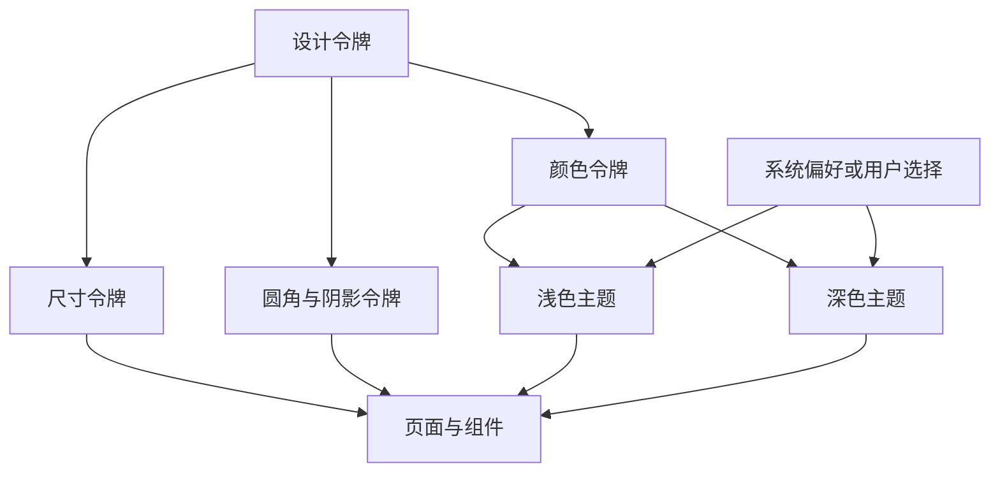

# CSS 09｜CSS 变量与主题系统

> 使用 CSS 自定义属性建立一套可维护的视觉令牌，让浅色、深色和组件样式共享同一组设计规则。

## 学习目标

- 使用 `--name` 声明自定义属性，并通过 `var()` 读取。
- 理解变量继承、作用域与回退值。
- 使用系统偏好或 `data-theme` 属性实现主题切换。
- 将颜色、间距、圆角、阴影等视觉规则与组件样式分离。

## 1. 主题系统的结构



思路是让组件依赖语义化令牌，例如 `--surface`、`--text`，而不是把浅色主题的具体色值写进每一个组件。

## 2. 声明与使用变量

```css
:root {
  --color-brand: #315ee7;
  --color-text: #172033;
  --color-muted: #5e6b80;
  --space-card: 1.25rem;
  --radius-card: 1rem;
}

.card {
  color: var(--color-text, #172033);
  padding: var(--space-card);
  border-radius: var(--radius-card);
}
```

注意：

- 自定义属性名区分大小写，通常使用小写和连字符。
- `var(--name, fallback)` 的第二个参数是变量未能提供有效值时使用的回退值。
- 自定义属性会按 CSS 级联规则确定值，并通常继承到后代元素。
- `var()` 不是文本替换工具；拼接时仍需符合目标 CSS 属性的语法。
- 变量值最终是否适用于某个属性，还取决于使用位置的语法要求。

## 3. 变量作用域与局部覆盖

```css
:root {
  --accent: #315ee7;
  --card-padding: 1rem;
}

.card {
  padding: var(--card-padding);
  border-color: var(--accent);
}

.card--compact {
  --card-padding: 0.75rem;
}

.card--warm {
  --accent: #a34a16;
}
```

把变量声明在 `:root` 可以让整个文档使用；声明在某个组件上则可只影响该组件及其后代。这使组件变体更容易实现。

## 4. 主题切换的两种方式

### 方式 A：跟随系统偏好

```css
:root {
  color-scheme: light;
  --page: #f4f7fb;
  --surface: #fff;
  --text: #172033;
  --muted: #5e6b80;
  --border: #dce4f0;
  --accent: #315ee7;
}

@media (prefers-color-scheme: dark) {
  :root {
    color-scheme: dark;
    --page: #111722;
    --surface: #1b2533;
    --text: #edf2fa;
    --muted: #b1bfd2;
    --border: #354255;
    --accent: #9bb3ff;
  }
}

body {
  background: var(--page);
  color: var(--text);
}
```

这是最简单的自动主题方式，适合希望尊重操作系统设置、暂时不需要页面内切换按钮的项目。

### 方式 B：通过 data-theme 明确切换

```css
:root,
:root[data-theme="light"] {
  color-scheme: light;
  --page: #f4f7fb;
  --surface: #fff;
  --text: #172033;
  --muted: #5e6b80;
  --border: #dce4f0;
  --accent: #315ee7;
}

:root[data-theme="dark"] {
  color-scheme: dark;
  --page: #111722;
  --surface: #1b2533;
  --text: #edf2fa;
  --muted: #b1bfd2;
  --border: #354255;
  --accent: #9bb3ff;
}
```

此方式适合用户可以手动切换主题的页面。若还希望“默认跟随系统、用户手动选择优先”，需要额外约定主题状态，例如让 JavaScript 只在用户明确选择时写入 `data-theme`，未选择时由媒体查询决定。

## 5. 完整示例：按钮切换浅色与深色主题

将代码保存为 HTML 文件运行。此示例用页面内状态切换主题，不依赖第三方库。

```html
<!doctype html>
<html lang="zh-CN" data-theme="light">
<head>
  <meta charset="UTF-8">
  <meta name="viewport" content="width=device-width, initial-scale=1">
  <title>主题切换示例</title>
  <style>
    :root,
    :root[data-theme="light"] {
      color-scheme: light;
      --page: #f4f7fb;
      --surface: #fff;
      --text: #172033;
      --muted: #5e6b80;
      --border: #dce4f0;
      --accent: #315ee7;
    }

    :root[data-theme="dark"] {
      color-scheme: dark;
      --page: #111722;
      --surface: #1b2533;
      --text: #edf2fa;
      --muted: #b1bfd2;
      --border: #354255;
      --accent: #9bb3ff;
    }

    * { box-sizing: border-box; }
    body {
      margin: 0;
      min-height: 100vh;
      background: var(--page);
      color: var(--text);
      font-family: system-ui, sans-serif;
      line-height: 1.7;
      transition: background-color 160ms ease, color 160ms ease;
    }
    main { width: min(100% - 2rem, 48rem); margin-inline: auto; padding-block: 3rem; }
    .card {
      padding: 1.5rem;
      background: var(--surface);
      border: 1px solid var(--border);
      border-radius: 1rem;
    }
    p { color: var(--muted); }
    button {
      padding: .7rem 1rem;
      border: 0;
      border-radius: .6rem;
      background: var(--accent);
      color: white;
      font: inherit;
      cursor: pointer;
    }
    button:focus-visible { outline: 3px solid var(--text); outline-offset: 3px; }

    @media (prefers-reduced-motion: reduce) {
      *, *::before, *::after { transition-duration: 0.01ms !important; }
    }
  </style>
</head>
<body>
  <main>
    <article class="card">
      <h1>个人知识库</h1>
      <p>主题切换时，组件只引用语义化变量，无需为每个组件重复定义所有颜色。</p>
      <button id="theme-toggle" type="button" aria-pressed="false">切换到深色主题</button>
    </article>
  </main>

  <script>
    const root = document.documentElement;
    const button = document.querySelector("#theme-toggle");

    button.addEventListener("click", () => {
      const isDark = root.dataset.theme === "dark";
      const nextTheme = isDark ? "light" : "dark";

      root.dataset.theme = nextTheme;
      button.textContent = nextTheme === "dark"
        ? "切换到浅色主题"
        : "切换到深色主题";
      button.setAttribute("aria-pressed", String(nextTheme === "dark"));
    });
  </script>
</body>
</html>
```

这个示例的主题状态只保存在当前页面内；刷新后会恢复 HTML 中声明的默认主题。若需要记住用户选择，可以再引入 localStorage，并在读取时处理异常和无效值。

## 6. 组件设计：让组件消费令牌

```css
:root {
  --surface: #fff;
  --text: #172033;
  --muted: #5e6b80;
  --border: #dce4f0;
  --accent: #315ee7;
  --radius: 1rem;
}

.card {
  background: var(--surface);
  color: var(--text);
  border: 1px solid var(--border);
  border-radius: var(--radius);
}

.card__description { color: var(--muted); }

.card__link {
  color: var(--accent);
  text-underline-offset: .2em;
}
```

好处是主题变化只需调整令牌，组件本身仍描述结构和角色。不要把所有属性都抽象成变量；优先抽象会重复使用、需要统一调整或存在主题差异的值。

## 7. 常见问题排查

| 问题 | 原因与处理 |
|---|---|
| 变量没有生效 | 检查拼写、作用域、选择器优先级和变量是否在当前元素可见 |
| `var()` 回退值未出现 | 变量可能存在但展开后不符合属性语法；回退值不等同于所有无效情况的兜底 |
| 只有部分组件变色 | 组件可能写死了色值，或没有使用语义令牌 |
| 深色模式对比不足 | 检查正文、次级文字、边框、链接和焦点状态 |
| 系统深色偏好覆盖手动选择 | 明确主题优先级；用户选择优先时使用显式状态选择器 |
| 切换后控件仍是浅色 | 检查 `color-scheme` 以及原生表单控件的呈现 |

## 8. 动手练习与验收

- [ ] 建立页面背景、表面、正文、次级文字、边框、强调色等令牌。
- [ ] 让至少三个组件使用这些令牌。
- [ ] 实现浅色与深色主题切换。
- [ ] 为主题按钮提供清楚的文字和键盘焦点样式。
- [ ] 检查两种主题下正文、链接和控件的可读性。
- [ ] 验证切换主题时不需要逐个修改组件规则。

## 9. 面试自测

1. CSS 自定义属性与 Sass 变量有什么主要区别？
2. 自定义属性如何继承，局部声明有什么用途？
3. `var(--x, fallback)` 的回退值何时会生效？
4. 如何同时支持系统主题和用户手动选择？
5. 为什么主题系统应该使用语义化变量，而不是 `--blue`、`--gray` 这类纯色名？

## 延伸阅读

- [MDN：使用 CSS 自定义属性](https://developer.mozilla.org/zh-CN/docs/Web/CSS/Using_CSS_custom_properties)
- [MDN：prefers-color-scheme](https://developer.mozilla.org/zh-CN/docs/Web/CSS/@media/prefers-color-scheme)
- [MDN：color-scheme](https://developer.mozilla.org/zh-CN/docs/Web/CSS/color-scheme)
- [web.dev：颜色与主题相关实践](https://web.dev/learn/css)
