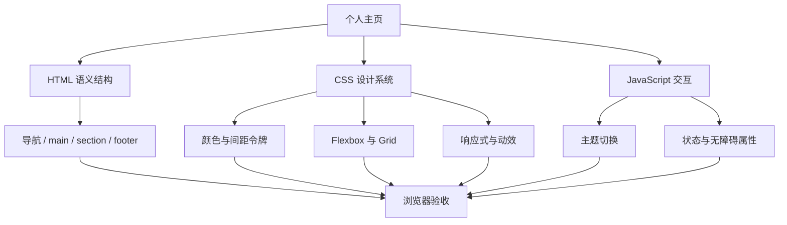

# CSS 10｜综合实战：响应式个人主页

> 将选择器、盒模型、Flexbox、Grid、定位、响应式、视觉令牌、动效和主题系统整合成一个可独立运行的作品。

## 项目目标

完成一个适合放入 GitHub Pages 或静态网站的个人主页。页面包括：

- 个人介绍与导航
- 技能或知识领域卡片
- 项目展示区
- 浅色/深色主题切换
- 响应式布局
- 键盘焦点和减少动态效果支持

本项目只使用原生 HTML、CSS 和少量 JavaScript，不需要构建工具或第三方依赖。

## 1. 页面结构与样式分层



建议目录：

```text
personal-home/
├── index.html
├── css/
│   └── styles.css
├── js/
│   └── main.js
└── README.md
```

为了方便初次练习，也可以先将下方三个文件内容合并成单个 HTML 文件；熟悉后再拆分。

## 2. 完整示例

### 2.1 index.html

```html
<!doctype html>
<html lang="zh-CN" data-theme="light">
<head>
  <meta charset="UTF-8">
  <meta name="viewport" content="width=device-width, initial-scale=1">
  <meta name="description" content="个人主页，记录学习、项目与持续成长。">
  <title>个人主页｜持续学习与创造</title>
  <link rel="stylesheet" href="css/styles.css">
  <script src="js/main.js" defer></script>
</head>
<body>
  <a class="skip-link" href="#main">跳转到主要内容</a>

  <header class="site-header">
    <div class="container header-inner">
      <a class="brand" href="#top" aria-label="主页">MySpace<span>.</span></a>
      <nav class="nav" aria-label="主导航">
        <a href="#about">关于</a>
        <a href="#skills">领域</a>
        <a href="#projects">项目</a>
      </nav>
      <button class="theme-toggle" id="theme-toggle" type="button" aria-pressed="false">
        切换到深色主题
      </button>
    </div>
  </header>

  <main id="main" class="container">
    <section class="hero" id="top" aria-labelledby="hero-title">
      <div class="hero-copy">
        <p class="eyebrow">LEARN · BUILD · SHARE</p>
        <h1 id="hero-title">把好奇心，变成持续创造的能力。</h1>
        <p class="hero-description">
          这里记录我的学习路径、工程实践和不断完善的知识系统。
          相信小步迭代，也相信长期积累。
        </p>
        <div class="hero-actions">
          <a class="button button-primary" href="#projects">查看项目</a>
          <a class="button button-secondary" href="#about">了解更多</a>
        </div>
      </div>
      <aside class="profile-card" aria-label="个人简介">
        <div class="avatar" aria-hidden="true">M</div>
        <p class="profile-label">CURRENT FOCUS</p>
        <h2>学习 · 实践 · 复盘</h2>
        <p>用项目验证理解，用笔记连接知识。</p>
        <div class="profile-tags">
          <span>前端开发</span><span>嵌入式</span><span>知识管理</span>
        </div>
      </aside>
    </section>

    <section class="section" id="about" aria-labelledby="about-title">
      <div class="section-heading">
        <p class="eyebrow">ABOUT</p>
        <h2 id="about-title">关于这个空间</h2>
        <p>不是一次性展示，而是一个可以持续生长的个人档案。</p>
      </div>
      <div class="about-panel">
        <p>
          我关注如何把零散的信息整理成可以检索、复用和实践的知识。
          通过阅读、编码、写作与复盘，让学习成果逐步沉淀为自己的工具箱。
        </p>
      </div>
    </section>

    <section class="section" id="skills" aria-labelledby="skills-title">
      <div class="section-heading">
        <p class="eyebrow">FOCUS AREAS</p>
        <h2 id="skills-title">关注领域</h2>
        <p>围绕基础能力持续积累，再通过真实项目连接不同主题。</p>
      </div>
      <div class="card-grid">
        <article class="content-card">
          <span class="card-number">01</span>
          <h3>前端开发</h3>
          <p>HTML 语义、CSS 布局、JavaScript 交互与静态站点实践。</p>
          <a href="#projects">相关项目 <span aria-hidden="true">→</span></a>
        </article>
        <article class="content-card">
          <span class="card-number">02</span>
          <h3>嵌入式系统</h3>
          <p>从 C 语言、驱动和调试出发，理解软硬件之间的协作。</p>
          <a href="#projects">相关项目 <span aria-hidden="true">→</span></a>
        </article>
        <article class="content-card">
          <span class="card-number">03</span>
          <h3>知识管理</h3>
          <p>通过卡片笔记、主题索引和项目复盘，构建个人知识网络。</p>
          <a href="#projects">相关项目 <span aria-hidden="true">→</span></a>
        </article>
      </div>
    </section>

    <section class="section" id="projects" aria-labelledby="projects-title">
      <div class="section-heading">
        <p class="eyebrow">SELECTED WORK</p>
        <h2 id="projects-title">项目与实践</h2>
        <p>把学习过程变成可查看、可验证、可继续迭代的成果。</p>
      </div>
      <div class="project-list">
        <article class="project-row">
          <div><span class="project-type">KNOWLEDGE</span><h3>个人知识库</h3></div>
          <p>组织专题、学习路径与可复用笔记，让知识之间建立连接。</p>
          <span class="project-status">持续迭代</span>
        </article>
        <article class="project-row">
          <div><span class="project-type">ENGINEERING</span><h3>工程学习记录</h3></div>
          <p>将问题、解决思路、代码示例与复盘整理成长期参考资料。</p>
          <span class="project-status">持续迭代</span>
        </article>
        <article class="project-row">
          <div><span class="project-type">WEB</span><h3>静态网页实验</h3></div>
          <p>练习响应式布局、内容呈现、可访问性与自动化发布。</p>
          <span class="project-status">持续迭代</span>
        </article>
      </div>
    </section>
  </main>

  <footer class="site-footer">
    <div class="container footer-inner">
      <p>持续学习，持续创造。</p>
      <a href="#top">返回顶部 ↑</a>
    </div>
  </footer>
</body>
</html>
```

### 2.2 css/styles.css

```css
:root,
:root[data-theme="light"] {
  color-scheme: light;
  --page: #f5f7fb;
  --surface: #ffffff;
  --surface-soft: #edf2fb;
  --text: #172033;
  --muted: #5e6b80;
  --border: #dce4f0;
  --accent: #315ee7;
  --accent-strong: #244bc2;
  --shadow: 0 12px 32px rgb(26 43 75 / 8%);
  --radius: 1.25rem;
}

:root[data-theme="dark"] {
  color-scheme: dark;
  --page: #101722;
  --surface: #192434;
  --surface-soft: #202f43;
  --text: #edf2fa;
  --muted: #b1bfd2;
  --border: #35445a;
  --accent: #a4b9ff;
  --accent-strong: #c2d0ff;
  --shadow: 0 12px 32px rgb(0 0 0 / 22%);
  --radius: 1.25rem;
}

*,
*::before,
*::after {
  box-sizing: border-box;
}

html {
  scroll-behavior: smooth;
  scroll-padding-top: 5rem;
}

body {
  margin: 0;
  background: var(--page);
  color: var(--text);
  font-family: system-ui, -apple-system, BlinkMacSystemFont, "Segoe UI", sans-serif;
  line-height: 1.7;
  transition: background-color 180ms ease, color 180ms ease;
}

a {
  color: inherit;
  text-underline-offset: .22em;
}

a:focus-visible,
button:focus-visible {
  outline: 3px solid var(--accent);
  outline-offset: 4px;
}

button,
a {
  -webkit-tap-highlight-color: transparent;
}

.container {
  width: min(100% - 2rem, 72rem);
  margin-inline: auto;
}

.skip-link {
  position: absolute;
  z-index: 10;
  top: .5rem;
  left: .5rem;
  padding: .6rem 1rem;
  transform: translateY(-160%);
  border-radius: .5rem;
  background: var(--surface);
  color: var(--text);
}

.skip-link:focus {
  transform: translateY(0);
}

.site-header {
  position: sticky;
  z-index: 5;
  top: 0;
  border-bottom: 1px solid var(--border);
  background: var(--page);
}

.header-inner,
.nav,
.hero-actions,
.profile-tags,
.footer-inner {
  display: flex;
  align-items: center;
}

.header-inner {
  min-height: 4.5rem;
  justify-content: space-between;
  gap: 1.25rem;
}

.brand {
  font-size: 1.2rem;
  font-weight: 800;
  letter-spacing: -.04em;
  text-decoration: none;
}

.brand span { color: var(--accent); }

.nav { gap: clamp(.75rem, 2vw, 1.5rem); }
.nav a { color: var(--muted); text-decoration: none; font-size: .95rem; }
.nav a:hover { color: var(--accent); }

.theme-toggle {
  border: 1px solid var(--border);
  border-radius: 999px;
  padding: .55rem .8rem;
  background: var(--surface);
  color: var(--text);
  font: inherit;
  font-size: .875rem;
  cursor: pointer;
}

.hero {
  display: grid;
  grid-template-columns: minmax(0, 1.5fr) minmax(16rem, .8fr);
  align-items: center;
  gap: clamp(2rem, 6vw, 5rem);
  padding-block: clamp(4rem, 10vw, 8rem);
}

.eyebrow {
  margin: 0 0 .75rem;
  color: var(--accent);
  font-size: .78rem;
  font-weight: 800;
  letter-spacing: .14em;
}

h1,
h2,
h3,
p { overflow-wrap: anywhere; }

h1 {
  max-width: 13ch;
  margin: 0;
  font-size: clamp(2.5rem, 6vw, 4.8rem);
  line-height: 1.08;
  letter-spacing: -.055em;
}

.hero-description {
  max-width: 39rem;
  margin-block: 1.5rem 0;
  color: var(--muted);
  font-size: clamp(1rem, 2vw, 1.15rem);
}

.hero-actions { flex-wrap: wrap; gap: .75rem; margin-block-start: 1.75rem; }

.button {
  display: inline-flex;
  min-height: 2.9rem;
  align-items: center;
  justify-content: center;
  padding: .7rem 1.1rem;
  border: 1px solid transparent;
  border-radius: .75rem;
  font-weight: 700;
  text-decoration: none;
  transition: transform 160ms ease, background-color 160ms ease;
}

.button:hover { transform: translateY(-2px); }
.button-primary { background: var(--accent); color: #fff; }
.button-primary:hover { background: var(--accent-strong); }
.button-secondary { border-color: var(--border); background: var(--surface); }

.profile-card,
.about-panel,
.content-card {
  border: 1px solid var(--border);
  border-radius: var(--radius);
  background: var(--surface);
  box-shadow: var(--shadow);
}

.profile-card { padding: clamp(1.25rem, 3vw, 2rem); }
.avatar {
  display: grid;
  width: 4rem;
  aspect-ratio: 1;
  place-items: center;
  border-radius: 1.25rem;
  background: var(--surface-soft);
  color: var(--accent);
  font-size: 1.8rem;
  font-weight: 800;
}
.profile-label { margin-block: 1.5rem .25rem; color: var(--muted); font-size: .75rem; letter-spacing: .12em; }
.profile-card h2 { margin: 0; font-size: 1.35rem; }
.profile-card > p:last-of-type { color: var(--muted); }
.profile-tags { flex-wrap: wrap; gap: .5rem; }
.profile-tags span { padding: .3rem .65rem; border-radius: 999px; background: var(--surface-soft); font-size: .8rem; }

.section { padding-block: clamp(3rem, 7vw, 5.5rem); }
.section-heading { max-width: 42rem; margin-block-end: 1.75rem; }
.section-heading h2 { margin: 0; font-size: clamp(1.8rem, 4vw, 2.6rem); line-height: 1.2; letter-spacing: -.035em; }
.section-heading > p:last-child { color: var(--muted); }

.about-panel { padding: clamp(1.25rem, 4vw, 2rem); }
.about-panel p { max-width: 62ch; margin: 0; font-size: 1.05rem; }

.card-grid {
  display: grid;
  grid-template-columns: repeat(auto-fit, minmax(min(100%, 15rem), 1fr));
  gap: 1rem;
}

.content-card { padding: 1.4rem; transition: transform 180ms ease, border-color 180ms ease; }
.content-card:hover { transform: translateY(-3px); border-color: var(--accent); }
.card-number { color: var(--accent); font-size: .8rem; font-weight: 800; letter-spacing: .08em; }
.content-card h3 { margin-block: 1rem .4rem; font-size: 1.2rem; }
.content-card p { color: var(--muted); }
.content-card a { color: var(--accent); font-weight: 700; text-decoration: none; }

.project-list { border-top: 1px solid var(--border); }
.project-row {
  display: grid;
  grid-template-columns: minmax(10rem, .8fr) minmax(0, 1.5fr) auto;
  align-items: center;
  gap: 1.5rem;
  padding-block: 1.4rem;
  border-bottom: 1px solid var(--border);
}
.project-type { color: var(--accent); font-size: .7rem; font-weight: 800; letter-spacing: .1em; }
.project-row h3 { margin: .25rem 0 0; }
.project-row p { margin: 0; color: var(--muted); }
.project-status { padding: .3rem .65rem; border: 1px solid var(--border); border-radius: 999px; color: var(--muted); font-size: .8rem; white-space: nowrap; }

.site-footer { margin-block-start: 3rem; border-top: 1px solid var(--border); }
.footer-inner { min-height: 5rem; justify-content: space-between; gap: 1rem; color: var(--muted); }
.footer-inner a { color: var(--accent); }

@media (max-width: 48rem) {
  .header-inner { flex-wrap: wrap; padding-block: .75rem; }
  .nav { order: 3; width: 100%; justify-content: center; padding-block: .4rem; }
  .hero { grid-template-columns: 1fr; }
  .profile-card { max-width: 34rem; }
  .project-row { grid-template-columns: 1fr; gap: .5rem; }
  .project-status { justify-self: start; }
}

@media (max-width: 24rem) {
  .container { width: min(100% - 1.25rem, 72rem); }
  .theme-toggle { font-size: .78rem; }
  .nav { gap: .8rem; }
}

@media (prefers-reduced-motion: reduce) {
  html { scroll-behavior: auto; }
  *,
  *::before,
  *::after {
    animation-duration: .01ms !important;
    animation-iteration-count: 1 !important;
    transition-duration: .01ms !important;
  }
}
```

### 2.3 js/main.js

```javascript
const root = document.documentElement;
const themeToggle = document.querySelector("#theme-toggle");

if (themeToggle) {
  const applyTheme = (theme) => {
    const isDark = theme === "dark";
    root.dataset.theme = isDark ? "dark" : "light";
    themeToggle.textContent = isDark
      ? "切换到浅色主题"
      : "切换到深色主题";
    themeToggle.setAttribute("aria-pressed", String(isDark));
  };

  themeToggle.addEventListener("click", () => {
    const currentTheme = root.dataset.theme || "light";
    applyTheme(currentTheme === "dark" ? "light" : "dark");
  });
}
```

当前版本不会持久化主题选择，刷新后会回到 HTML 中的默认主题。这是刻意保持的最小实现；需要记忆用户选择时，可在后续练习中增加 localStorage。

## 3. 布局原理复盘

- **Grid**：用于 hero 主区域、技能卡片网格等二维布局。
- **Flexbox**：用于导航、按钮组、标签和页脚内部的一维排列。
- **minmax(0, 1fr)**：允许网格内容在可用空间中收缩，降低长内容撑破布局的风险。
- **auto-fit + minmax()**：让卡片根据容器宽度自动换列。
- **clamp()**：使标题和间距能在设定范围内流动。
- **sticky**：让导航在滚动时保持可见；应检查它是否遮挡锚点目标。
- **data-theme**：只改变主题令牌，避免为每个组件单独覆盖颜色。

## 4. 验收清单

### 结构与内容

- [ ] 页面有清晰的标题层级、导航、main 和 footer。
- [ ] 每个 section 都有可理解的标题。
- [ ] 没有无意义的空链接；真实发布时替换示例链接和占位内容。
- [ ] 页面描述与 title 已按实际内容调整。

### 布局与响应式

- [ ] 在 320px、375px、768px、1024px 和宽屏视口检查页面。
- [ ] 页面没有意外的横向滚动。
- [ ] 长标题和长文本不会撑坏卡片。
- [ ] 导航在窄屏下仍能使用，按钮不会挤出视口。

### 交互与可访问性

- [ ] 主题按钮可通过键盘聚焦和激活。
- [ ] 按钮的文字与 aria-pressed 状态同步。
- [ ] 跳过导航链接在获得焦点时可见。
- [ ] 所有可交互元素具有明显焦点样式。
- [ ] 减少动态效果偏好生效，关闭动效后功能不受影响。
- [ ] 颜色不是传递状态的唯一方式。

### 工程质量

- [ ] 浏览器控制台没有脚本错误。
- [ ] CSS 和 JavaScript 文件路径正确。
- [ ] HTML/CSS/JS 职责清晰，重复样式已抽取。
- [ ] README 包含预览方式、功能说明和已知限制。

## 5. 排错清单

| 现象 | 可能原因 | 检查方法 |
|---|---|---|
| CSS 完全没生效 | 文件路径错误或文件名大小写不匹配 | 在 Network 面板确认 styles.css 返回成功 |
| 主题按钮无反应 | JS 路径错误、脚本未加载或选择器未匹配 | 检查 Console 和 main.js 是否加载 |
| 卡片在窄屏溢出 | 固定宽度、长单词或网格最小尺寸过大 | 检查 minmax、min-width 与文本换行 |
| 锚点标题被导航遮挡 | sticky 导航覆盖滚动目标 | 调整 scroll-padding-top |
| 深色主题仍有白色块 | 某个组件写死了背景色 | 搜索硬编码颜色并替换为令牌 |
| 动画仍然明显 | 有规则未被减少动态效果媒体查询覆盖 | 搜索 animation、transition 和 scroll-behavior |

## 6. 建议的 Git 提交节奏

```bash
git init
git add index.html css/styles.css js/main.js README.md
git commit -m "feat: build responsive personal homepage"
```

后续修改可按功能拆分提交，例如：

- `style: refine responsive card layout`
- `feat: add theme toggle`
- `fix: improve keyboard focus visibility`
- `docs: add homepage setup and acceptance checklist`

## 7. 项目复盘问题

1. 哪些区域适合 Grid，哪些区域适合 Flexbox？为什么？
2. 如果要新增“阅读记录”卡片区，哪些 CSS 令牌和组件可以复用？
3. 如果要记住主题选择，如何在不引入依赖的前提下扩展？
4. 页面在 320px 宽度出现横向滚动时，你会按什么顺序排查？
5. 如何验证页面的键盘可操作性和减少动态效果支持？
6. 发布到 GitHub Pages 前，还需要替换哪些示例内容、链接和元信息？

## 8. 下一步扩展

- 从 GitHub API 或本地 JSON 读取项目列表。
- 加入项目标签筛选与关键词搜索。
- 增加主题选择持久化，并明确“系统偏好”和“手动选择”的优先级。
- 为页面添加 Lighthouse、键盘导航和屏幕阅读器检查。
- 把 CSS 令牌整理成独立的设计系统文档。

## 延伸阅读

- [MDN：HTML 学习路径](https://developer.mozilla.org/zh-CN/docs/Learn_web_development/Core/Structuring_content)
- [MDN：CSS Grid 布局](https://developer.mozilla.org/zh-CN/docs/Web/CSS/CSS_grid_layout)
- [MDN：Flexbox](https://developer.mozilla.org/zh-CN/docs/Web/CSS/CSS_flexible_box_layout)
- [MDN：使用 CSS 自定义属性](https://developer.mozilla.org/zh-CN/docs/Web/CSS/Using_CSS_custom_properties)
- [web.dev：Learn CSS](https://web.dev/learn/css)
