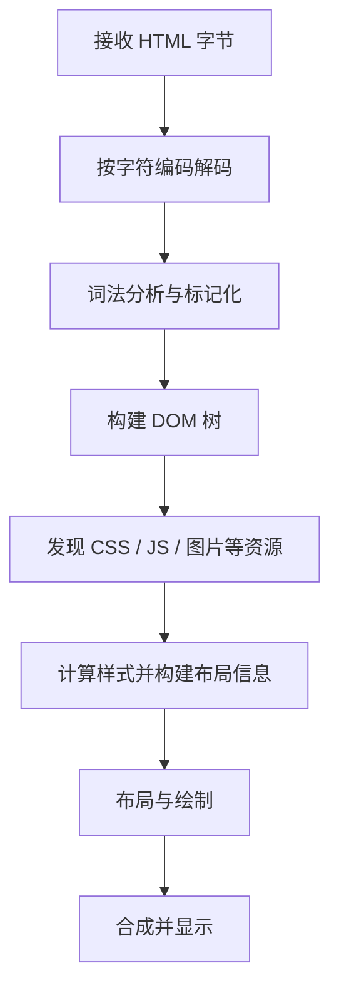

# HTML 01｜文档结构与浏览器解析

> 本节目标：能从空白文件创建规范的 HTML 文档，并解释浏览器如何将标记解析成页面结构。

## 学习目标

完成本节后，你应该能够：

- 写出标准 HTML 文档骨架，说明每个关键声明的用途。
- 区分 `head` 中的文档元信息与 `body` 中的页面内容。
- 正确设置字符编码、语言、视口和页面标题。
- 使用开发者工具检查 DOM，并定位常见结构问题。

## 1. 文档的基本骨架

```html
<!doctype html>
<html lang="zh-CN">
  <head>
    <meta charset="UTF-8">
    <meta name="viewport" content="width=device-width, initial-scale=1">
    <meta name="description" content="学习 HTML 文档结构的示例页面">
    <title>HTML 文档结构</title>
  </head>
  <body>
    <header>
      <h1>我的学习主页</h1>
    </header>
    <main>
      <p>这是页面的主要内容。</p>
    </main>
    <footer>
      <small>持续学习，持续记录。</small>
    </footer>
  </body>
</html>
```

### 关键组成

| 组成 | 作用 | 常见误区 |
|---|---|---|
| `<!doctype html>` | 让浏览器使用标准模式 | 它不是普通 HTML 元素 |
| `html` | 文档根元素 | 应设置合适的 `lang` |
| `head` | 放置标题、元信息、样式等文档信息 | 通常不放页面正文内容 |
| `meta charset` | 声明文档字符编码 | 应尽早声明，通常使用 UTF-8 |
| `meta viewport` | 为移动端视口提供配置 | 不能单独替代响应式 CSS |
| `title` | 定义浏览器标签标题等 | 不应留空或所有页面都相同 |
| `body` | 放置页面可见内容与交互元素 | 页面主体内容应有清晰结构 |

## 2. 浏览器如何处理 HTML

下面是便于学习的简化流程。真实浏览器会增量解析资源，并可能并行下载样式、图片和脚本。



- **DOM**：浏览器根据 HTML 构建的文档对象模型，可由 JavaScript 查询和修改。
- **CSSOM**：浏览器解析 CSS 后形成的样式对象模型。
- **布局（Layout）**：计算元素的几何位置和尺寸。
- **绘制（Paint）**：将文本、边框、背景等绘制成图形。
- **合成（Compositing）**：把绘制结果合成到屏幕上。并非每次变化都会完整执行全部步骤。

## 3. 标题与内容结构

```html
<main>
  <article>
    <h1>前端学习笔记</h1>
    <section aria-labelledby="html-basics">
      <h2 id="html-basics">HTML 基础</h2>
      <p>HTML 描述内容的结构与语义。</p>
      <h3>文档骨架</h3>
      <p>从标准文档结构开始练习。</p>
    </section>
  </article>
</main>
```

标题应该反映内容层级，而不是只为了改变字号。视觉样式交给 CSS；不要因为想要更小的字，就跳过语义层级。

## 4. 最小实践：个人介绍页

将下面内容保存为 `index.html`，用浏览器打开：

```html
<!doctype html>
<html lang="zh-CN">
<head>
  <meta charset="UTF-8">
  <meta name="viewport" content="width=device-width, initial-scale=1">
  <title>个人介绍</title>
</head>
<body>
  <header>
    <h1>你好，我正在学习前端开发</h1>
    <p>记录知识，也记录实践。</p>
  </header>
  <main>
    <section>
      <h2>当前目标</h2>
      <ul>
        <li>掌握 HTML 语义结构</li>
        <li>理解 CSS 布局</li>
        <li>使用 JavaScript 实现交互</li>
      </ul>
    </section>
  </main>
  <footer>
    <p>最后更新：2026 年</p>
  </footer>
</body>
</html>
```

### 验收步骤

1. 页面标签标题显示“个人介绍”。
2. 浏览器开发者工具中能看到 `html`、`head`、`body` 的层级关系。
3. 将 `lang` 改为 `en`，观察它对文档语言声明的影响；不要把语言声明误认为自动翻译功能。
4. 暂时删除 `meta viewport`，在窄屏设备模拟器中观察差异，再恢复。
5. 检查标题是否按内容层级排列，而非单纯按视觉大小选择。

## 5. 常见错误与排查

- **中文乱码**：检查文件实际保存编码和 `meta charset`，两者应一致。
- **手机页面像桌面页面一样缩小**：检查 viewport 声明，并继续学习响应式 CSS。
- **浏览器标签标题不对**：检查 `head` 中的 `title`。
- **把所有内容塞进一个 div**：先判断是否有更合适的语义元素。
- **标题跳级**：根据内容关系组织标题，不要只按默认字号决定标签。
- **误以为 HTML 是编程语言**：HTML 是标记语言，负责表达内容结构和语义；交互逻辑通常由 JavaScript 实现。

## 6. 练习任务

### 基础

- [ ] 创建一个有效的 HTML 文档。
- [ ] 设置语言、编码、视口和有意义的标题。
- [ ] 使用 `header`、`main`、`section`、`footer` 组织内容。

### 进阶

- [ ] 创建包含至少三个主题区块的学习主页。
- [ ] 为每个区块设计合理的标题层级。
- [ ] 在开发者工具中检查 DOM，解释浏览器中的节点关系。

### 复盘问题

1. `doctype` 与普通 HTML 元素有什么不同？
2. `head` 和 `body` 的职责分别是什么？
3. DOM 是什么？它与 HTML 源文件有何区别？
4. 为什么 `meta viewport` 不能替代响应式 CSS？
5. 如果页面出现乱码，你会按什么顺序排查？

## 参考资料

- [MDN：HTML 入门](https://developer.mozilla.org/zh-CN/docs/Learn/HTML/Introduction_to_HTML)
- [HTML Living Standard](https://html.spec.whatwg.org/)
