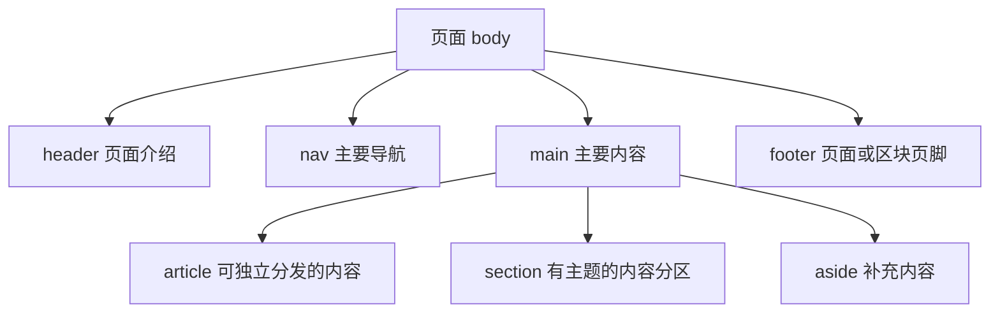
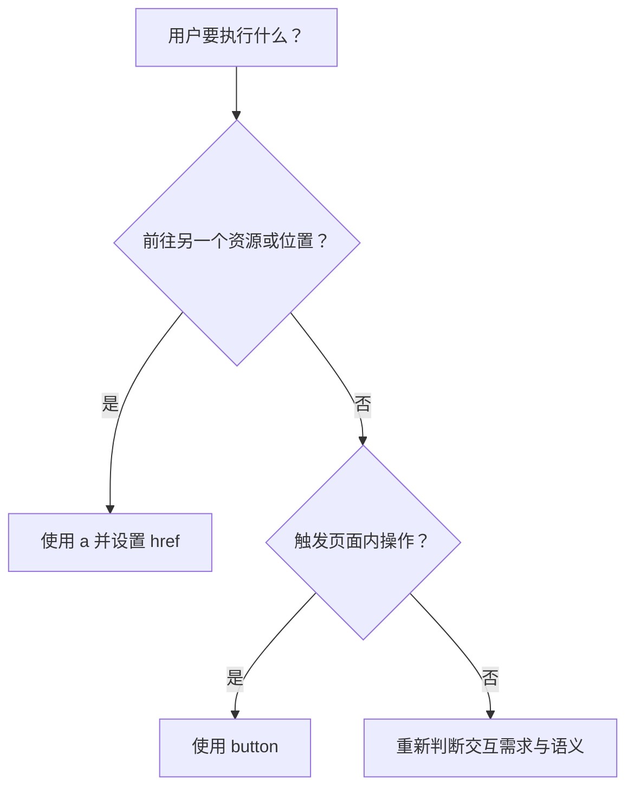

# HTML 02｜语义化标签与页面分区

> 本节目标：根据内容含义选择 HTML 元素，让页面更易理解、导航、维护和被辅助技术使用。

## 学习目标

- 解释语义化 HTML 的价值，不把语义标签当作带有固定外观的样式组件。
- 正确使用 `header`、`nav`、`main`、`section`、`article`、`aside`、`footer`。
- 根据内容目的选择链接、按钮和标题。
- 检查常见的语义与可访问性问题。

## 1. 页面语义结构图



这张图是常见组织方式，不是要求每个页面都必须包含所有元素，也不意味着所有元素只能出现在图示位置。

## 2. 核心语义标签

| 元素 | 适合的场景 | 不应误解为 |
|---|---|---|
| `header` | 页面或某个内容区块的介绍、标题、相关工具 | 只能用作整个页面最顶部 |
| `nav` | 重要的导航链接集合 | 所有链接都必须放进 nav |
| `main` | 页面独有的主要内容 | 通用容器或侧栏 |
| `section` | 围绕同一主题组织的内容分区 | 纯粹为了加边距而使用的容器 |
| `article` | 能够相对独立地分发或复用的内容 | 所有内容块都必须使用 article |
| `aside` | 与周边主体内容相关的补充信息 | 固定在屏幕右侧的侧栏样式 |
| `footer` | 页面或某个内容区块的页脚信息 | 只能在 body 末尾出现 |
| `div` | 没有更合适语义元素时的通用容器 | 错误或禁止使用的元素 |
| `span` | 行内通用容器 | 自动具有强调含义的元素 |

语义标签本身不决定布局。要让内容呈现为双栏、卡片或固定导航，应使用 CSS。

## 3. 示例：文章页面

```html
<body>
  <header>
    <a href="/" aria-label="返回首页">知识笔记</a>
    <p>持续积累，可复用的知识。</p>
  </header>

  <nav aria-label="主导航">
    <ul>
      <li><a href="/notes.html">笔记</a></li>
      <li><a href="/projects.html">项目</a></li>
      <li><a href="/about.html">关于</a></li>
    </ul>
  </nav>

  <main>
    <article>
      <header>
        <h1>如何建立自己的学习系统</h1>
        <p>分类：学习方法</p>
      </header>

      <section aria-labelledby="why">
        <h2 id="why">为什么需要学习系统</h2>
        <p>系统帮助我们连接、复习和应用知识。</p>
      </section>

      <section aria-labelledby="steps">
        <h2 id="steps">实践步骤</h2>
        <ol>
          <li>记录问题。</li>
          <li>整理概念。</li>
          <li>通过项目验证。</li>
        </ol>
      </section>

      <footer>
        <p>本文为个人学习记录。</p>
      </footer>
    </article>

    <aside aria-label="相关阅读">
      <h2>相关阅读</h2>
      <ul>
        <li><a href="/review.html">如何复盘学习</a></li>
      </ul>
    </aside>
  </main>

  <footer>
    <small>© 2026 知识笔记</small>
  </footer>
</body>
```

## 4. 链接还是按钮？



- 用 `a` 导航到页面、文件、页面内锚点或其他资源。
- 用 `button` 执行操作，例如打开菜单、提交表单或切换状态。
- 不要用没有 `href` 的空链接模拟按钮，也不要用普通 `div` 代替可交互控件。
- 原生链接和按钮通常自带键盘行为与语义，优先使用它们。

## 5. 标题与替代文本

- 页面应有清楚的主标题；区块标题应体现内容层级。
- 标题不是为了字号：用 CSS 控制视觉大小。
- 有信息价值的图片应写准确的 `alt`。
- 纯装饰图片可使用 `alt=""`，避免辅助技术重复播报无用信息。
- 链接文本应让用户大致知道目标；避免连续出现多个“更多”却没有上下文。
- 仅在确实需要时添加 ARIA 属性；原生 HTML 已有合适语义时，不要重复造轮子。

## 6. 常见反模式

### 用 section 取代所有容器

如果一块内容没有独立主题，只是用于布局或样式，`div` 可能更合适。

### 用标题标签改变字号

不要为了得到小字就从 `h2` 跳到 `h5`。标题顺序应由内容层级决定，视觉样式交给 CSS。

### 用可点击 div 代替按钮

这会让键盘操作、焦点管理和辅助技术支持更复杂。优先使用 `button` 或 `a`。

### 过度使用 ARIA

ARIA 可以补充语义，但不能自动修复糟糕的结构。优先选择正确的原生元素。

## 7. 练习与验收

- [ ] 把一个由大量 `div` 组成的个人主页改为语义化结构。
- [ ] 为导航添加清楚的名称；确保主内容使用 `main`。
- [ ] 将“前往文章”的交互改为链接，将“切换主题”的交互改为按钮。
- [ ] 检查图片的替代文本与标题层级。
- [ ] 尝试仅用键盘 Tab、Shift+Tab、Enter 和 Space 操作页面主要控件。

## 8. 面试自测

**问：语义化 HTML 有什么价值？**

答：它能更清楚地表达内容结构与控件目的，改善维护性、辅助技术支持，并为浏览器和其他工具提供更明确的文档信息。语义化并不自动保证页面可访问，仍需检查键盘交互、标签关联、对比度等问题。

**问：`section` 和 `div` 有什么区别？**

答：`section` 表示有主题的内容分区，通常配有标题；`div` 是没有更合适语义时的通用容器，常用于布局或样式分组。

**问：`article` 和 `section` 是否互斥？**

答：不互斥。文章可以包含多个 section；一个 section 中也可能包含多个 article，具体取决于内容关系。

## 参考资料

- [MDN：HTML 语义](https://developer.mozilla.org/zh-CN/docs/Glossary/Semantics)
- [MDN：HTML 元素参考](https://developer.mozilla.org/zh-CN/docs/Web/HTML/Element)
- [WAI：页面结构教程](https://www.w3.org/WAI/tutorials/page-structure/)
