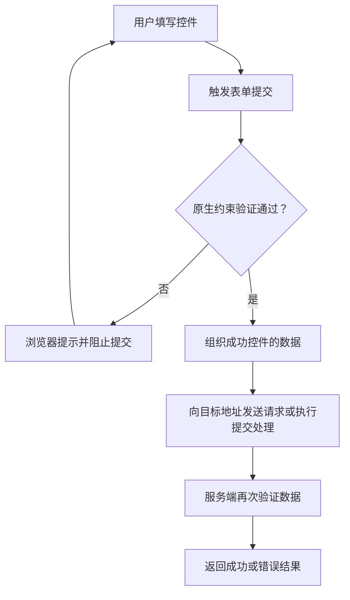

# HTML 03｜表单、输入控件与原生验证

> 本节目标：构建标签关联清晰、键盘可操作、输入类型正确，并能处理基本校验反馈的 HTML 表单。

## 学习目标

- 理解 `form`、`label`、`input`、`select`、`textarea`、`button` 的职责。
- 说明 `name`、`id`、`value`、`required` 等属性的区别。
- 使用浏览器原生约束验证改善输入体验。
- 理解客户端验证的边界，避免把它当成安全防线。

## 1. 表单提交流程



表单是否真正发送请求，还取决于表单的 `action`、`method` 以及页面脚本是否拦截提交。客户端验证不能代替服务端验证。

## 2. 可运行示例

将以下内容保存为 `form.html` 后用浏览器打开。示例使用原生校验，不会向服务器发送数据。

```html
<!doctype html>
<html lang="zh-CN">
<head>
  <meta charset="UTF-8">
  <meta name="viewport" content="width=device-width, initial-scale=1">
  <title>学习报名表</title>
  <style>
    body {
      max-width: 42rem;
      margin: 2rem auto;
      padding: 0 1rem;
      font-family: system-ui, sans-serif;
      line-height: 1.6;
    }

    form {
      display: grid;
      gap: 1rem;
    }

    .field {
      display: grid;
      gap: 0.35rem;
    }

    input, select, textarea, button {
      font: inherit;
      padding: 0.6rem;
    }

    :focus-visible {
      outline: 3px solid #2463eb;
      outline-offset: 2px;
    }
  </style>
</head>
<body>
  <main>
    <h1>学习报名表</h1>
    <p>这是本地示例，提交后只显示演示提示，不会上传资料。</p>

    <form id="signup-form">
      <div class="field">
        <label for="full-name">姓名</label>
        <input id="full-name" name="fullName" autocomplete="name" required>
      </div>

      <div class="field">
        <label for="email">电子邮箱</label>
        <input id="email" name="email" type="email"
               autocomplete="email" required>
      </div>

      <div class="field">
        <label for="level">当前水平</label>
        <select id="level" name="level" required>
          <option value="">请选择</option>
          <option value="beginner">初学</option>
          <option value="intermediate">有基础</option>
          <option value="advanced">进阶</option>
        </select>
      </div>

      <div class="field">
        <label for="goal">学习目标（选填）</label>
        <textarea id="goal" name="goal" rows="4"
                  maxlength="300"></textarea>
      </div>

      <button type="submit">提交报名</button>
      <p id="result" role="status" aria-live="polite"></p>
    </form>
  </main>

  <script>
    const form = document.querySelector("#signup-form");
    const result = document.querySelector("#result");

    form.addEventListener("submit", (event) => {
      event.preventDefault();

      const formData = new FormData(form);
      const name = formData.get("fullName");

      result.textContent = `校验通过，${name}！这是本地演示，没有发送任何数据。`;
    });
  </script>
</body>
</html>
```

## 3. 重要属性

| 属性 | 作用 | 易错点 |
|---|---|---|
| `id` | 在文档中标识元素，供 label、脚本和锚点等引用 | 同一页面中应保持唯一 |
| `name` | 作为提交数据中的字段名 | 没有 name 的控件通常不会作为表单字段提交 |
| `value` | 控件当前值或选项值 | 对 select，提交的是被选中 option 的 value |
| `required` | 要求必须提供有效值 | 不能替代业务规则与服务端验证 |
| `type` | 指定输入控件类型 | 使用适当类型可改善键盘与原生校验体验 |
| `autocomplete` | 提示浏览器可否自动填充及填充内容类型 | 应按真实字段语义选择 |
| `minlength` / `maxlength` | 约束文本长度 | 不代表服务端收到的数据可信 |
| `min` / `max` / `step` | 对数字或日期等值设定约束 | 需要理解不同 input 类型的行为 |
| `pattern` | 对文本输入定义匹配模式 | 正则表达式需与业务规则一致并清楚提示用户 |

## 4. 选择合适的控件

- 单行文本：`input type="text"`
- 邮箱：`input type="email"`
- 数字：在确实需要数值语义时使用 `input type="number"`
- 日期：`input type="date"`
- 单选：多个相同 `name` 的 radio
- 多选：checkbox
- 固定选项：select
- 多行文本：textarea
- 提交动作：button type="submit"
- 普通按钮：button type="button"

避免仅凭外观选择控件。例如电话号码不一定适合 `type="number"`，因为电话号码通常不是用于数学运算的数值，并可能包含前导零或加号。

## 5. Label 与可访问性

推荐显式关联：

```html
<label for="user-email">电子邮箱</label>
<input id="user-email" name="email" type="email" required>
```

也可以将控件放在 label 内：

```html
<label>
  <input type="checkbox" name="subscribe" value="yes">
  接收学习更新
</label>
```

注意事项：

- 每个输入控件都应有可理解的标签或等效名称。
- placeholder 是输入提示，不应取代 label。
- 错误信息应明确指出问题和修正方式。
- 不要仅用红色区分错误；应提供文本说明。
- 确保键盘焦点清晰可见。
- 对成功或错误的动态反馈，可合理使用 `role="status"` 或适当的 live region，避免重复播报过多信息。

## 6. 原生验证的边界

原生属性（例如 `required`、`type="email"`、`minlength`）可提供基础用户体验，但并不保证数据符合业务规则，也不能阻止恶意客户端绕过验证。

服务端应独立验证：
- 字段是否存在、类型和长度是否符合预期。
- 数值范围、业务状态和用户权限是否合法。
- 数据库操作是否使用参数化查询。
- 输出内容是否按目标上下文正确编码。
- 是否需要 CSRF 防护、速率限制或其他安全控制。

不要把“浏览器显示校验通过”理解为“输入数据安全可信”。

## 7. 常见问题

**为什么表单提交时没有某个字段？**
检查控件是否有 `name`、是否被禁用、是否属于目标表单，以及控件是否成功参与提交。

**为什么 required 没有效果？**
确认该控件是否支持相应约束，是否通过脚本直接调用了不触发约束验证的提交方式，以及控件是否处于禁用等特殊状态。

**为什么不建议只使用 placeholder？**
输入后提示文字会消失，用户可能忘记字段用途；placeholder 也不等同于可访问名称。

**为什么客户端校验不够？**
客户端代码可被关闭、修改或绕过。所有重要业务约束都必须由服务端重新验证。

## 8. 练习与验收

- [ ] 制作一个包含姓名、邮箱、学习水平和备注的表单。
- [ ] 每个控件都有正确关联的 label。
- [ ] 必填字段和输入类型设置合理。
- [ ] 测试空值、错误邮箱、超长文本和有效数据。
- [ ] 使用键盘完成所有控件操作。
- [ ] 确认错误提示不只依赖颜色。
- [ ] 在代码注释或 README 中说明：示例没有后端，不会真实保存或上传数据。

## 9. 面试自测

1. `id` 和 `name` 有什么区别？
2. `required` 与 `type="email"` 分别解决什么问题？
3. 为什么电话号码通常不应当作为普通数值处理？
4. placeholder 为什么不能替代 label？
5. 为什么服务端必须重复验证输入？

## 参考资料

- [MDN：Web 表单](https://developer.mozilla.org/zh-CN/docs/Learn/Forms)
- [MDN：约束验证](https://developer.mozilla.org/zh-CN/docs/Web/HTML/Constraint_validation)
- [WAI：表单教程](https://www.w3.org/WAI/tutorials/forms/)
