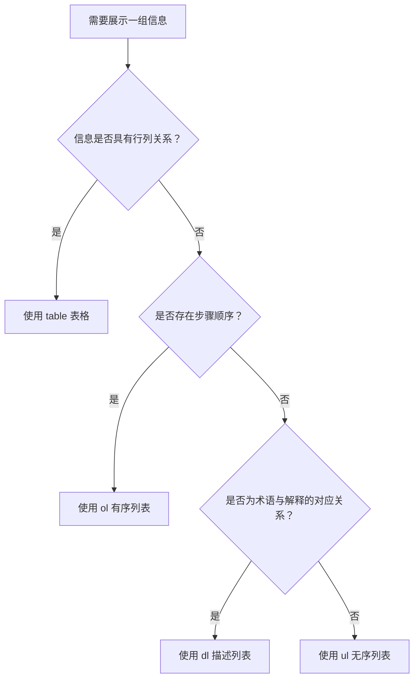

# HTML 04｜表格与列表

> 本节目标：根据数据的性质选择表格或列表，正确组织行列、表头与嵌套条目，并让信息对视觉用户和辅助技术用户都清晰可读。

## 学习目标

- 区分有序列表、无序列表和描述列表。
- 使用 `table`、`caption`、`thead`、`tbody`、`th`、`td` 表达二维数据。
- 正确关联行标题、列标题和数据单元格。
- 了解合并单元格的边界，避免用表格实现页面布局。

## 1. 如何选择合适的元素？



- **无序列表 `ul`**：项目之间没有必须遵守的先后顺序。
- **有序列表 `ol`**：顺序有意义，例如步骤、排名或操作流程。
- **描述列表 `dl`**：用于术语、名称与对应描述等名值关系。
- **表格 `table`**：用于具有行列关系的结构化数据，例如课程表、成绩表和配置对照表。

不要仅仅为了获得缩进或项目符号而选择列表类型；应优先考虑内容含义。

## 2. 列表示例

```html
<h2>学习步骤</h2>
<ol>
  <li>阅读概念说明</li>
  <li>运行最小示例</li>
  <li>完成练习并复盘</li>
</ol>

<h2>本周主题</h2>
<ul>
  <li>HTML 文档结构</li>
  <li>语义化标签</li>
  <li>表单与验证</li>
</ul>

<h2>术语</h2>
<dl>
  <dt>HTML</dt>
  <dd>描述网页内容结构与语义的标记语言。</dd>
  <dt>CSS</dt>
  <dd>描述网页视觉呈现与布局的样式语言。</dd>
</dl>
```

### 嵌套列表

```html
<ul>
  <li>前端基础
    <ul>
      <li>HTML</li>
      <li>CSS</li>
      <li>JavaScript</li>
    </ul>
  </li>
  <li>工程实践</li>
</ul>
```

嵌套列表应表达真实的从属关系。不要为了页面缩进而随意嵌套；缩进样式应交由 CSS 控制。

## 3. 表格的基本结构

```html
<table>
  <caption>前端学习计划</caption>
  <thead>
    <tr>
      <th scope="col">阶段</th>
      <th scope="col">主题</th>
      <th scope="col">验收成果</th>
    </tr>
  </thead>
  <tbody>
    <tr>
      <th scope="row">第一阶段</th>
      <td>HTML 基础</td>
      <td>完成语义化个人主页</td>
    </tr>
    <tr>
      <th scope="row">第二阶段</th>
      <td>CSS 布局</td>
      <td>完成响应式页面</td>
    </tr>
  </tbody>
</table>
```

核心元素：

| 元素 | 用途 |
|---|---|
| `table` | 包含表格数据 |
| `caption` | 提供表格标题或用途说明 |
| `thead` | 组织表头行 |
| `tbody` | 组织主要数据行 |
| `tfoot` | 组织汇总或表尾信息（需要时使用） |
| `tr` | 表格中的一行 |
| `th` | 表头单元格 |
| `td` | 普通数据单元格 |

### 为什么表头要使用 th？

`th` 表达单元格是标题，而不只是普通文本。对于简单表格，可通过 `scope="col"` 或 `scope="row"` 明确其对应列或行，有助于辅助技术理解表格关系。

## 4. 表格样式与响应式处理

```html
<div class="table-wrapper">
  <table>
    <caption>课程进度</caption>
    <thead>
      <tr>
        <th scope="col">课程</th>
        <th scope="col">状态</th>
        <th scope="col">下一步</th>
      </tr>
    </thead>
    <tbody>
      <tr>
        <th scope="row">HTML</th>
        <td>学习中</td>
        <td>完成表单练习</td>
      </tr>
      <tr>
        <th scope="row">CSS</th>
        <td>待开始</td>
        <td>学习盒模型</td>
      </tr>
    </tbody>
  </table>
</div>
```

```css
.table-wrapper {
  max-width: 100%;
  overflow-x: auto;
}

table {
  width: 100%;
  border-collapse: collapse;
  text-align: left;
}

caption {
  margin-bottom: 0.75rem;
  font-weight: 700;
  text-align: left;
}

th,
td {
  padding: 0.75rem;
  border: 1px solid #d7dce3;
  vertical-align: top;
}

thead {
  background: #f3f5f8;
}
```

- 表格数据较宽时，可给外层容器设置横向滚动，避免整个页面被撑宽。
- 不要为了让页面分栏而使用 table；布局应优先使用 CSS Grid 或 Flexbox。
- 颜色不能成为唯一的信息表达方式；例如状态最好同时显示文字。

## 5. 合并单元格：谨慎使用

- `colspan`：一个单元格横跨多个列。
- `rowspan`：一个单元格纵跨多行。

```html
<table>
  <caption>课程安排</caption>
  <thead>
    <tr>
      <th scope="col">日期</th>
      <th scope="col">上午</th>
      <th scope="col">下午</th>
    </tr>
  </thead>
  <tbody>
    <tr>
      <th scope="row">周一</th>
      <td colspan="2">HTML 实践工作坊</td>
    </tr>
    <tr>
      <th scope="row">周二</th>
      <td>语义化练习</td>
      <td>表单练习</td>
    </tr>
  </tbody>
</table>
```

合并单元格会增加表格的理解和维护成本。复杂表格可能需要更明确的标题关联；如果数据结构过于复杂，考虑拆成多个简单表格。

## 6. 常见错误

- 用 `td` 代替所有表头，丢失数据关系语义。
- 用表格做页面布局，导致窄屏适配和结构维护困难。
- 没有表格标题，读者无法快速知道表格用途。
- 用空格手动对齐内容，而不是使用正确的结构和 CSS。
- 列表项之间存在层级关系，却没有合理嵌套。
- 将 `dl` 当作所有普通列表的替代品；它更适合名值或术语描述关系。

## 7. 练习与验收

- [ ] 创建一个有序列表，表达一套有明确顺序的操作流程。
- [ ] 创建一个无序列表，展示一组没有固定顺序的学习主题。
- [ ] 创建一个描述列表，解释至少三个前端术语。
- [ ] 创建一张课程计划表，包含 caption、表头和至少三行数据。
- [ ] 为行标题使用 `th scope="row"`，为列标题使用 `th scope="col"`。
- [ ] 在窄屏下检查表格，不让它意外撑宽整个页面。
- [ ] 确认表格用于数据，而不是用来模拟页面布局。

## 8. 面试自测

1. `ul`、`ol` 和 `dl` 的适用场景分别是什么？
2. `th` 与 `td` 有什么区别？
3. `caption` 对表格有什么帮助？
4. 为什么不推荐使用 table 实现网页布局？
5. `colspan` 与 `rowspan` 分别表示什么？

## 参考资料

- [MDN：HTML 表格基础](https://developer.mozilla.org/zh-CN/docs/Learn/HTML/Tables/Basics)
- [MDN：HTML 列表](https://developer.mozilla.org/zh-CN/docs/Web/HTML/Element#内容分区)
- [WAI：表格教程](https://www.w3.org/WAI/tutorials/tables/)
