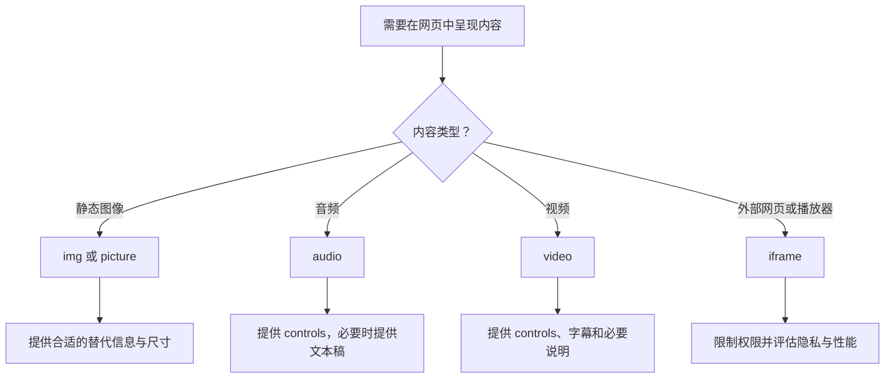

# HTML 05｜图片、音视频与嵌入内容

> 本节目标：合理地在网页中呈现图片、音频、视频与外部嵌入内容，并兼顾响应式体验、性能、替代信息和安全边界。

## 学习目标

- 正确使用 `img`、`picture`、`audio`、`video` 和 `iframe`。
- 为有信息含义的图片提供合适的替代文本。
- 理解图片尺寸、响应式图片与加载策略的基本作用。
- 为音视频提供必要的控件、字幕或文本替代。
- 了解嵌入第三方内容的隐私、安全和性能影响。

## 1. 选择媒体元素



## 2. 图片：img 与 alt

```html
<figure>
  
  <figcaption>前端学习路线概览</figcaption>
</figure>
```

- `src`：图片资源地址。
- `alt`：在图片无法呈现或使用辅助技术时提供替代信息。
- `width` 和 `height`：声明固有尺寸，浏览器可据此提前预留布局空间。
- `loading="lazy"`：可延迟加载适合延后的图片；首屏关键图片通常不应盲目延迟。
- `figure` 与 `figcaption`：在图片、图表等内容确实需要说明文字时组织内容与说明。

### alt 怎么写？

- **信息型图片**：描述图片对当前内容有价值的信息。
- **功能型图片**：描述它代表的操作或目的，例如图标按钮的可访问名称。
- **装饰图片**：若不提供额外信息，通常使用 `alt=""`。
- 不要把文件名、无关关键词或“图片：图片”写进 alt。
- 如果图片旁边已有完整说明，alt 应避免重复冗长内容。

## 3. 响应式图片

### 使用 CSS 控制显示尺寸

```css
img,
video {
  display: block;
  max-width: 100%;
  height: auto;
}
```

这能避免媒体内容超出容器，但不同尺寸设备下载不同图片资源时，还可使用 `srcset` 和 `sizes`。

```html

```

浏览器会综合候选图片宽度、显示尺寸和设备条件选择资源。实际项目中需要确保各候选资源确实存在，且图像比例和内容相符。

### picture：艺术指导与格式选择

```html
<picture>
  <source
    media="(max-width: 600px)"
    srcset="images/portrait-crop.jpg">
  <source
    type="image/avif"
    srcset="images/landscape.avif">
  
</picture>
```

`picture` 可用于不同视口选择不同构图，或按浏览器支持情况提供不同格式。内部的 `img` 仍然是必要的后备与替代文本承载元素。

## 4. 音频与视频

```html
<audio controls preload="metadata">
  <source src="media/lesson.mp3" type="audio/mpeg">
  <source src="media/lesson.ogg" type="audio/ogg">
  当前浏览器无法播放此音频，请查看课程文字稿。
</audio>

<video controls width="960" height="540" preload="metadata">
  <source src="media/demo.mp4" type="video/mp4">
  <track
    kind="captions"
    src="media/demo-zh.vtt"
    srclang="zh"
    label="中文字幕"
    default>
  当前浏览器无法播放此视频。
</video>
```

- 使用 `controls` 提供用户可操作的播放控件。
- `preload` 是加载提示，不保证浏览器一定按指定方式加载。
- 对有语音或重要声音信息的视频，应提供准确字幕；音频内容可提供文字稿。
- 不要默认自动播放带声音的媒体。
- 不同浏览器、格式和编码的支持情况可能不同，应测试实际目标环境。
- 若媒体有重要视觉信息，单纯字幕可能不够，还需考虑音频描述或替代说明。

## 5. iframe 与外部嵌入

```html
<iframe
  src="https://example.com/embed"
  title="示例内容的嵌入页面"
  width="800"
  height="450"
  loading="lazy"
  sandbox
  referrerpolicy="strict-origin-when-cross-origin">
</iframe>
```

这是一个结构示例；真实网站可能拒绝被嵌入，且 `sandbox` 的限制可能影响内容正常运行。应按需要谨慎添加允许项，而不是为了方便直接移除全部限制。

安全与隐私注意事项：

- 为 iframe 提供描述性 `title`，帮助用户理解其内容。
- 只嵌入可信来源，并确认内容确实需要在页面内加载。
- `sandbox` 可限制嵌入内容的能力；只在理解影响后增加所需权限。
- 外部嵌入可能在用户访问页面时向第三方发送请求，涉及隐私和性能。
- 不要在 iframe 的 URL 中放入密钥、会话令牌或敏感个人数据。
- 外部服务的响应头可能禁止跨站嵌入；这是对方的安全策略，不一定是你的 HTML 写错。

## 6. 性能与用户体验

- 为图片声明尺寸，减少加载过程中的布局偏移。
- 对首屏关键图片优先保证及时加载；对远离首屏的图片可考虑懒加载。
- 根据显示尺寸提供合适资源，避免手机加载过大的原图。
- 音视频尽量不要无条件预加载完整文件。
- 避免同时加载多个重量级第三方嵌入。
- 为媒体失败提供合理的替代文本或说明。
- 测试窄屏、键盘操作和不同浏览器的实际表现。

## 7. 练习与验收

- [ ] 在个人主页添加一张有意义的图片，并写准确的 alt。
- [ ] 给图片设置宽高，检查加载前后布局是否稳定。
- [ ] 为一张图片提供多个 srcset 候选资源。
- [ ] 添加一个带 controls 的音频或视频示例。
- [ ] 为视频字幕准备 WebVTT 文件，或说明暂时没有字幕的限制。
- [ ] 添加一个 iframe，设置 title，并评估是否需要 sandbox。
- [ ] 用 Network 面板观察媒体资源大小、加载时机与失败请求。

## 8. 面试自测

1. `alt` 属性解决什么问题？什么时候使用空 alt？
2. `srcset` 和 `sizes` 如何协同工作？
3. `picture` 与单独的 `img` 有什么区别？
4. 为什么音视频应考虑字幕或文字稿？
5. iframe 的 `title`、`sandbox` 和 `loading` 分别有什么作用？
6. 为什么不应该对所有图片都使用懒加载？

## 参考资料

- [MDN：HTML 图像](https://developer.mozilla.org/zh-CN/docs/Learn/HTML/Multimedia_and_embedding/Images_in_HTML)
- [MDN：音频与视频内容](https://developer.mozilla.org/zh-CN/docs/Learn/HTML/Multimedia_and_embedding/Video_and_audio_content)
- [MDN：iframe](https://developer.mozilla.org/zh-CN/docs/Web/HTML/Element/iframe)
- [WAI：音视频内容](https://www.w3.org/WAI/media/av/)
