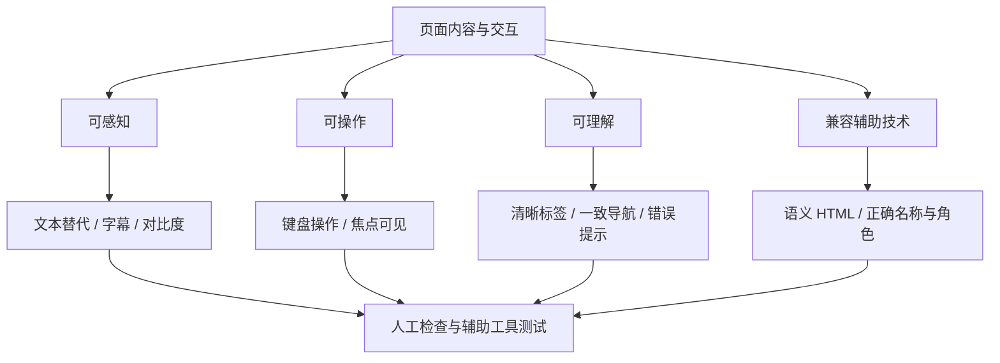

# HTML 06｜可访问性与 SEO 基础

> 本节目标：让网页结构容易理解、键盘可以操作、重要信息有合适的替代方式，并为搜索引擎提供清晰、准确的页面信息。

## 学习目标

- 理解 Web 可访问性关注的用户需求与基本原则。
- 使用语义化 HTML、清晰标题、标签关联和可见焦点改善使用体验。
- 认识 title、description、canonical 等常见页面元信息。
- 区分对搜索引擎有帮助的基础结构与无法保证的排名结果。
- 形成一套可重复执行的页面检查清单。

## 1. 可访问性检查思路



常见的四个方向可概括为：可感知、可操作、可理解、稳健兼容。自动化工具有帮助，但无法代替真实的键盘操作和人工判断。

## 2. 标题、语言与页面结构

```html
<!doctype html>
<html lang="zh-CN">
<head>
  <meta charset="UTF-8">
  <meta name="viewport" content="width=device-width, initial-scale=1">
  <title>HTML 可访问性学习笔记</title>
  <meta name="description" content="学习语义化 HTML、键盘操作、表单标签与页面元信息。">
</head>
<body>
  <header>
    <a href="/">学习笔记首页</a>
    <nav aria-label="主导航">
      <a href="/html.html">HTML</a>
      <a href="/css.html">CSS</a>
    </nav>
  </header>
  <main>
    <h1>HTML 可访问性学习笔记</h1>
    <p>本页介绍页面结构与辅助技术支持的基础实践。</p>
  </main>
</body>
</html>
```

- `lang` 应反映页面主要语言，有助于屏幕阅读器和语言处理工具。
- 页面标题应简洁、准确，并能区分不同页面。
- 标题层级应反映内容组织，而不是只用来调整字号。
- 使用 `main`、`nav` 等语义元素帮助用户快速定位内容区域。
- 同一页面中应保持清晰且合理的主内容结构。

## 3. 键盘操作与焦点

所有主要功能都应能通过键盘完成，特别是导航、菜单、表单和对话框。

```css
:focus-visible {
  outline: 3px solid #245fe8;
  outline-offset: 3px;
}

/* 不要为了视觉简洁而无条件移除焦点指示 */
```

检查方法：

1. 仅使用 Tab 和 Shift+Tab 遍历可交互元素。
2. 观察焦点顺序是否与页面阅读顺序一致。
3. 使用 Enter 激活链接，使用 Space 或 Enter 操作合适的按钮。
4. 确认没有键盘陷阱，用户可以离开所有组件。
5. 确认焦点不会被固定页头或弹层完全遮挡。

自定义控件需要额外实现键盘交互和焦点管理。能使用原生 `button`、`a`、`input` 时，优先使用原生元素。

## 4. 图片、颜色与表单

- 有意义的图片需要准确替代文本；纯装饰图片通常使用空 alt。
- 不能只通过颜色表达错误、成功或状态，应配合文字、图标或其他线索。
- 文本与背景应有足够的颜色对比度。
- 输入控件需要可理解的标签，错误信息应指出问题和修复方式。
- 动态状态更新应适当通知辅助技术，避免内容变化后用户完全不知道。
- 页面应允许用户放大文本，并在窄屏下正常阅读。

## 5. SEO：页面信息与可发现性

SEO（搜索引擎优化）涉及内容质量、技术可抓取性、页面结构和外部因素。正确的 HTML 元信息是基础，但不能保证页面一定被收录或获得特定排名。

```html
<head>
  <title>前端学习路线：HTML、CSS 与 JavaScript</title>
  <meta
    name="description"
    content="整理前端基础知识、学习路线、可运行示例与项目练习。">
  <link rel="canonical" href="https://example.com/frontend-roadmap/">
</head>
```

- **title**：简洁准确地描述当前页面，是浏览器标签与搜索结果展示的重要信息来源之一。
- **description**：概括页面内容；搜索引擎可能采用它，也可能根据查询生成其他摘要。
- **canonical**：在内容相同或高度相似的多个 URL 中声明偏好的规范 URL；必须指向合理且可访问的目标。
- **清晰链接**：使用可理解的链接文本，确保页面之间可以通过正常链接发现。
- **图片替代文本**：有助于理解图片内容，也能在图片无法显示时提供信息。
- **高质量内容**：页面应真正回答访问者的问题，避免关键词堆砌和误导性描述。

## 6. robots.txt 与 sitemap 的基本区别

- `robots.txt` 是向爬虫表达抓取规则的文件；它不等于访问控制机制，不能用于保护机密页面。
- XML sitemap 用于列出希望搜索引擎发现的规范 URL，可辅助发现页面，但不保证收录。
- 页面是否可访问、是否允许索引，以及服务器响应是否正常，都可能影响搜索引擎处理。
- 不要把需要登录或保密的数据仅靠 robots.txt 隐藏。

## 7. 常见误区

**误区一：添加 ARIA 就一定可访问。**
错误。应先使用正确的原生语义，ARIA 只在必要时补充名称、角色或状态。

**误区二：有 alt 就算完成图片无障碍。**
错误。替代文本需要准确表达图片在当前上下文中的作用。

**误区三：SEO 就是多写关键词。**
错误。关键词堆砌会损害阅读体验；页面应准确满足用户意图。

**误区四：robots.txt 可以隐藏私密页面。**
错误。它不是认证或访问控制机制。

**误区五：自动化扫描通过代表完全无障碍。**
错误。键盘体验、内容含义、阅读顺序等仍需要人工检查。

## 8. 页面发布前检查清单

- [ ] 页面有准确且独特的 title。
- [ ] 文档语言声明正确，标题层级有逻辑。
- [ ] 页面使用合适的语义结构。
- [ ] 所有交互可通过键盘完成，焦点可见。
- [ ] 图片替代文本准确，装饰图片不造成冗余播报。
- [ ] 表单控件有标签，错误提示清晰。
- [ ] 颜色不是表达信息的唯一方式，文本对比度合理。
- [ ] 页面在窄屏和放大文本时仍可使用。
- [ ] 链接可访问且描述清楚，没有无意的死链。
- [ ] description 与页面实际内容一致。
- [ ] canonical（如需要）指向正确的规范 URL。
- [ ] 没有把 robots.txt 当作保护敏感数据的手段。

## 9. 面试自测

1. Web 可访问性常说的四个原则是什么？
2. 为什么不应该移除所有焦点样式？
3. `alt`、`title` 与 `meta description` 的用途有什么区别？
4. canonical 的作用是什么？它是否能保证搜索排名？
5. robots.txt 能否保护不希望公开的内容？
6. 为什么自动化扫描无法完全证明页面可访问？

## 参考资料

- [W3C：Web Content Accessibility Guidelines (WCAG)](https://www.w3.org/WAI/standards-guidelines/wcag/)
- [WAI：入门指南](https://www.w3.org/WAI/fundamentals/accessibility-intro/)
- [MDN：HTML 基础](https://developer.mozilla.org/zh-CN/docs/Learn/HTML)
- [Google Search Central：SEO 入门指南](https://developers.google.com/search/docs/fundamentals/seo-starter-guide)
