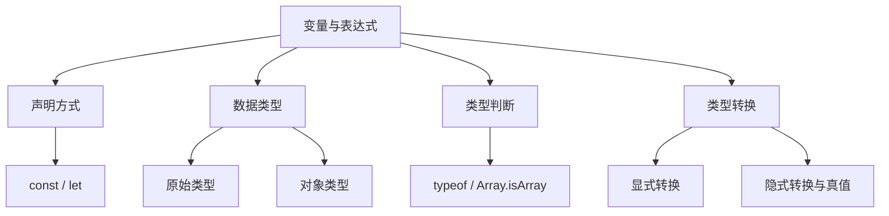

# JavaScript 01｜变量、数据类型与类型转换

> 目标不是背诵语法，而是能预测表达式的结果，解释类型转换，并写出可读、可维护的基础代码。

## 学习目标

- 区分 `const`、`let` 与旧式 `var`。
- 认识 JavaScript 的原始类型和对象类型。
- 理解 `typeof`、严格相等、显式转换和真值判断。
- 识别常见隐式转换陷阱。

## 1. 学习地图



## 2. const、let 与 var

```js
const siteName = "学习笔记";
let visitCount = 0;

visitCount += 1;
console.log(siteName, visitCount);
```

- 优先使用 `const`；当绑定需要重新赋值时使用 `let`。
- `const` 约束的是变量绑定，不会自动冻结对象内部的数据。
- `let` 和 `const` 具有块级作用域。
- `var` 的作用域规则不同，可能带来意外覆盖；新代码通常不需要使用它。
- 变量应尽量在首次使用附近声明，并使用能表达含义的名称。

```js
const user = { name: "小明" };
user.name = "小李"; // 可以修改对象属性
// user = {};       // TypeError：不能重新绑定 const 变量
```

## 3. JavaScript 的数据类型

常见原始类型：

- `string`：字符串。
- `number`：数字，包括 `NaN`、`Infinity`。
- `bigint`：大整数，例如 `123n`。
- `boolean`：`true` / `false`。
- `undefined`：尚未赋值或缺少值。
- `symbol`：唯一标识符。
- `null`：有意表示空值（但 `typeof null` 是历史遗留结果 `"object"`）。

对象类型包括普通对象、数组、函数、日期、正则表达式等。数组和函数也属于对象体系，但有专门的行为和检查方式。

```js
console.log(typeof "hello");       // "string"
console.log(typeof 42);            // "number"
console.log(typeof true);          // "boolean"
console.log(typeof undefined);     // "undefined"
console.log(typeof null);          // "object"（历史遗留行为）
console.log(typeof []);            // "object"
console.log(Array.isArray([]));    // true
console.log(typeof (() => {}));    // "function"
```

## 4. 类型判断与特殊数字

```js
console.log(Number.isNaN(NaN));       // true
console.log(Number.isNaN("hello"));   // false
console.log(Number.isFinite(12));     // true
console.log(Number.isFinite(Infinity)); // false
```

- 不要只用 `typeof value === "object"` 判断普通对象；还需要区分 `null` 和数组。
- `NaN === NaN` 为 `false`，判断它应使用 `Number.isNaN()`。
- `Number.isFinite()` 不会先把字符串等值强制转换成数字。
- 当业务数据来自表单、URL 或 API 时，应明确校验数据格式，而不是猜测它的类型。

## 5. 显式类型转换

```js
const input = "42";
const quantity = Number(input);
const label = String(quantity);
const enabled = Boolean(1);

console.log(quantity + 8); // 50
console.log(label);        // "42"
console.log(enabled);      // true
```

常用转换：

- `Number(value)`：转换为数字；无法转换时可能得到 `NaN`。
- `String(value)`：转换为字符串。
- `Boolean(value)`：转换为布尔值。
- `parseInt(text, 10)`：按十进制解析整数前缀，适用于明确需要解析整数的场景。
- `parseFloat(text)`：解析浮点数前缀。

```js
console.log(Number(""));       // 0
console.log(Number("  "));     // 0
console.log(Number("12px"));   // NaN
console.log(parseInt("12px", 10)); // 12
```

这些结果不同是因为完整数值转换与前缀解析的规则不同。处理表单时，通常应先验证输入是否符合业务要求。

## 6. 真值与假值

下列值在布尔上下文中是假值：

`false`、`0`、`-0`、`0n`、`""`、`null`、`undefined`、`NaN`。

空数组 `[]` 和空对象 `{}` 都是真值。

```js
const title = "";
const displayTitle = title || "未命名";

console.log(displayTitle); // "未命名"
console.log(Boolean([]));   // true
console.log(Boolean({}));   // true
```

当你只想在左侧值为 `null` 或 `undefined` 时使用默认值，考虑空值合并运算符：

```js
const pageSize = 0;
console.log(pageSize || 20); // 20
console.log(pageSize ?? 20); // 0
```

## 7. 相等比较与转换陷阱

优先使用严格相等 `===` 和 `!==`，它们不会像宽松相等那样进行常规类型强制转换。

```js
console.log(5 === "5"); // false
console.log(5 == "5");  // true
console.log(0 === false); // false
```

字符串拼接与数字加法共用 `+`：

```js
console.log("5" + 2); // "52"
console.log("5" - 2); // 3
console.log("5" * 2); // 10
```

尽量不要依赖隐式转换表达业务逻辑；在边界处明确转换和校验，可以让代码更容易理解。

## 8. 动手练习

### 练习 A：输入值校验

编写函数，将用户输入转换为非负整数；输入为空、负数、小数或非法字符串时返回清晰的错误结果。

### 练习 B：表达式预测

不运行代码，先写下结果，再通过控制台验证：

```js
console.log("8" + 2);
console.log("8" - 2);
console.log(Boolean("0"));
console.log(Boolean(0));
console.log(null ?? "默认");
console.log("" || "默认");
```

验收标准：

- [ ] 能解释每个表达式的结果。
- [ ] 不用 `==` 处理普通业务比较。
- [ ] 能区分空字符串、零、null 和 undefined。
- [ ] 能说明为什么空数组是真值。

## 9. 常见问题排查

| 问题 | 排查方式 |
|---|---|
| 数字相加变成字符串 | 检查是否有字符串参与 `+` 运算 |
| 输入转换后得到 NaN | 用 `Number.isNaN()` 检查并验证输入格式 |
| 空数组判断为 true | 记住数组和对象是真值，需检查 length 或业务字段 |
| `typeof null` 返回 object | 这是历史遗留行为，使用明确判断处理 null |
| 默认值把 0 覆盖了 | 若 0 是有效值，使用 `??` 而不是 `||` |

## 10. 面试自测

1. `const` 与不可变对象是同一回事吗？
2. `typeof null` 为什么需要特别记忆？
3. `Number("12px")` 与 `parseInt("12px", 10)` 有何不同？
4. `||` 和 `??` 的默认值语义有什么区别？
5. 为什么一般推荐严格相等？

## 延伸阅读

- [MDN：JavaScript 数据类型与数据结构](https://developer.mozilla.org/zh-CN/docs/Web/JavaScript/Data_structures)
- [MDN：变量](https://developer.mozilla.org/zh-CN/docs/Web/JavaScript/Guide/Grammar_and_types#declarations)
- [MDN：相等比较与相同性](https://developer.mozilla.org/zh-CN/docs/Web/JavaScript/Equality_comparisons_and_sameness)
