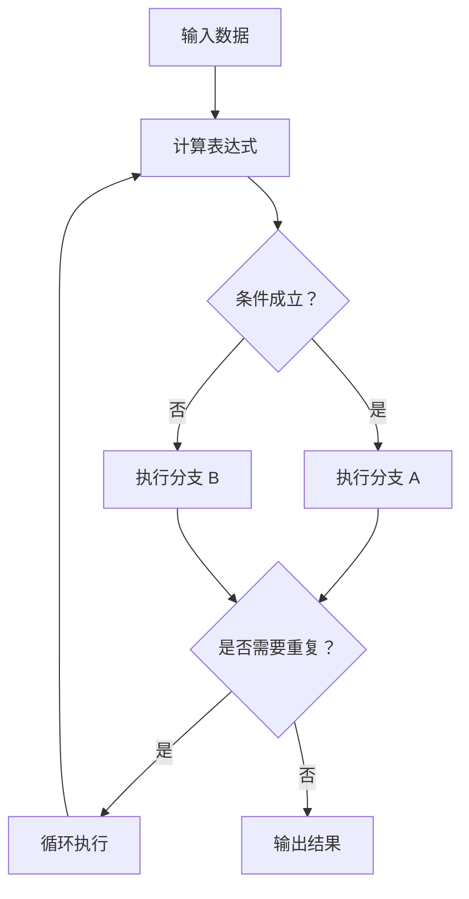

# JavaScript 02｜运算符与流程控制

> 把数据转换为决策：掌握表达式、条件分支、循环，以及如何让控制流程清晰、可预测。

## 学习目标

- 使用算术、比较、逻辑和赋值运算符。
- 理解短路求值、优先级和条件表达式。
- 使用 if、switch、for、while、for...of 解决常见问题。
- 正确处理边界条件，避免死循环与隐蔽分支。

## 1. 控制流程地图



## 2. 常见运算符

```js
const subtotal = 3 * 20;
const discount = subtotal >= 50 ? 5 : 0;
const total = subtotal - discount;

console.log({ subtotal, discount, total });
```

- 算术：`+`、`-`、`*`、`/`、`%`、`**`。
- 比较：`>`、`>=`、`<`、`<=`、`===`、`!==`。
- 逻辑：`&&`、`||`、`!`。
- 赋值：`=`、`+=`、`-=`、`*=`。
- 条件表达式：`condition ? a : b`，适合简单的二选一表达式。

不要只凭数学直觉判断 JavaScript 表达式；例如 `+` 还可能进行字符串拼接。复杂表达式应使用括号或拆分为有意义的变量。

## 3. 短路求值

`&&` 在左侧为假值时停止并返回左侧值；`||` 在左侧为真值时停止并返回左侧值。它们不保证返回布尔值。

```js
const user = { name: "小林" };
const name = user && user.name;
const title = "" || "默认标题";

console.log(name);  // "小林"
console.log(title); // "默认标题"
```

现代代码可使用可选链和空值合并：

```js
const city = user.profile?.city ?? "未知城市";
```

这里即使 `profile` 不存在也不会因为访问 `city` 而报错；若 `city` 是空字符串或 0，`??` 也会保留它们。

## 4. if / else 与 switch

```js
function getLevel(score) {
  if (!Number.isFinite(score) || score < 0 || score > 100) {
    return "分数无效";
  }

  if (score >= 90) return "优秀";
  if (score >= 80) return "良好";
  if (score >= 60) return "及格";
  return "需要继续练习";
}

console.log(getLevel(86));
```

使用 switch 处理有限的离散选项：

```js
function getPageTitle(page) {
  switch (page) {
    case "home":
      return "首页";
    case "projects":
      return "项目";
    case "notes":
      return "笔记";
    default:
      return "未找到页面";
  }
}
```

- 多条件判断时先处理无效输入和边界。
- 条件应表达明确的业务规则，避免一行写入太多逻辑。
- 使用 switch 时注意是否需要 break；本例每个分支 return，因此不会继续执行后续分支。

## 5. 循环：for、while 与 for...of

```js
const topics = ["HTML", "CSS", "JavaScript"];

for (let index = 0; index < topics.length; index += 1) {
  console.log(index + 1, topics[index]);
}

for (const topic of topics) {
  console.log(topic);
}
```

当只需要依次读取数组元素时，`for...of` 通常更直接。

```js
let attempts = 0;
while (attempts < 3) {
  console.log("尝试次数：", attempts + 1);
  attempts += 1;
}
```

循环必须确保条件最终可以变为 false，或在适当条件下使用 break；否则可能造成页面卡顿。

## 6. 实战：统计有效分数

```js
function summarizeScores(scores) {
  const validScores = scores.filter(
    (score) => Number.isFinite(score) && score >= 0 && score <= 100
  );

  if (validScores.length === 0) {
    return { count: 0, average: null, highest: null };
  }

  let sum = 0;
  let highest = validScores[0];

  for (const score of validScores) {
    sum += score;
    if (score > highest) highest = score;
  }

  return {
    count: validScores.length,
    average: sum / validScores.length,
    highest
  };
}

console.log(summarizeScores([88, 92, -1, 105, 76, NaN]));
```

这段代码先过滤无效数据，再处理空集合，最后统计总分与最高分。实际业务中还需要决定无效数据是忽略、报错还是单独返回。

## 7. 常见问题排查

| 问题 | 可能原因 | 处理方式 |
|---|---|---|
| 循环不结束 | 更新表达式遗漏或方向错误 | 检查循环变量与终止条件 |
| 分支总是进入第一个条件 | 条件范围重叠或顺序不当 | 先处理特殊情况，再处理一般情况 |
| `&&` 结果不是 true/false | 逻辑运算符返回操作数 | 在需要时显式转换为 Boolean |
| 计算结果异常 | 字符串拼接、NaN 或除零 | 检查输入类型与中间结果 |
| switch 执行多个分支 | 忘记 break 或没有 return | 检查分支终止行为 |

## 8. 动手练习与验收

1. 编写函数判断年份是否为闰年，并检查世纪年份边界。
2. 输出 1～100 中能被 3 或 5 整除的数字，并统计数量。
3. 为分数评级函数添加输入验证。
4. 对一组数字统计最小值、最大值、平均值，并正确处理空数组。

验收：

- [ ] 条件覆盖有效、无效和边界输入。
- [ ] 循环有明确终止条件。
- [ ] 没有依赖隐式类型转换的脆弱逻辑。
- [ ] 能解释每个分支的触发条件。

## 9. 面试自测

1. `&&` 与 `||` 如何进行短路求值？
2. 什么时候使用 for...of，什么时候需要传统 for？
3. 为什么业务函数要先验证输入范围？
4. 如何避免 if/else 形成难以维护的深层嵌套？
5. 如何确保 while 循环不会意外无限执行？

## 延伸阅读

- [MDN：表达式与运算符](https://developer.mozilla.org/zh-CN/docs/Web/JavaScript/Guide/Expressions_and_operators)
- [MDN：循环与迭代](https://developer.mozilla.org/zh-CN/docs/Web/JavaScript/Guide/Loops_and_iteration)
- [MDN：条件语句](https://developer.mozilla.org/zh-CN/docs/Web/JavaScript/Guide/Control_flow_and_error_handling)
