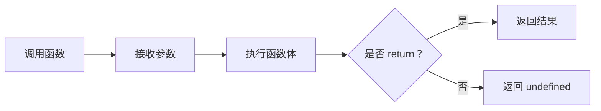

# JavaScript 03｜函数、作用域与闭包

> 函数不只是重复调用的代码块。理解参数、返回值、作用域与闭包，才能组织可测试、可组合的程序逻辑。

## 学习目标

- 声明函数、使用参数和返回值。
- 区分函数声明、函数表达式与箭头函数。
- 理解词法作用域、块级作用域和闭包。
- 认识默认参数、剩余参数与回调函数。

## 1. 从输入到输出



函数应尽量有明确职责：接收输入、完成一件可描述的工作、返回结果或执行清楚的副作用。

## 2. 函数声明与函数表达式

```js
function add(a, b) {
  return a + b;
}

const multiply = function (a, b) {
  return a * b;
};

const square = (number) => number * number;

console.log(add(2, 3));
console.log(multiply(2, 3));
console.log(square(4));
```

- 函数声明在同一作用域内可以在声明语句之前调用，这是函数声明提升的一部分。
- 函数表达式赋值给变量；变量能否提前使用取决于声明方式和执行顺序。
- 箭头函数适合简短回调，但它没有自己的 `this`、`arguments`，也不能用作构造函数。
- 有多条语句的箭头函数需要花括号，并使用 `return` 返回结果。

## 3. 参数、默认值与剩余参数

```js
function createLabel(name = "未命名", prefix = "主题") {
  return `${prefix}：${name}`;
}

function sum(...numbers) {
  return numbers.reduce((total, number) => total + number, 0);
}

console.log(createLabel("CSS"));
console.log(sum(1, 2, 3, 4));
```

默认参数只在实参缺失或为 `undefined` 时使用；传入 `null`、空字符串或 0 不会触发默认值。

剩余参数 `...numbers` 会把多个实参收集为数组。调用函数时传入对象或数组，函数获得的是对象引用值的副本；修改该对象属性可能被调用方观察到，因此应明确约定是否会修改输入。

## 4. 词法作用域

JavaScript 使用词法作用域：变量的可见范围由代码写在哪里决定，而不是由函数从哪里调用决定。

```js
const topic = "外层主题";

function showTopic() {
  const detail = "函数内部";
  console.log(topic);
  console.log(detail);
}

showTopic();
// console.log(detail); // ReferenceError：函数外无法访问
```

块级作用域示例：

```js
if (true) {
  const message = "只在这个块中可见";
  console.log(message);
}
// console.log(message); // ReferenceError
```

优先将变量限制在需要它的最小作用域，能减少意外覆盖并降低理解成本。

## 5. 闭包是什么？

闭包是函数与其词法环境的组合。内部函数即使在外层函数执行完毕后仍被保留，也可能继续访问外层作用域中的变量。

```js
function createCounter() {
  let count = 0;

  return function increment() {
    count += 1;
    return count;
  };
}

const counterA = createCounter();
const counterB = createCounter();

console.log(counterA()); // 1
console.log(counterA()); // 2
console.log(counterB()); // 1
```

每次调用 `createCounter()` 都会建立独立的词法环境，所以两个计数器的状态互不干扰。

常见用途：

- 封装状态，限制外部直接修改。
- 创建函数工厂，预先配置参数。
- 实现回调和事件处理逻辑。
- 在异步任务中保留需要的数据。

闭包并不意味着“变量一定泄漏”。但如果长期保存不再需要的回调、DOM 节点或大型对象引用，可能延长相关对象的生命周期，需要注意资源管理。

## 6. 回调与高阶函数

如果一个函数把另一个函数作为参数，或返回一个函数，它就属于高阶函数。

```js
function transformItems(items, transform) {
  return items.map(transform);
}

const labels = transformItems(
  ["html", "css", "javascript"],
  (item) => item.toUpperCase()
);

console.log(labels);
```

回调可以将“处理什么数据”与“如何处理”分开。使用回调时要注意是否会异步执行、是否可能多次调用，以及错误如何传递。

## 7. 实战：创建可配置的格式化函数

```js
function createFormatter(prefix, suffix = "") {
  return (value) => {
    const safeValue = String(value).trim();
    return safeValue ? `${prefix}${safeValue}${suffix}` : "";
  };
}

const formatTag = createFormatter("#", "");
const formatQuote = createFormatter("「", "」");

console.log(formatTag("  JavaScript  "));
console.log(formatQuote("持续学习"));
```

`createFormatter` 是函数工厂，返回的函数通过闭包保存 prefix 和 suffix 配置。

## 8. 常见问题排查

| 问题 | 可能原因 | 处理方式 |
|---|---|---|
| 函数结果是 undefined | 没有 return，或分支遗漏返回值 | 检查每条路径是否返回 |
| 箭头函数返回对象异常 | 直接写花括号被解释为函数体 | 返回对象字面量时使用括号，例如 `() => ({ ok: true })` |
| 外部无法访问局部变量 | 变量受词法作用域限制 | 将所需值通过参数或返回值传递 |
| 两个计数器共享状态 | 状态放在了共享外层作用域 | 在工厂函数内部创建状态 |
| 回调中的 this 不符合预期 | 箭头函数与普通函数的 this 规则不同 | 根据是否需要动态 this 选择函数形式 |

## 9. 动手练习与验收

1. 编写一个函数，接收价格和折扣率，返回校验后的最终价格。
2. 编写 `createMultiplier(factor)`，返回一个将输入乘以 factor 的函数。
3. 用闭包创建两个互不干扰的计数器。
4. 使用高阶函数把字符串数组映射为长度数组。

验收：

- [ ] 能区分参数、实参、返回值与副作用。
- [ ] 能解释局部变量为什么在函数外不可见。
- [ ] 能用自己的话解释闭包如何保留词法环境。
- [ ] 能判断箭头函数是否适合需要动态 this 的场景。

## 10. 面试自测

1. 函数声明与函数表达式有什么区别？
2. 什么是词法作用域？
3. 闭包的定义与常见用途是什么？
4. 为什么两个调用同一个工厂函数创建的闭包可以持有独立状态？
5. 箭头函数与普通函数的 this 行为有什么不同？

## 延伸阅读

- [MDN：函数](https://developer.mozilla.org/zh-CN/docs/Web/JavaScript/Guide/Functions)
- [MDN：闭包](https://developer.mozilla.org/zh-CN/docs/Web/JavaScript/Closures)
- [MDN：箭头函数表达式](https://developer.mozilla.org/zh-CN/docs/Web/JavaScript/Reference/Functions/Arrow_functions)
