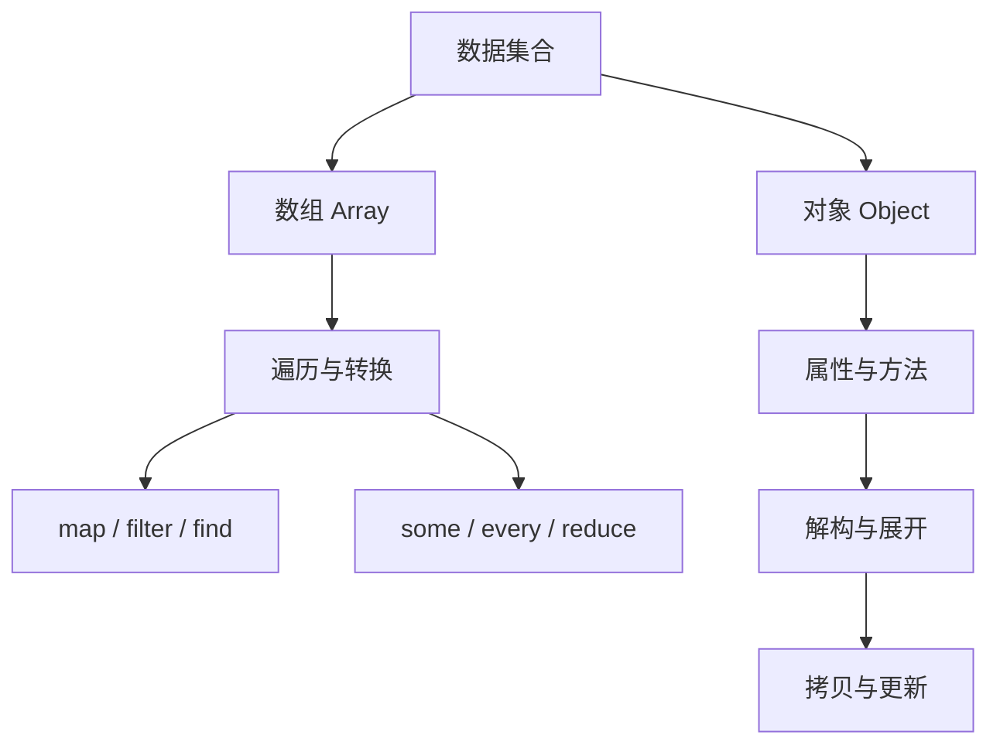

# JavaScript 04｜数组与对象

> 数组组织有序集合，对象表达带名称的属性。掌握二者及其常用操作，是处理页面数据的基础。

## 学习目标

- 创建、读取和更新数组与对象。
- 正确使用 `map`、`filter`、`find`、`some`、`every` 与 `reduce`。
- 理解解构、展开语法、引用与浅拷贝。
- 选择合适的数据结构，并处理空数据与缺失属性。

## 1. 知识地图



## 2. 数组基础

```js
const topics = ["HTML", "CSS", "JavaScript"];

console.log(topics[0]);       // HTML
console.log(topics.length);   // 3

topics.push("Web API");       // 末尾添加
topics[1] = "CSS3";           // 更新元素
const last = topics.pop();    // 移除并返回末尾元素

console.log(topics, last);
```

数组索引从 0 开始。访问越界索引通常得到 `undefined`，不要把它当成数组长度检查的替代方案。

## 3. 数组方法：选择正确工具

```js
const scores = [68, 92, 75, 92, 48];

const passed = scores.filter((score) => score >= 60);
const labels = passed.map((score) => `成绩：${score}`);
const firstHigh = scores.find((score) => score >= 90);
const hasPerfect = scores.some((score) => score === 100);
const allValid = scores.every(
  (score) => Number.isFinite(score) && score >= 0 && score <= 100
);
const total = scores.reduce((sum, score) => sum + score, 0);

console.log({ passed, labels, firstHigh, hasPerfect, allValid, total });
```

| 方法 | 返回结果 | 典型用途 |
|---|---|---|
| `map` | 新数组，长度通常相同 | 转换每个元素 |
| `filter` | 满足条件的新数组 | 筛选数据 |
| `find` | 第一个匹配元素或 undefined | 查找单项 |
| `some` | 布尔值 | 是否至少一个满足 |
| `every` | 布尔值 | 是否全部满足 |
| `reduce` | 累积后的结果 | 求和、分组、汇总 |

不要仅为副作用滥用 `map`；如果目标是执行操作而非生成新数组，应考虑 `for...of`。使用 `reduce` 时为累积结果提供合适的初始值，尤其要考虑空数组。

## 4. 对象基础

```js
const article = {
  title: "学习 JavaScript",
  author: "小林",
  tags: ["前端", "编程"],
  published: false
};

console.log(article.title);
console.log(article["author"]);

article.published = true;
article.updatedAt = "2026-10-14";
delete article.updatedAt;

console.log(Object.keys(article));
console.log(Object.values(article));
console.log(Object.entries(article));
```

对象属性适合描述实体的命名信息。读取可能不存在的属性时会得到 `undefined`；对于嵌套数据，可使用可选链，例如 `article.meta?.description`。

遍历对象自有可枚举属性时，可用 `Object.keys()`、`Object.values()` 或 `Object.entries()`。不要把 `for...in` 当作数组遍历工具，因为它遍历的是可枚举属性名，并可能包含继承属性。

## 5. 解构与展开语法

```js
const user = { name: "小林", role: "editor" };
const { name, role, city = "未知" } = user;

const original = [1, 2, 3];
const copied = [...original, 4];

const updatedUser = { ...user, role: "admin" };

console.log(name, role, city);
console.log(copied, updatedUser);
```

- 解构可以从数组或对象中提取值。
- 对象展开适合合并配置或创建浅拷贝。
- 后面的同名属性会覆盖前面的属性。
- 展开语法不会递归复制嵌套对象。

## 6. 引用与浅拷贝

```js
const original = { profile: { name: "小林" }, active: true };
const copy = { ...original };

copy.active = false;
copy.profile.name = "小李";

console.log(original.active);        // true
console.log(original.profile.name);  // 小李：嵌套对象仍共享引用
```

对象展开只复制第一层属性。若需要不可变更新，应复制发生变化的嵌套层级；也可以根据数据结构和运行环境评估 `structuredClone()`。不要默认使用 JSON 序列化实现通用深拷贝，因为它会丢失或改变某些数据类型和特殊值。

## 7. 实战：整理专题列表

```js
const notes = [
  { id: 1, title: "变量与类型", category: "JavaScript", done: true },
  { id: 2, title: "CSS Grid", category: "CSS", done: false },
  { id: 3, title: "数组与对象", category: "JavaScript", done: false }
];

const unfinishedJS = notes.filter(
  (note) => note.category === "JavaScript" && !note.done
);

const titles = unfinishedJS.map((note) => note.title);
const noteById = Object.fromEntries(notes.map((note) => [note.id, note]));

console.log(titles);
console.log(noteById[3]);
```

这里通过对象数组表达记录，通过 `filter` 筛选，通过 `map` 转换，再通过 `Object.fromEntries` 构建按 ID 查找的索引对象。

## 8. 常见问题排查

| 问题 | 原因与处理 |
|---|---|
| 修改副本影响原对象 | 嵌套引用仍共享；逐层复制需要更新的对象 |
| `map` 结果全是 undefined | 回调函数花括号内缺少 return |
| 对空数组 reduce 报错 | 没提供初始值；确认业务含义并传入初始值 |
| 找不到数据却继续访问属性 | `find` 可能返回 undefined；先检查结果或使用可选链 |
| 对象展开后仍互相影响 | 展开是浅拷贝，不会复制嵌套对象 |

## 9. 动手练习与验收

1. 从商品数组中筛选库存大于 0 的商品，并映射成展示标题。
2. 使用 `reduce` 统计订单总金额，考虑空数组。
3. 将对象数组按 ID 转成查找对象。
4. 更新用户的嵌套设置，同时保证原对象不被修改。

验收：

- [ ] 能解释六种常见数组方法的用途与返回值。
- [ ] 能处理 `find` 未找到结果的情况。
- [ ] 能解释浅拷贝与深拷贝的差别。
- [ ] 不通过直接修改原始数据完成所有更新。

## 10. 面试自测

1. `map` 和 `forEach` 有什么区别？
2. `find`、`filter`、`some` 分别返回什么？
3. 为什么对象展开只能实现浅拷贝？
4. 为什么 `reduce` 通常建议提供初始值？
5. 如何安全读取可能缺失的嵌套属性？

## 延伸阅读

- [MDN：数组](https://developer.mozilla.org/zh-CN/docs/Web/JavaScript/Reference/Global_Objects/Array)
- [MDN：对象基础](https://developer.mozilla.org/zh-CN/docs/Learn/JavaScript/Objects/Basics)
- [MDN：解构赋值](https://developer.mozilla.org/zh-CN/docs/Web/JavaScript/Reference/Operators/Destructuring)
