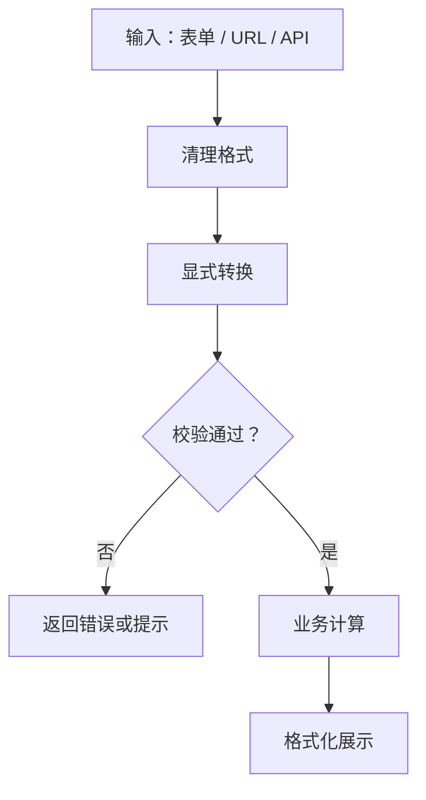

# JavaScript 05｜字符串、数字与日期处理

> 页面数据经常来自输入框、URL 或 API。可靠的数据处理需要明确转换规则、验证边界，并区分展示格式与真实数据。

## 学习目标

- 掌握字符串常用方法和模板字符串。
- 处理数字转换、精度与格式化。
- 理解日期解析与本地化展示的区别。
- 通过输入验证避免错误数据悄悄进入业务流程。

## 1. 数据处理流程



## 2. 字符串处理

```js
const raw = "  JavaScript 学习笔记  ";
const text = raw.trim();

console.log(text.length);
console.log(text.toUpperCase());
console.log(text.includes("学习"));
console.log(text.startsWith("JavaScript"));

const title = "第 5 篇：字符串";
console.log(`当前主题：${title}`);
```

常用方法：

- `trim()`：去掉首尾空白，不改变原字符串。
- `includes()`：判断是否包含子串。
- `startsWith()` / `endsWith()`：判断前缀或后缀。
- `slice(start, end)`：截取指定范围，不包含 end 位置。
- `replace()` / `replaceAll()`：替换匹配内容。
- `split(separator)`：按分隔符拆分成数组。

字符串不可变；这些方法会返回新字符串，不会原地修改原值。注意 `length` 统计的是 UTF-16 代码单元数量，不总等于用户感知的字符数，尤其遇到 emoji 或组合字符时。

## 3. 数字转换与验证

```js
function parseNonNegativeAmount(input) {
  const value = String(input).trim();

  if (value === "") {
    return { ok: false, error: "金额不能为空" };
  }

  const amount = Number(value);
  if (!Number.isFinite(amount) || amount < 0) {
    return { ok: false, error: "请输入有效的非负金额" };
  }

  return { ok: true, value: amount };
}

console.log(parseNonNegativeAmount("12.50"));
console.log(parseNonNegativeAmount("12px"));
```

不要只检查输入是不是“看起来像数字”。业务规则可能还要求非负、整数、范围限制或小数位数限制。

浮点数使用二进制表示，某些十进制小数无法精确表示：

```js
console.log(0.1 + 0.2); // 结果不是精确的 0.3
console.log((0.1 + 0.2) === 0.3); // false
```

涉及货币时，不应直接依赖浮点数的精确相等。可根据业务采用最小货币单位的整数计算，或使用经过评估的十进制定点方案。

## 4. 数字格式化

```js
const amount = 1234567.5;

console.log(
  new Intl.NumberFormat("zh-CN", {
    style: "currency",
    currency: "CNY"
  }).format(amount)
);

console.log(
  new Intl.NumberFormat("zh-CN", {
    maximumFractionDigits: 1
  }).format(amount)
);
```

格式化只改变展示形式，不应将格式化后的字符串直接当成原始数值继续计算。

## 5. 日期与时间

```js
const now = new Date();
console.log(now.toISOString());
console.log(
  new Intl.DateTimeFormat("zh-CN", {
    dateStyle: "medium",
    timeStyle: "short"
  }).format(now)
);
```

- `Date` 表示时间点；本地显示会受到运行环境时区影响。
- `toISOString()` 输出 UTC 时间的 ISO 格式。
- `Intl.DateTimeFormat` 适合本地化展示。
- 对日期字符串的解析应使用明确、可控的格式；避免依赖含糊的日期写法。
- 只表示“年月日”的业务日期，与精确到时分秒的时间点并不总是同一概念。跨时区场景要先明确产品规则。

例如，日期时间字符串带有 `Z` 表示 UTC；带有明确偏移量则表示对应时区偏移。缺少时区信息的日期时间字符串可能按本地时间解释，容易造成跨环境差异。

## 6. 实战：格式化学习记录

```js
function formatStudyRecord(record) {
  const title = String(record.title ?? "").trim();
  if (!title) {
    return { ok: false, error: "标题不能为空" };
  }

  const minutes = Number(record.minutes);
  if (!Number.isInteger(minutes) || minutes < 0) {
    return { ok: false, error: "学习时长必须是非负整数" };
  }

  return {
    ok: true,
    title,
    duration: `${minutes} 分钟`,
    completed: Boolean(record.completed)
  };
}

console.log(
  formatStudyRecord({ title: "  数组与对象 ", minutes: "35", completed: true })
);
```

这里把输入清理、转换、验证和展示结果分开处理。真实项目还应根据业务规则决定 `completed` 是否接受字符串输入，以及是否允许 0 分钟记录。

## 7. 常见问题排查

| 问题 | 处理方式 |
|---|---|
| 输入 `"12px"` 被当成数字 | 使用 `Number` 并校验，而不是无条件解析前缀 |
| 金额比较出现意外结果 | 考虑浮点精度，使用适当的金额表示方式 |
| 日期在不同机器显示不同 | 明确时区与输入格式，区分 UTC 和本地时间 |
| 格式化数字无法计算 | 保留数值用于计算，只在展示层格式化 |
| 字符串截断 emoji 异常 | 认识 UTF-16 与用户感知字符的差异，必要时使用 Intl.Segmenter |

## 8. 动手练习与验收

1. 写一个字符串清理函数：去除首尾空白，并拒绝空标题。
2. 写一个金额解析函数，验证空字符串、负数、非法字符和边界金额。
3. 用 `Intl.NumberFormat` 格式化数字与人民币金额。
4. 将时间点分别格式化为 ISO 字符串和中文本地展示。

验收：

- [ ] 先验证，再执行业务计算。
- [ ] 不混用数值和格式化后的字符串。
- [ ] 能解释浮点精度问题。
- [ ] 能说明时区为什么影响日期展示。

## 9. 面试自测

1. 字符串方法会原地修改字符串吗？
2. `Number("12px")` 为什么返回 NaN？
3. 为什么 `0.1 + 0.2` 不严格等于 `0.3`？
4. `toISOString()` 与本地日期展示有什么区别？
5. 金额、日期输入为什么需要业务校验？

## 延伸阅读

- [MDN：字符串](https://developer.mozilla.org/zh-CN/docs/Web/JavaScript/Reference/Global_Objects/String)
- [MDN：Intl.NumberFormat](https://developer.mozilla.org/zh-CN/docs/Web/JavaScript/Reference/Global_Objects/Intl/NumberFormat)
- [MDN：Date](https://developer.mozilla.org/zh-CN/docs/Web/JavaScript/Reference/Global_Objects/Date)
