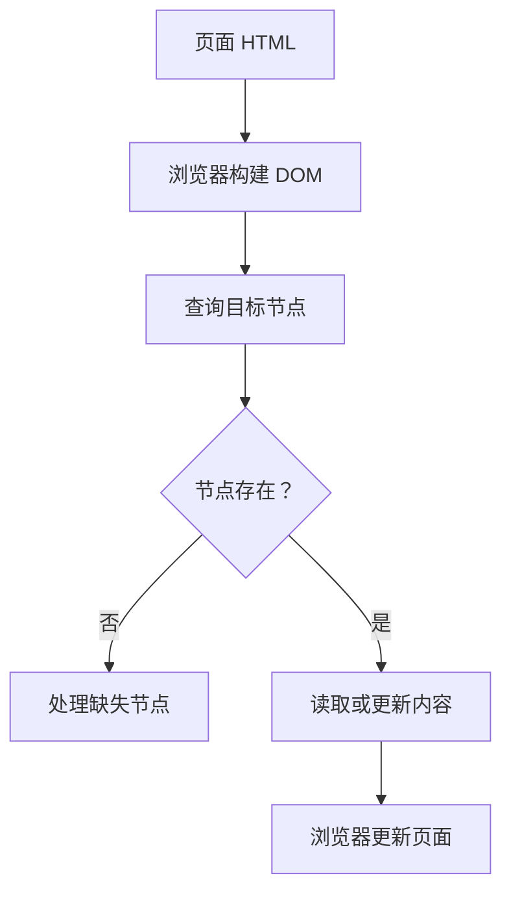

# JavaScript 06｜DOM 查询与页面更新

> DOM 是 JavaScript 与 HTML 文档交互的重要接口。本专题练习查询元素、更新内容、创建节点与安全处理用户输入。

## 学习目标

- 使用常见 DOM API 查询元素。
- 修改文本、属性、类名和表单值。
- 创建、插入和移除元素。
- 理解安全更新文本与避免不可信 HTML 注入的重要性。

## 1. DOM 操作流程



## 2. 查询元素

```js
const heading = document.querySelector("h1");
const cards = document.querySelectorAll(".card");
const app = document.getElementById("app");

if (heading) {
  console.log(heading.textContent);
}

console.log(cards.length);
console.log(app);
```

- `querySelector()` 返回第一个匹配元素，未找到时返回 `null`。
- `querySelectorAll()` 返回静态 NodeList，可使用 `forEach` 遍历。
- `getElementById()` 按 ID 查找，未找到时同样返回 `null`。
- 操作元素前应确认它存在，尤其在脚本加载时机或页面模板变化时。

若脚本放在 `head` 中，元素可能尚未解析；可将脚本放在页面末尾，或使用 `defer`：

```html
<script src="app.js" defer></script>
```

## 3. 更新文本、类名与属性

```html
<h1 id="page-title">旧标题</h1>
<button id="toggle" type="button">切换状态</button>
<p id="status" class="status">尚未启用</p>
```

```js
const title = document.querySelector("#page-title");
const toggle = document.querySelector("#toggle");
const status = document.querySelector("#status");

if (title && toggle && status) {
  title.textContent = "JavaScript DOM 实践";

  toggle.addEventListener("click", () => {
    const enabled = status.classList.toggle("is-active");
    status.textContent = enabled ? "已启用" : "尚未启用";
    toggle.setAttribute("aria-pressed", String(enabled));
  });
}
```

- 用 `textContent` 更新普通文本。
- 用 `classList.add/remove/toggle/contains` 管理 CSS 类。
- 用 `setAttribute` 更新适当的 HTML 属性。
- 表单控件的当前输入通常通过 `value` 读取或设置。
- 不要把用户输入直接拼接进 `innerHTML`。若确实需要渲染 HTML，必须使用经过审核的安全策略或可靠的净化方案。

## 4. 创建并插入节点

```html
<ul id="topic-list"></ul>
```

```js
const list = document.querySelector("#topic-list");

function addTopic(label) {
  if (!list) return;

  const text = String(label).trim();
  if (!text) return;

  const item = document.createElement("li");
  item.textContent = text;
  list.append(item);
}

addTopic("数组与对象");
addTopic("DOM 查询");
```

`createElement` 创建节点，`textContent` 写入纯文本，`append` 将节点加入文档。用这种方式处理普通用户输入，可避免把输入解释为 HTML 标记。

## 5. 安全与可访问性

- 更新界面内容时优先使用 `textContent`。
- 事件触发的按钮应使用真正的 `button` 元素，保证键盘操作。
- 图标按钮应提供可理解的名称；状态变化需要适当反馈。
- 不要把 `innerHTML` 当作普通字符串赋值工具。
- 对外部数据依然需要校验；安全的 DOM 写入不能替代业务验证。
- 查询不到节点时应有明确处理，不要继续访问 `null` 的属性。

## 6. 实战：添加学习专题

下面示例包含 HTML 与 JavaScript，可以保存为单个 HTML 文件后在浏览器打开。

```html
<!doctype html>
<html lang="zh-CN">
<head>
  <meta charset="UTF-8">
  <meta name="viewport" content="width=device-width, initial-scale=1">
  <title>学习专题清单</title>
</head>
<body>
  <main>
    <h1>学习专题清单</h1>
    <form id="topic-form">
      <label for="topic-input">专题名称</label>
      <input id="topic-input" name="topic" required maxlength="80">
      <button type="submit">添加专题</button>
    </form>
    <p id="feedback" role="status" aria-live="polite"></p>
    <ul id="topic-list"></ul>
  </main>

  <script>
    const form = document.querySelector("#topic-form");
    const input = document.querySelector("#topic-input");
    const list = document.querySelector("#topic-list");
    const feedback = document.querySelector("#feedback");

    form.addEventListener("submit", (event) => {
      event.preventDefault();

      const title = input.value.trim();
      if (!title) {
        feedback.textContent = "请输入专题名称。";
        input.focus();
        return;
      }

      const item = document.createElement("li");
      item.textContent = title;
      list.append(item);

      feedback.textContent = `已添加专题：${title}`;
      form.reset();
      input.focus();
    });
  </script>
</body>
</html>
```

示例通过表单提交事件处理输入，使用 `textContent` 写入节点，并提供状态提示。它尚未保存数据；刷新页面后列表会重置，持久化会在后续专题介绍。

## 7. 常见问题排查

| 问题 | 可能原因 | 处理方式 |
|---|---|---|
| 查询结果是 null | 选择器写错或脚本执行过早 | 检查元素 ID、类名和脚本加载时机 |
| 点击后页面刷新 | 表单默认提交行为 | 在 submit 事件中调用 `preventDefault()` |
| 用户输入变成 HTML | 使用了不安全的 `innerHTML` 拼接 | 改用 `textContent` 或安全净化策略 |
| 样式类重复或状态不同步 | 直接拼接 class 字符串 | 使用 `classList` API |
| 无法通过键盘触发控件 | 使用了不合适的非交互元素 | 使用语义化 button、input 等控件 |

## 8. 动手练习与验收

1. 为页面增加一个按钮，点击后切换深浅主题类名。
2. 为专题清单增加删除按钮，使用 DOM 节点 API 创建。
3. 输入空白内容时显示提示，并把焦点返回输入框。
4. 尝试输入 ``，确认它作为文本显示而不是执行。

验收：

- [ ] 能说明 querySelector 找不到元素时的返回值。
- [ ] 能使用 textContent 更新文本。
- [ ] 能创建、插入和删除节点。
- [ ] 表单可以键盘操作并提供可理解的状态提示。
- [ ] 不将不可信输入直接拼入 innerHTML。

## 9. 面试自测

1. `querySelector` 与 `querySelectorAll` 有何区别？
2. 为什么推荐用 `textContent` 更新用户输入？
3. `classList.toggle` 适合解决什么问题？
4. 为什么表单提交处理通常需要 `preventDefault()`？
5. `defer` 如何影响外部脚本的执行时机？

## 延伸阅读

- [MDN：文档对象模型（DOM）](https://developer.mozilla.org/zh-CN/docs/Web/API/Document_Object_Model)
- [MDN：Document.querySelector](https://developer.mozilla.org/zh-CN/docs/Web/API/Document/querySelector)
- [MDN：Node.textContent](https://developer.mozilla.org/zh-CN/docs/Web/API/Node/textContent)
