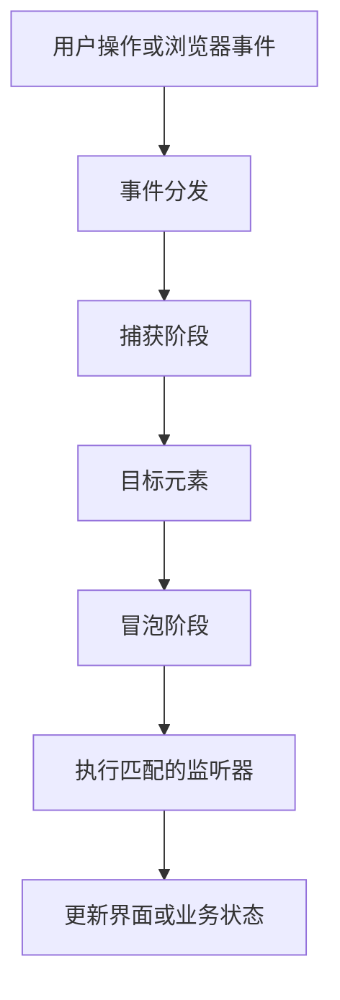

# JavaScript 07｜DOM 事件机制

> 事件把用户操作与程序行为连接起来。掌握监听、事件对象、冒泡和事件委托，才能构建可靠的交互界面。

## 学习目标

- 使用 `addEventListener` 注册和移除事件监听器。
- 读取事件对象，区分目标元素与当前监听元素。
- 理解捕获、目标阶段与冒泡。
- 使用事件委托处理动态创建的列表项。

## 1. 事件处理流程



并非所有事件都以相同方式冒泡；具体行为应查看对应事件的文档。常见的 `click`、`input` 和 `submit` 事件通常适合用事件委托或表单级监听。

## 2. 注册与移除监听器

```js
const button = document.querySelector("#save-button");

function handleSave(event) {
  console.log("触发事件：", event.type);
}

if (button) {
  button.addEventListener("click", handleSave);
  // 需要清理时，传入相同的函数引用：
  // button.removeEventListener("click", handleSave);
}
```

使用具名函数便于移除监听器。若注册时使用匿名函数，之后很难通过同一个函数引用移除它。不要在重复渲染过程中无意地重复注册同一类处理逻辑。

## 3. 事件对象、target 与 currentTarget

```html
<div id="toolbar">
  <button type="button" id="publish-button">
    <span>发布</span>
  </button>
</div>
```

```js
const toolbar = document.querySelector("#toolbar");

toolbar?.addEventListener("click", (event) => {
  console.log(event.target);        // 实际触发事件的后代节点也可能是 span
  console.log(event.currentTarget); // 当前注册监听器的 toolbar
});
```

- `event.target` 是事件最初命中的目标。
- `event.currentTarget` 是当前正在执行监听器的元素。
- `event.preventDefault()` 取消事件的默认行为（若该事件支持且尚未被动处理器限制）。
- `event.stopPropagation()` 阻止事件继续传播；不要把它当作常规修补工具，以免破坏其他组件的事件流程。

## 4. 冒泡与捕获

事件通常先沿祖先链向目标传播（捕获），到达目标后，再向外传播（冒泡）。监听器第三个参数可以设置为 `true` 或使用选项对象开启捕获。

```js
const parent = document.querySelector("#parent");
const child = document.querySelector("#child");

parent?.addEventListener("click", () => {
  console.log("父元素：冒泡阶段");
});

parent?.addEventListener("click", () => {
  console.log("父元素：捕获阶段");
}, { capture: true });

child?.addEventListener("click", () => {
  console.log("子元素");
});
```

点击子元素时，在典型冒泡事件中，捕获监听器先执行，然后目标监听器执行，最后执行父元素的冒泡监听器。

## 5. 事件委托：处理动态列表

```html
<ul id="task-list">
  <li><button type="button" data-action="remove">删除</button> 学习 DOM</li>
</ul>
```

```js
const list = document.querySelector("#task-list");

list?.addEventListener("click", (event) => {
  if (!(event.target instanceof Element)) return;

  const button = event.target.closest('button[data-action="remove"]');
  if (!button || !list.contains(button)) return;

  const item = button.closest("li");
  item?.remove();
});
```

事件委托将监听器放在稳定的父元素上，借助冒泡处理后代的事件。新添加的列表项也可以自动使用这套处理逻辑，不必为每个新按钮重新注册监听器。

## 6. 实战：添加并删除专题

```html
<form id="topic-form">
  <label for="topic-input">专题名称</label>
  <input id="topic-input" required maxlength="80">
  <button type="submit">添加</button>
</form>
<p id="feedback" role="status" aria-live="polite"></p>
<ul id="topic-list"></ul>
```

```js
const form = document.querySelector("#topic-form");
const input = document.querySelector("#topic-input");
const list = document.querySelector("#topic-list");
const feedback = document.querySelector("#feedback");

form?.addEventListener("submit", (event) => {
  event.preventDefault();
  if (!(input instanceof HTMLInputElement) || !(list instanceof HTMLUListElement)) return;

  const title = input.value.trim();
  if (!title) {
    feedback.textContent = "请填写专题名称。";
    input.focus();
    return;
  }

  const item = document.createElement("li");
  const label = document.createElement("span");
  const remove = document.createElement("button");

  label.textContent = title;
  remove.type = "button";
  remove.textContent = "删除";
  remove.dataset.action = "remove";
  item.append(label, document.createTextNode(" "), remove);
  list.append(item);

  feedback.textContent = `已添加：${title}`;
  form.reset();
});

list?.addEventListener("click", (event) => {
  if (!(event.target instanceof Element)) return;
  const button = event.target.closest('button[data-action="remove"]');
  if (!button || !list.contains(button)) return;
  button.closest("li")?.remove();
  feedback.textContent = "专题已删除。";
});
```

本例通过表单级监听器处理提交，并通过列表级监听器处理所有删除按钮。真实应用还应考虑重复名称、持久化和删除确认等产品规则。

## 7. 常见问题排查

| 问题 | 原因与处理 |
|---|---|
| 点击内部图标时判断失败 | `event.target` 可能是后代节点；使用 `closest()` 定位按钮 |
| 动态新增按钮没有响应 | 监听器只注册在旧节点；考虑事件委托 |
| 无法移除监听器 | 传给 `removeEventListener` 的函数引用不一致 |
| 点击提交导致页面刷新 | 在 submit 监听器中按需调用 `preventDefault()` |
| 阻止冒泡后其他功能失效 | 检查是否真的需要 `stopPropagation()`，优先缩小监听范围 |

## 8. 动手练习与验收

1. 给多个按钮注册点击事件，并输出按钮的自定义 `data-id`。
2. 给动态列表增加删除功能，使用事件委托。
3. 分别在捕获和冒泡阶段注册监听器，记录执行顺序。
4. 为表单提交添加状态提示，并确保按 Enter 也能提交。

验收：

- [ ] 能区分 target 与 currentTarget。
- [ ] 能解释捕获与冒泡的基本顺序。
- [ ] 新增列表项无需额外注册删除监听器。
- [ ] 不依赖不必要的 `stopPropagation()`。

## 9. 面试自测

1. `addEventListener` 与直接设置 `onclick` 有什么区别？
2. 事件冒泡是什么？哪些场景适合事件委托？
3. `target` 与 `currentTarget` 有何区别？
4. 为什么移除监听器需要同一个函数引用？
5. `preventDefault()` 和 `stopPropagation()` 分别做什么？

## 延伸阅读

- [MDN：事件介绍](https://developer.mozilla.org/zh-CN/docs/Learn/JavaScript/Building_blocks/Events)
- [MDN：EventTarget.addEventListener](https://developer.mozilla.org/zh-CN/docs/Web/API/EventTarget/addEventListener)
- [MDN：事件冒泡](https://developer.mozilla.org/zh-CN/docs/Learn/JavaScript/Building_blocks/Events#事件冒泡)
