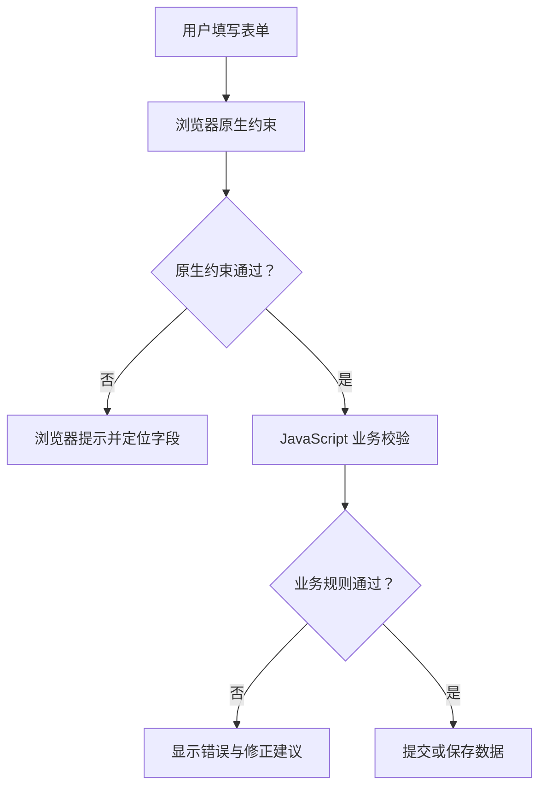

# JavaScript 08｜表单与数据校验

> 表单是网页收集用户输入的入口。好的表单既要验证数据，也要说明问题所在，并照顾键盘操作与辅助技术。

## 学习目标

- 理解表单的 submit 事件与默认提交行为。
- 使用 HTML 原生约束和 JavaScript 业务校验。
- 显示字段级错误与提交状态。
- 避免只依赖前端验证来保护服务端数据。

## 1. 表单校验流程



前端校验改善体验，但不能替代服务端验证。用户可以绕过浏览器界面直接发送请求，因此服务端仍需独立检查权限、格式、长度和业务规则。

## 2. 优先使用 HTML 原生约束

```html
<form id="profile-form">
  <label for="display-name">显示名称</label>
  <input id="display-name" name="displayName" required minlength="2" maxlength="30">

  <label for="email">邮箱</label>
  <input id="email" name="email" type="email" required>

  <label for="minutes">每日学习分钟数</label>
  <input id="minutes" name="minutes" type="number" min="0" max="1440" step="1" required>

  <button type="submit">保存</button>
</form>
<p id="form-status" role="status" aria-live="polite"></p>
```

常用约束包括 `required`、`minlength`、`maxlength`、`type="email"`、`min`、`max` 与 `step`。为每个控件关联可见的 `label`，不要只用 placeholder 代替标签。

## 3. JavaScript 业务校验

```js
const form = document.querySelector("#profile-form");
const nameInput = document.querySelector("#display-name");
const minutesInput = document.querySelector("#minutes");
const status = document.querySelector("#form-status");

form?.addEventListener("submit", (event) => {
  event.preventDefault();

  if (!(nameInput instanceof HTMLInputElement) ||
      !(minutesInput instanceof HTMLInputElement)) return;

  const name = nameInput.value.trim();
  const minutes = minutesInput.valueAsNumber;

  if (name.length < 2) {
    status.textContent = "显示名称至少需要 2 个字符。";
    nameInput.focus();
    return;
  }

  if (!Number.isInteger(minutes) || minutes < 0 || minutes > 1440) {
    status.textContent = "学习分钟数必须是 0 到 1440 之间的整数。";
    minutesInput.focus();
    return;
  }

  status.textContent = `校验通过：${name}，每日 ${minutes} 分钟。`;
});
```

浏览器在触发常规 submit 事件之前会执行原生约束校验。若需要自定义校验界面，可以研究 `checkValidity()`、`reportValidity()` 和 `setCustomValidity()`，但要避免让用户失去必要的错误信息。

## 4. 使用 FormData 收集字段

```js
const form = document.querySelector("#profile-form");

form?.addEventListener("submit", (event) => {
  event.preventDefault();
  if (!(form instanceof HTMLFormElement)) return;

  const data = new FormData(form);
  const displayName = String(data.get("displayName") ?? "").trim();
  const email = String(data.get("email") ?? "").trim();

  console.log({ displayName, email });
});
```

`FormData` 会根据表单控件的 `name` 收集数据。未设置 `name` 的控件不会以预期方式成为提交字段；未勾选的复选框也不会像普通文本字段一样提交。服务端接收数据后必须再次校验。

## 5. 错误提示与可访问性

- 错误信息应说明具体问题和修正方式，而不只是“输入错误”。
- 可以使用 `aria-describedby` 将字段与帮助文字、错误文字关联。
- 必要时设置 `aria-invalid="true"`，校验成功后清除错误状态。
- 将焦点移到第一个错误字段，帮助键盘用户快速修正。
- 不要只用颜色区分错误；还应提供文本提示或图标等信息。
- 提交成功或失败后，可用 `role="status"` 或适当的实时区域反馈结果。

## 6. 实战：校验并生成记录

```html
<form id="study-form">
  <label for="study-title">学习主题</label>
  <input id="study-title" name="title" required maxlength="80">
  <label for="study-minutes">学习时长（分钟）</label>
  <input id="study-minutes" name="minutes" type="number" min="1" max="1440" step="1" required>
  <button type="submit">记录学习</button>
</form>
<p id="study-status" role="status" aria-live="polite"></p>
<ul id="study-records"></ul>
```

```js
const studyForm = document.querySelector("#study-form");
const studyStatus = document.querySelector("#study-status");
const records = document.querySelector("#study-records");

studyForm?.addEventListener("submit", (event) => {
  event.preventDefault();
  if (!(studyForm instanceof HTMLFormElement) || !(records instanceof HTMLUListElement)) return;

  const data = new FormData(studyForm);
  const title = String(data.get("title") ?? "").trim();
  const minutes = Number(data.get("minutes"));

  if (!title || !Number.isInteger(minutes) || minutes < 1 || minutes > 1440) {
    studyStatus.textContent = "请填写有效主题，并输入 1 到 1440 之间的整数分钟。";
    return;
  }

  const item = document.createElement("li");
  item.textContent = `${title}：${minutes} 分钟`;
  records.append(item);
  studyStatus.textContent = "学习记录已添加。";
  studyForm.reset();
});
```

该示例仅在当前页面内添加记录，刷新后会丢失；数据持久化将在下一专题介绍。

## 7. 常见问题排查

| 问题 | 原因与处理 |
|---|---|
| submit 事件没有触发 | 原生约束可能阻止提交；检查 required、type 与字段范围 |
| 收集不到某字段 | 检查控件的 name 属性和控件是否参与提交 |
| 数字字段得到空值或 NaN | 使用 `valueAsNumber` 或明确转换，并处理无效值 |
| 错误只通过红色展示 | 增加具体文本、关联描述并管理焦点 |
| 认为前端验证足够安全 | 服务端必须独立验证，不能信任客户端传来的数据 |

## 8. 动手练习与验收

1. 创建注册表单，包含名称、邮箱和密码长度规则。
2. 为每个错误字段显示关联的错误说明。
3. 让提交按钮支持鼠标与键盘操作。
4. 验证空值、超长文本、负数、小数和无效邮箱。

验收：

- [ ] 表单控件有可见 label 与合适的 name。
- [ ] 错误信息明确并能帮助用户修正。
- [ ] 原生约束和业务校验职责清晰。
- [ ] 知道服务端必须重新验证所有不可信输入。

## 9. 面试自测

1. 浏览器原生表单校验与 JavaScript 校验有什么区别？
2. 为什么监听 submit 通常比只监听按钮 click 更完整？
3. `FormData` 依据什么收集字段？
4. 如何让错误提示更易于辅助技术读取？
5. 为什么前端校验不能替代服务端校验？

## 延伸阅读

- [MDN：客户端表单验证](https://developer.mozilla.org/zh-CN/docs/Learn/Forms/Form_validation)
- [MDN：FormData](https://developer.mozilla.org/zh-CN/docs/Web/API/FormData)
- [MDN：HTMLFormElement](https://developer.mozilla.org/zh-CN/docs/Web/API/HTMLFormElement)
