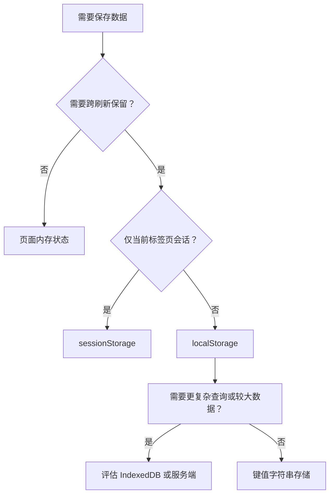

# JavaScript 09｜浏览器存储与数据持久化

> 把数据保存在页面内存之外，用户刷新页面后才能继续使用之前的记录。本专题介绍 LocalStorage、JSON 序列化与稳健的读取策略。

## 学习目标

- 区分页面内存、sessionStorage 与 localStorage。
- 使用 JSON 序列化和反序列化简单数据。
- 处理损坏数据、缺失数据和存储异常。
- 理解浏览器存储的安全边界与适用范围。

## 1. 存储选择地图



- 页面变量适合临时状态，刷新后通常丢失。
- `sessionStorage` 面向当前浏览上下文会话。
- `localStorage` 可跨页面刷新保留同源键值数据，直到被清理。
- `localStorage` 是同步 API，适合较小的简单数据；大规模或复杂结构可评估 IndexedDB。
- 浏览器存储不等于云端备份，也不保证用户换设备后仍能访问。

## 2. localStorage 的基本用法

```js
localStorage.setItem("theme", "dark");

const theme = localStorage.getItem("theme");
console.log(theme); // "dark"

localStorage.removeItem("theme");
// localStorage.clear(); // 清除当前源下全部 localStorage，慎用
```

`getItem()` 在键不存在时返回 `null`。存储 API 只能保存字符串；保存数组或对象时需要序列化。

## 3. 使用 JSON 保存对象数组

```js
const records = [
  { id: "a1", title: "数组与对象", minutes: 30 },
  { id: "a2", title: "DOM 事件", minutes: 25 }
];

localStorage.setItem("study-records", JSON.stringify(records));

const raw = localStorage.getItem("study-records");
const parsed = raw ? JSON.parse(raw) : [];

console.log(parsed);
```

`JSON.stringify()` 把可 JSON 表示的数据转换为字符串；`JSON.parse()` 可能因为无效文本而抛出异常。JSON 不会保留所有 JavaScript 类型，例如函数、Symbol 和某些特殊对象信息，因此它不是通用深拷贝工具。

## 4. 编写安全的读取与写入函数

```js
const STORAGE_KEY = "study-records";

function readRecords() {
  try {
    const raw = localStorage.getItem(STORAGE_KEY);
    if (raw === null) return [];

    const value = JSON.parse(raw);
    if (!Array.isArray(value)) return [];

    return value.filter((item) =>
      item &&
      typeof item.id === "string" &&
      typeof item.title === "string" &&
      Number.isFinite(item.minutes)
    );
  } catch (error) {
    console.warn("无法读取本地学习记录：", error);
    return [];
  }
}

function writeRecords(records) {
  try {
    localStorage.setItem(STORAGE_KEY, JSON.stringify(records));
    return true;
  } catch (error) {
    console.error("无法保存本地学习记录：", error);
    return false;
  }
}
```

这里同时处理了 JSON 损坏、数据不是数组、记录结构不符合预期，以及存储写入失败等情况。生产代码可以进一步区分“没有记录”和“读取失败”，避免把失败误当成空数据后覆盖原内容。

## 5. 实战：可持久化的学习记录清单

以下示例保存记录、重新加载记录，并允许删除单条记录。保存为 HTML 文件，在浏览器中打开即可尝试；不同浏览器对直接以 `file://` 打开的页面存储行为可能有差异，建议通过本地开发服务器验证。

```html
<!doctype html>
<html lang="zh-CN">
<head>
  <meta charset="UTF-8">
  <meta name="viewport" content="width=device-width, initial-scale=1">
  <title>学习记录</title>
</head>
<body>
  <main>
    <h1>学习记录</h1>
    <form id="record-form">
      <label for="record-title">学习主题</label>
      <input id="record-title" name="title" required maxlength="80">
      <label for="record-minutes">分钟</label>
      <input id="record-minutes" name="minutes" type="number" min="1" max="1440" step="1" required>
      <button type="submit">添加记录</button>
    </form>
    <p id="status" role="status" aria-live="polite"></p>
    <ul id="records"></ul>
  </main>

  <script>
    const KEY = "study-records-v1";
    const form = document.querySelector("#record-form");
    const titleInput = document.querySelector("#record-title");
    const minutesInput = document.querySelector("#record-minutes");
    const list = document.querySelector("#records");
    const status = document.querySelector("#status");

    function loadRecords() {
      try {
        const raw = localStorage.getItem(KEY);
        const data = raw ? JSON.parse(raw) : [];
        return Array.isArray(data) ? data.filter((item) =>
          item &&
          typeof item.id === "string" &&
          typeof item.title === "string" &&
          Number.isInteger(item.minutes) &&
          item.minutes > 0
        ) : [];
      } catch {
        status.textContent = "读取本地记录失败，当前显示空列表。";
        return [];
      }
    }

    let records = loadRecords();

    function saveRecords() {
      try {
        localStorage.setItem(KEY, JSON.stringify(records));
        return true;
      } catch {
        status.textContent = "保存失败，浏览器可能已禁用存储或空间不足。";
        return false;
      }
    }

    function renderRecords() {
      list.replaceChildren();

      for (const record of records) {
        const item = document.createElement("li");
        const label = document.createElement("span");
        const remove = document.createElement("button");

        label.textContent = `${record.title}：${record.minutes} 分钟`;
        remove.type = "button";
        remove.textContent = "删除";
        remove.dataset.id = record.id;
        item.append(label, document.createTextNode(" "), remove);
        list.append(item);
      }
    }

    form.addEventListener("submit", (event) => {
      event.preventDefault();
      const title = titleInput.value.trim();
      const minutes = Number(minutesInput.value);

      if (!title || !Number.isInteger(minutes) || minutes < 1 || minutes > 1440) {
        status.textContent = "请填写有效主题与 1～1440 之间的整数分钟。";
        return;
      }

      const next = [
        ...records,
        { id: crypto.randomUUID(), title, minutes }
      ];
      const previous = records;
      records = next;

      if (saveRecords()) {
        renderRecords();
        status.textContent = "记录已保存。";
        form.reset();
      } else {
        records = previous;
      }
    });

    list.addEventListener("click", (event) => {
      if (!(event.target instanceof Element)) return;
      const button = event.target.closest("button[data-id]");
      if (!button) return;

      const previous = records;
      records = records.filter((record) => record.id !== button.dataset.id);
      if (saveRecords()) {
        renderRecords();
        status.textContent = "记录已删除。";
      } else {
        records = previous;
      }
    });

    renderRecords();
  </script>
</body>
</html>
```

说明：示例使用 `crypto.randomUUID()` 生成记录 ID；需在支持该 API 的安全上下文中使用。若目标环境不支持，应提供经过评估的 ID 生成策略。存储失败时示例会保留当前内存状态，但不会谎称数据已保存。

## 6. 安全与可靠性

- 不要在 localStorage 中保存密码、会话令牌或其他高敏感信息。
- 同源脚本通常可以读取该源的 localStorage；发生 XSS 时，存储内容可能暴露。
- 存储的数据必须视为不可信输入，读取后要校验结构和类型。
- 不同用户、浏览器和设备之间不会自动同步。
- 存储空间有限，写入可能抛出异常；应提供失败提示。
- `localStorage.clear()` 会清除当前源的全部键值数据，除非确实需要，否则不要使用。

## 7. 常见问题排查

| 问题 | 原因与处理 |
|---|---|
| 刷新后记录消失 | 检查是否调用 setItem，以及读写键名是否一致 |
| JSON.parse 抛异常 | 存储内容可能被手动修改或损坏；使用 try/catch |
| setItem 失败 | 检查存储策略、隐私模式限制或空间不足 |
| 读到旧数据结构 | 使用版本化键名或设计迁移逻辑 |
| 多个标签页数据不同步 | 评估 storage 事件或更合适的数据同步架构 |

## 8. 动手练习与验收

1. 给学习记录增加日期字段并展示。
2. 添加“清空记录”功能，先二次确认，并且只删除本应用的键。
3. 模拟存储里出现无效 JSON，确保页面仍能显示错误提示。
4. 设计数据版本升级方案，例如从 v1 迁移到 v2。

验收：

- [ ] 对 JSON.parse 和存储写入异常做了处理。
- [ ] 保存后刷新页面仍能恢复记录。
- [ ] 用户输入通过 DOM 文本 API 安全显示。
- [ ] 不保存密码等高敏感数据。
- [ ] 区分内存状态和真正持久化成功的状态。

## 9. 面试自测

1. localStorage 与 sessionStorage 的区别是什么？
2. 为什么对象需要 JSON.stringify 才能存入 localStorage？
3. JSON.parse 为什么需要异常处理？
4. localStorage 为什么不适合存储高敏感令牌？
5. 如何处理旧版本数据结构与写入失败？

## 延伸阅读

- [MDN：Window.localStorage](https://developer.mozilla.org/zh-CN/docs/Web/API/Window/localStorage)
- [MDN：Storage](https://developer.mozilla.org/zh-CN/docs/Web/API/Storage)
- [MDN：JSON](https://developer.mozilla.org/zh-CN/docs/Web/JavaScript/Reference/Global_Objects/JSON)
