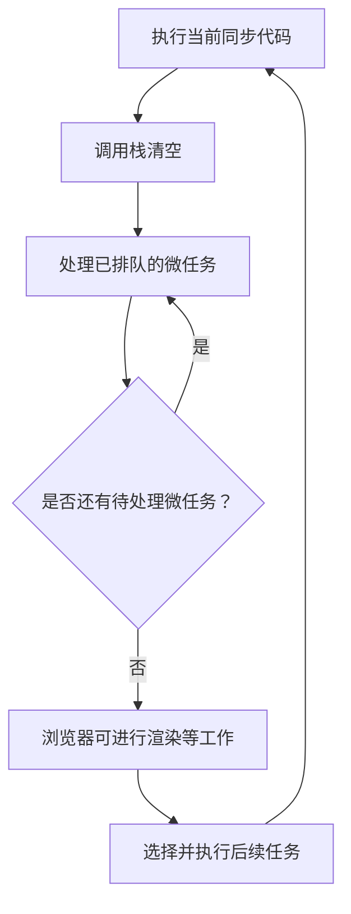

# JavaScript 10｜异步编程与事件循环

> 异步编程让浏览器在等待计时器、网络请求或其他任务时，仍然能够响应用户操作。理解执行顺序，是掌握 Promise 与 async/await 的基础。

## 学习目标

- 区分同步执行、异步任务与回调。
- 理解调用栈、任务队列和事件循环的基本关系。
- 解释微任务与任务（宏任务）的大致执行顺序。
- 避免用固定延时假设任务一定按预期完成。

## 1. 从同步代码开始

```js
console.log("A");
console.log("B");
console.log("C");
```

同步代码按照当前执行顺序运行，通常输出 A、B、C。当前调用栈中的代码执行完成后，运行环境才有机会处理后续排队的任务。

## 2. 事件循环概念图



这是帮助理解浏览器运行时的简化模型。实际调度还涉及不同任务源、渲染机会、宿主环境规则等细节，不能把它理解为所有工作都遵循一个简单 FIFO 队列。

## 3. setTimeout 不代表精确计时

```js
console.log("开始");

setTimeout(() => {
  console.log("定时器回调");
}, 0);

console.log("结束");
```

通常输出“开始”“结束”“定时器回调”。即使延时写成 0，回调也会被安排在后续任务中，而不是插入当前同步代码中立即执行。浏览器繁忙、嵌套定时器规则等也会影响实际延迟。

## 4. 微任务与任务的常见顺序

```js
console.log("同步 1");

setTimeout(() => console.log("定时器任务"), 0);

Promise.resolve().then(() => console.log("Promise 微任务"));

queueMicrotask(() => console.log("queueMicrotask 微任务"));

console.log("同步 2");
```

在常见浏览器环境中，输出顺序是：

1. 同步 1
2. 同步 2
3. Promise 微任务
4. queueMicrotask 微任务
5. 定时器任务

微任务通常在当前同步任务结束后、运行下一个任务前处理。持续生成微任务可能推迟渲染和其他任务，因此不要在微任务中无限递归排队。

## 5. 回调与错误处理

```js
function loadProfile(onSuccess, onError) {
  setTimeout(() => {
    const succeeded = Math.random() > 0.2;

    if (succeeded) {
      onSuccess({ name: "小明" });
    } else {
      onError(new Error("模拟加载失败"));
    }
  }, 100);
}

loadProfile(
  (profile) => console.log("加载成功", profile),
  (error) => console.error("加载失败", error)
);
```

回调可以表示稍后要执行的行为，但当异步步骤很多时，嵌套回调会让控制流和错误处理变得复杂。Promise 能让成功与失败的链式处理更清晰。

## 6. 不要用延时猜测异步完成

不可靠的写法：

```js
startLoading();
setTimeout(() => {
  // 错误假设：100 毫秒后一定加载完成
  showResult();
}, 100);
```

更好的设计是让异步操作在真正完成时通知调用方。下一专题将用 Promise 与 async/await 处理这种流程。

## 7. 常见问题排查

| 现象 | 排查方向 |
|---|---|
| 定时器比预期晚 | 检查主线程长任务、嵌套定时器和页面调度 |
| Promise 回调先于 setTimeout | 理解当前任务结束后的微任务处理 |
| 页面动画或输入卡顿 | 检查同步长循环与大量连续 DOM 操作 |
| 回调错误未被捕获 | 检查回调自身的错误处理；外层同步 try/catch 通常不能捕获稍后异步回调中抛出的错误 |
| 输出顺序与猜测不同 | 把同步语句、微任务和后续任务分别列出来逐步推演 |

## 8. 动手练习与验收

1. 将同步日志、Promise.then、queueMicrotask 和 setTimeout 混合起来，预测并验证输出顺序。
2. 用浏览器控制台验证不同延时值的行为。
3. 解释为什么长时间同步循环会阻塞用户交互。
4. 找出一段依赖固定延时的代码，改为等待实际完成信号。

验收：

- [ ] 能解释为什么 setTimeout(fn, 0) 不是立即执行。
- [ ] 能区分同步代码、微任务与后续任务。
- [ ] 不把事件循环简化成“所有异步操作都有同一个队列”。
- [ ] 能解释长任务对交互响应的影响。

## 9. 面试自测

1. JavaScript 同步代码为什么会阻塞页面交互？
2. Promise.then 回调通常属于哪类队列？
3. setTimeout 的延时参数是否保证精确执行时间？
4. 什么是微任务饥饿，为什么需要避免？
5. 为什么不应该用任意延时来判断网络请求是否完成？

## 延伸阅读

- [MDN：并发模型与事件循环](https://developer.mozilla.org/zh-CN/docs/Web/JavaScript/Event_loop)
- [MDN：setTimeout](https://developer.mozilla.org/zh-CN/docs/Web/API/Window/setTimeout)
- [MDN：queueMicrotask](https://developer.mozilla.org/zh-CN/docs/Web/API/queueMicrotask)
