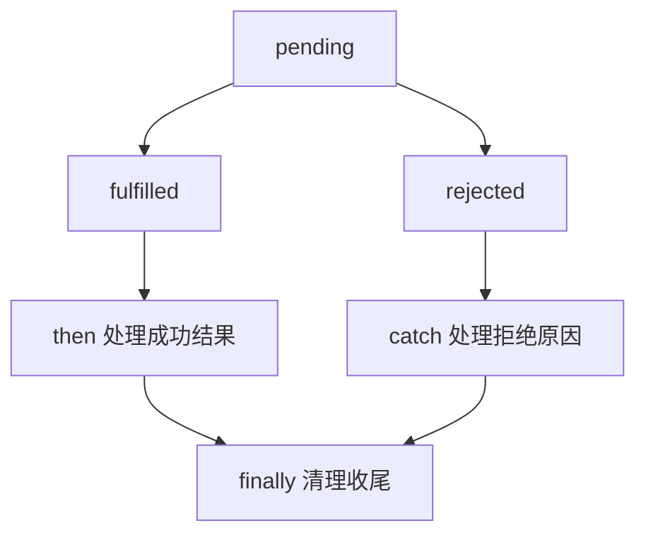

# JavaScript 11｜Promise 与 async/await

> Promise 为异步操作提供统一的状态与组合方式；async/await 则让异步控制流更接近顺序代码，但不会把异步操作变成同步操作。

## 学习目标

- 理解 Promise 的 pending、fulfilled 与 rejected 状态。
- 使用 then、catch、finally 组织异步流程。
- 使用 async/await 与 try/catch 处理异步错误。
- 选择合适的 Promise 并发组合方法。

## 1. Promise 状态流转



Promise 一旦 fulfilled 或 rejected，就不能再改变状态。Promise 的“已完成”不等于业务一定成功；需要明确成功结果和失败原因。

## 2. 创建和消费 Promise

```js
function wait(milliseconds) {
  return new Promise((resolve) => {
    setTimeout(resolve, milliseconds);
  });
}

wait(300)
  .then(() => {
    console.log("等待结束");
    return "下一步的数据";
  })
  .then((value) => console.log(value))
  .catch((error) => console.error("异步流程失败", error))
  .finally(() => console.log("流程收尾"));
```

- `then()` 注册成功处理逻辑，也可以提供第二个参数处理拒绝；实际项目中常用 `catch()` 统一处理链路错误。
- `catch()` 也会捕获前面链式处理器中抛出的异常。
- `finally()` 适合释放状态或资源，通常不接收业务结果。

## 3. 使用 async/await

```js
function getUser() {
  return new Promise((resolve) => {
    setTimeout(() => resolve({ id: 7, name: "小明" }), 200);
  });
}

async function main() {
  try {
    const user = await getUser();
    console.log("用户：", user.name);
  } catch (error) {
    console.error("读取用户失败", error);
  }
}

main();
```

调用 async 函数会返回 Promise。函数内部的 `await` 会暂停该 async 函数后续语句的执行，直到等待的值兑现或拒绝；它不会阻塞整个 JavaScript 主线程。

## 4. 顺序执行与并发执行

顺序等待适用于后一步依赖前一步的情况：

```js
const user = await getUser();
const profile = await getProfile(user.id);
```

若两个任务互不依赖，可以同时启动：

```js
const [settings, topics] = await Promise.all([
  getSettings(),
  getTopics()
]);
```

`Promise.all()` 在所有输入兑现后兑现；任一输入拒绝时，组合 Promise 会拒绝，但不会自动取消其他已经启动的操作。

## 5. 常用组合方法

| 方法 | 行为 | 适用场景 |
|---|---|---|
| `Promise.all()` | 全部兑现才兑现，任一拒绝则拒绝 | 所有结果都必需 |
| `Promise.allSettled()` | 等所有操作结束，返回每项状态 | 需要汇总成功与失败 |
| `Promise.race()` | 第一个兑现或拒绝的结果决定结果 | 竞速场景，但本身不取消其他任务 |
| `Promise.any()` | 第一个兑现的结果获胜；全部拒绝才拒绝 | 多个候选中任一成功即可 |

## 6. 实战：加载状态与错误反馈

```js
const button = document.querySelector("#reload");
const status = document.querySelector("#status");

async function refreshData() {
  button.disabled = true;
  status.textContent = "正在加载……";

  try {
    const result = await Promise.all([
      loadTopics(),
      loadProfile()
    ]);
    renderPage(result);
    status.textContent = "加载完成。";
  } catch (error) {
    console.error(error);
    status.textContent = "加载失败，请稍后重试。";
  } finally {
    button.disabled = false;
  }
}

button?.addEventListener("click", refreshData);
```

这里的 `loadTopics`、`loadProfile` 和 `renderPage` 是需要在项目中实现的函数。真实应用还应防止旧请求覆盖新结果，并根据需要增加超时和取消机制。

## 7. 常见陷阱

### 忘记 await 或 return

```js
async function saveAndReload() {
  saveRecord(); // 未等待：后续代码可能早于保存完成
  reloadList();
}
```

如果后续操作依赖保存结果，应使用 `await saveRecord()`；在 Promise 链中，则要 return 后续 Promise，保持链路可等待。

### 在 forEach 中使用 async

```js
// 不会等待所有异步回调完成
items.forEach(async (item) => {
  await saveItem(item);
});

// 需要顺序执行时：
for (const item of items) {
  await saveItem(item);
}

// 需要并发执行时：
await Promise.all(items.map((item) => saveItem(item)));
```

并发数量很大时，不应无限制地一次启动所有任务，应考虑并发池或分批执行。

## 8. 动手练习与验收

1. 把基于回调的延时函数改写为 Promise。
2. 编写 async 函数并用 try/catch/finally 管理加载状态。
3. 对比 Promise.all 与 Promise.allSettled 的返回结果。
4. 分别实现顺序保存和并发保存，并解释两者差异。

验收：

- [ ] 知道 async 函数总是返回 Promise。
- [ ] 能用 await 读取异步结果并处理拒绝。
- [ ] 能区分任务依赖关系与并发机会。
- [ ] 知道 Promise.all 拒绝不会自动取消其他任务。

## 9. 面试自测

1. Promise 的三种状态是什么？
2. await 会阻塞整个 JavaScript 线程吗？
3. Promise.all 与 Promise.allSettled 有何区别？
4. 为什么在 forEach 中使用 async 经常得不到预期等待效果？
5. 如何确保加载状态在成功或失败后都能复位？

## 延伸阅读

- [MDN：Promise](https://developer.mozilla.org/zh-CN/docs/Web/JavaScript/Reference/Global_Objects/Promise)
- [MDN：async function](https://developer.mozilla.org/zh-CN/docs/Web/JavaScript/Reference/Statements/async_function)
- [MDN：await](https://developer.mozilla.org/zh-CN/docs/Web/JavaScript/Reference/Operators/await)
