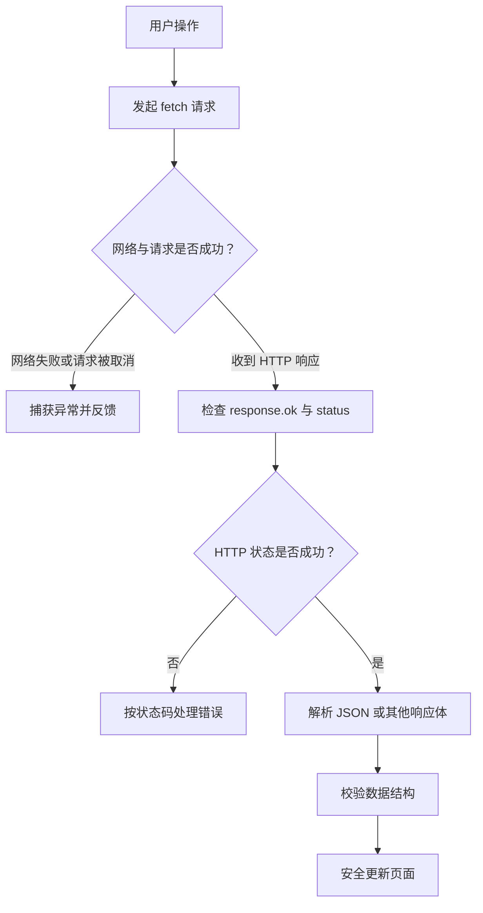

# JavaScript 12｜Fetch API 与 HTTP 请求

> 前端通过 HTTP 与服务端交换数据。Fetch API 提供现代的请求接口，但要注意：HTTP 4xx/5xx 响应通常不会让 fetch 自动 reject。

## 学习目标

- 使用 fetch 发起 GET 与 POST 请求。
- 检查 response.ok 与状态码。
- 处理 JSON 解析、网络异常和用户反馈。
- 使用 AbortController 取消不再需要的请求。
- 理解客户端与服务端各自的职责。

## 1. 请求流程



## 2. GET 请求与响应检查

```js
async function fetchTopics() {
  const response = await fetch("/api/topics");

  // fetch 收到 404 或 500 时通常仍会兑现 Response
  if (!response.ok) {
    throw new Error(`HTTP 错误：${response.status}`);
  }

  return response.json();
}

try {
  const topics = await fetchTopics();
  console.log(topics);
} catch (error) {
  console.error("请求失败：", error);
}
```

`fetch()` 会在网络错误、请求被中止等情况下拒绝；HTTP 错误状态本身通常需要通过 `response.ok` 或 `response.status` 判断。响应体读取与 JSON 解析也可能失败，因此应纳入错误处理。

## 3. POST JSON 请求

```js
async function createTopic(topic) {
  const response = await fetch("/api/topics", {
    method: "POST",
    headers: {
      "Content-Type": "application/json",
      "Accept": "application/json"
    },
    body: JSON.stringify(topic)
  });

  if (!response.ok) {
    throw new Error(`创建失败，HTTP ${response.status}`);
  }

  return response.json();
}
```

请求的字段、认证方式、CSRF 防护和错误格式取决于服务端 API 约定。不能假设任意地址都支持 JSON POST，也不要把秘密凭据写死在前端代码里。

## 4. 使用 AbortController 取消请求

```js
const controller = new AbortController();

async function loadWithSignal(signal) {
  const response = await fetch("/api/topics", { signal });
  if (!response.ok) throw new Error(`HTTP ${response.status}`);
  return response.json();
}

try {
  const topics = await loadWithSignal(controller.signal);
  console.log(topics);
} catch (error) {
  if (error instanceof DOMException && error.name === "AbortError") {
    console.log("请求已取消");
  } else {
    console.error("加载失败", error);
  }
}

// 当页面离开、查询条件改变或请求不再需要时：
// controller.abort();
```

一个 AbortController 可以为相关操作提供 signal。取消后应区分预期的取消行为与真实错误，避免把正常取消显示为故障。

## 5. 实战：加载并渲染专题列表

以下示例假设 `/api/topics` 返回形如 `[{ "id": "html", "title": "HTML 基础" }]` 的 JSON 数组。

```html
<button id="load-topics" type="button">加载专题</button>
<p id="topic-status" role="status" aria-live="polite"></p>
<ul id="topic-list"></ul>
```

```js
const loadButton = document.querySelector("#load-topics");
const topicStatus = document.querySelector("#topic-status");
const topicList = document.querySelector("#topic-list");
let activeController;

async function loadTopics() {
  activeController?.abort();
  activeController = new AbortController();

  loadButton.disabled = true;
  topicStatus.textContent = "正在加载专题……";

  try {
    const response = await fetch("/api/topics", {
      signal: activeController.signal,
      headers: { Accept: "application/json" }
    });

    if (!response.ok) {
      throw new Error(`HTTP ${response.status}`);
    }

    const data = await response.json();
    if (!Array.isArray(data) ||
        !data.every((item) =>
          item &&
          typeof item.id === "string" &&
          typeof item.title === "string"
        )) {
      throw new Error("服务端返回的数据结构不符合预期");
    }

    const fragment = document.createDocumentFragment();
    for (const topic of data) {
      const item = document.createElement("li");
      item.textContent = topic.title;
      fragment.append(item);
    }
    topicList.replaceChildren(fragment);
    topicStatus.textContent = `已加载 ${data.length} 个专题。`;
  } catch (error) {
    if (error instanceof DOMException && error.name === "AbortError") {
      return;
    }
    console.error(error);
    topicStatus.textContent = "加载失败，请检查网络或稍后重试。";
  } finally {
    loadButton.disabled = false;
  }
}

loadButton?.addEventListener("click", loadTopics);
```

该示例用于说明请求、校验和渲染流程，必须有提供对应接口的服务端才能实际返回数据。若允许连续发起多个请求，应进一步处理取消旧请求后旧请求的 finally 是否会覆盖新请求的按钮状态。

## 6. HTTP 基础概念

| 概念 | 说明 |
|---|---|
| URL | 资源地址及可选查询参数 |
| Method | GET 获取、POST 提交等请求语义 |
| Headers | 内容类型、协商、认证等元信息 |
| Status | 例如 200、201、400、401、403、404、500 |
| Request body | POST/PUT/PATCH 等请求可能携带的数据 |
| Response body | 服务端返回的数据，可能是 JSON、文本或其他类型 |

常见状态码只是约定的语义，最终处理应以 API 文档与服务端实际行为为准。

## 7. 跨域与安全提醒

- 跨源请求受同源策略与 CORS 规则约束；前端不能靠添加一个普通请求头绕过服务端 CORS 配置。
- 不要把 API 密钥或服务端私密凭据嵌入公开前端代码。
- 用户输入进入页面时应使用 `textContent` 等安全 DOM API，避免不可信 HTML 注入。
- 生产 API 需要服务端进行身份认证、授权、输入校验与必要的速率限制。
- 不要假定响应一定是合法 JSON；错误响应也可能返回空正文或文本。

## 8. 常见问题排查

| 问题 | 原因与处理 |
|---|---|
| 404 没进入 catch | fetch 通常仍返回 Response；检查 response.ok |
| response.json() 报错 | 响应可能为空、不是 JSON 或内容格式错误 |
| 浏览器报告 CORS | 检查服务端响应头、预检请求与请求方式 |
| 取消请求却显示失败 | 识别 AbortError，区分主动取消 |
| 旧查询结果覆盖新结果 | 使用 AbortController、请求序号或结果有效性检查 |

## 9. 动手练习与验收

1. 请求一个公开或自建 JSON API，显示加载、成功和失败状态。
2. 人为请求不存在的路径，确认能正确处理 404。
3. 为查询按钮增加请求取消功能。
4. 检查响应结构，拒绝不符合预期的数据。
5. 使用 DOM API 渲染服务端文本，不把不可信内容直接拼接进 innerHTML。

验收：

- [ ] 检查 response.ok，而非只写 try/catch。
- [ ] 处理网络错误和响应解析错误。
- [ ] 了解 CORS 需要服务端配合。
- [ ] 知道前端校验与服务端安全职责不同。

## 10. 面试自测

1. fetch 遇到 HTTP 404 时会自动 reject 吗？
2. response.json() 返回什么？为什么它本身也是异步的？
3. AbortController 有什么用途？
4. 什么是 CORS，前端能否单方面解除跨域限制？
5. 如何避免旧请求的结果覆盖最新的页面状态？

## 延伸阅读

- [MDN：使用 Fetch](https://developer.mozilla.org/zh-CN/docs/Web/API/Fetch_API/Using_Fetch)
- [MDN：Fetch API](https://developer.mozilla.org/zh-CN/docs/Web/API/Fetch_API)
- [MDN：AbortController](https://developer.mozilla.org/zh-CN/docs/Web/API/AbortController)
