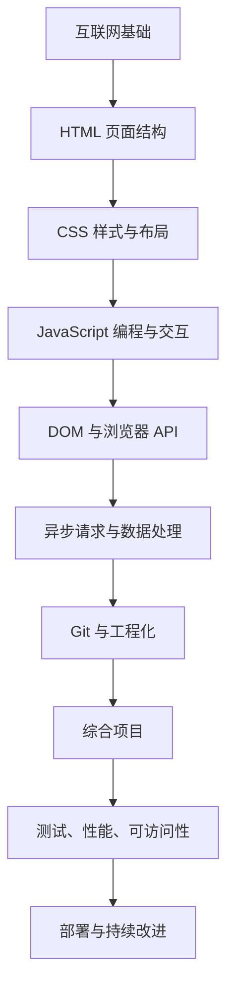
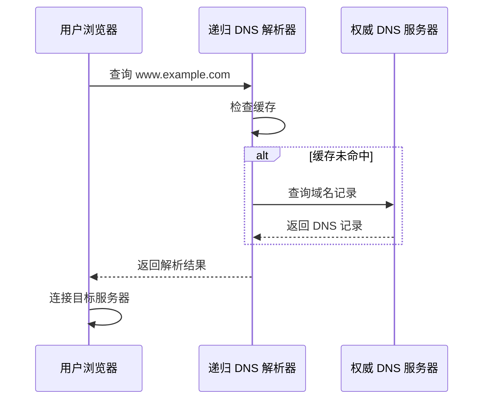
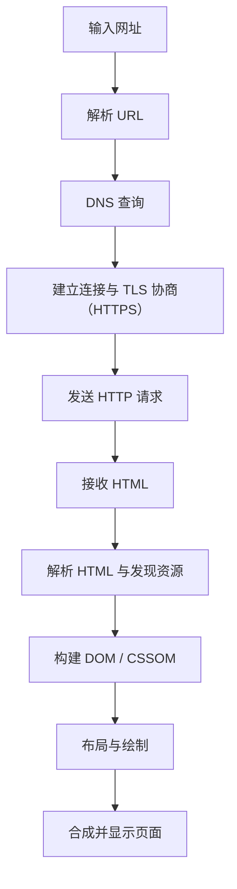
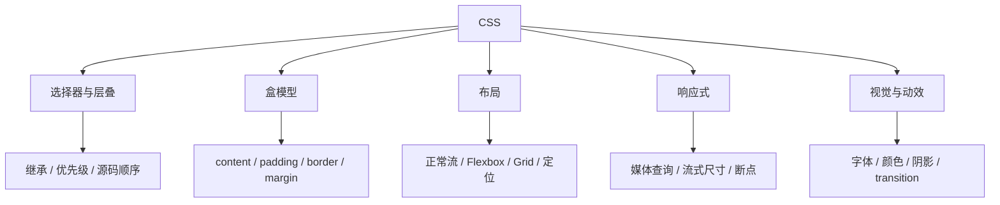
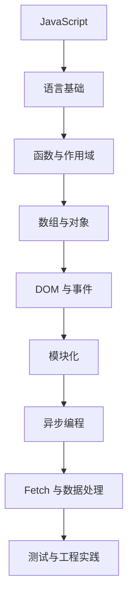
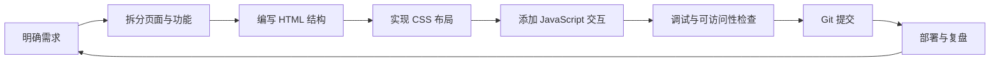

# HTML 前端学习笔记

> 从互联网基础到 HTML、CSS、JavaScript，再到工程化与项目实践。以“理解原理、动手验证、完成作品”为主线，逐步构建可复用的前端知识库。


## 学习导航

- [学习路线与阶段计划](StudyPlan.md)
- [互联网基础](#1-互联网基础)
- [HTML：语义化与页面结构](#2-html语义化与页面结构)
- [CSS：布局与视觉呈现](#3-css布局与视觉呈现)
- [JavaScript：交互与编程基础](#4-javascript交互与编程基础)
- [Git 与版本控制](#5-git-与版本控制)
- [浏览器、调试与 Web 工程](#6-浏览器调试与-web-工程)
- [综合项目与验收](#7-综合项目与验收)
- [参考资源](#8-参考资源)

## 学习方式

每个知识点尽量按以下结构补充，避免只堆积链接或概念：

1. **学习目标**：学完能解释或完成什么。
2. **核心概念**：术语、规则、适用场景与常见误区。
3. **原理图**：用 Mermaid 表达流程、结构或依赖关系。
4. **最小示例**：提供可复制运行的 HTML/CSS/JavaScript。
5. **逐步分析**：解释关键语法及浏览器行为。
6. **边界与排错**：列出常见错误、无障碍与兼容性问题。
7. **动手练习**：由易到难，明确验收标准。
8. **复盘问题**：用问答检验是否真正理解。

## 学习全景



---

## 1. 互联网基础

### 学习目标

理解浏览器访问网页时，域名如何解析、请求如何传输，以及浏览器如何接收并呈现资源。

### 1.1 DNS 与域名解析

DNS（Domain Name System，域名系统）负责将域名解析为 IP 地址。实际解析会受到浏览器/操作系统缓存、递归解析器缓存、DNS 记录类型和网络配置等因素影响。



常见记录：

- **A**：域名映射到 IPv4 地址。
- **AAAA**：域名映射到 IPv6 地址。
- **CNAME**：域名别名指向另一个域名。
- **MX**：指定邮件交换服务器。
- **TXT**：保存文本型信息，常用于域名验证及邮件安全配置。

### 1.2 HTTP 与 HTTPS

- HTTP 是应用层协议，用于客户端与服务器交换请求和响应。
- HTTPS 是通过 TLS 保护的 HTTP，提供传输加密、完整性校验和服务器身份验证。
- 常见方法包括 GET、POST、PUT、PATCH、DELETE；应根据语义理解其用途，而不是只记名称。
- 常见状态码：200（成功）、301/302（重定向）、400（请求错误）、401（未认证）、403（禁止访问）、404（未找到）、500（服务器内部错误）。

### 1.3 浏览器访问网页的基本过程



> 这是便于学习的简化流程。浏览器可能并行下载资源、增量渲染，并在脚本、样式和资源加载时调整执行顺序。

**练习**

1. 使用浏览器开发者工具的 Network 面板观察一个网页的请求。
2. 找出一个页面的文档请求、CSS、JavaScript、图片请求和状态码。
3. 比较 HTTP 与 HTTPS 地址在浏览器中的差异。

---

## 2. HTML：语义化与页面结构

### 学习目标

能够使用语义化 HTML 构建结构清晰、可访问、易维护的页面，并理解表单、媒体和元信息的基本用法。

### 2.1 文档基本结构

```html
<!doctype html>
<html lang="zh-CN">
  <head>
    <meta charset="UTF-8">
    <meta name="viewport" content="width=device-width, initial-scale=1">
    <title>我的第一个页面</title>
    <meta name="description" content="一个结构清晰的 HTML 页面示例">
  </head>
  <body>
    <header>
      <h1>页面标题</h1>
    </header>
    <main>
      <p>这里是页面的主要内容。</p>
    </main>
    <footer>页面页脚</footer>
  </body>
</html>
```

关键点：

- `<!doctype html>` 让浏览器以标准模式解析文档。
- `lang` 声明页面主要语言，有助于辅助技术和语言处理。
- `charset` 声明字符编码；现代页面通常使用 UTF-8。
- `viewport` 是移动端适配的基础设置之一。
- 页面通常应有清晰的主标题和主要内容区域。

### 2.2 常用语义标签

| 标签 | 用途 | 注意事项 |
|---|---|---|
| `header` | 页面或区块的介绍内容 | 不等于只能用于整个页面顶部 |
| `nav` | 主要导航链接 | 不必把所有链接都放进 nav |
| `main` | 页面主要内容 | 通常每个页面只有一个可见的 main |
| `section` | 有主题的内容分区 | 通常应有标题 |
| `article` | 可独立分发或复用的内容 | 例如文章、帖子 |
| `aside` | 与主体内容相关的补充内容 | 例如侧栏 |
| `footer` | 页面或区块的页脚 | 可在不同语义区块中使用 |

### 2.3 链接、图片与列表

```html
<a href="https://developer.mozilla.org/" target="_blank" rel="noopener noreferrer">
  阅读 MDN 文档
</a>


<ul>
  <li>结构</li>
  <li>样式</li>
  <li>交互</li>
</ul>
```

- 链接文本应描述目标，不要滥用“点击这里”。
- 有信息含义的图片应提供准确的 `alt`；纯装饰图片可使用空 alt。
- 为图片声明宽高有助于减少页面布局偏移。
- 新窗口打开外部链接时，应考虑安全属性与用户预期。

### 2.4 表单与可访问性

```html
<form>
  <label for="email">电子邮箱</label>
  <input id="email" name="email" type="email" autocomplete="email" required>
  <button type="submit">提交</button>
</form>
```

- 使用 `label` 将文本标签与表单控件关联。
- 为输入控件设置有意义的 `name`，以便表单提交。
- 使用合适的输入类型和原生校验，但不要把前端校验当作服务器端安全校验。
- 页面交互应支持键盘操作，焦点状态应清晰可见。

**练习与验收**

- 创建个人介绍页，至少包含 header、nav、main、section、footer。
- 添加图片、外部链接、有序/无序列表和一个表单。
- 使用浏览器检查器确认标题层级、图片替代文本和表单标签合理。

---

## 3. CSS：布局与视觉呈现

### 学习目标

理解层叠、继承、优先级、盒模型、常见布局方式、响应式设计和基础动画。

### 3.1 核心知识地图



### 3.2 盒模型与布局示例

```html
<div class="layout">
  <aside class="sidebar">导航</aside>
  <main class="content">主要内容</main>
</div>
```

```css
*,
*::before,
*::after {
  box-sizing: border-box;
}

.layout {
  display: grid;
  grid-template-columns: 16rem minmax(0, 1fr);
  gap: 1rem;
  max-width: 72rem;
  margin-inline: auto;
  padding: 1rem;
}

.sidebar,
.content {
  min-width: 0;
  padding: 1rem;
  border: 1px solid #d8dee8;
  border-radius: 0.75rem;
}

@media (max-width: 48rem) {
  .layout {
    grid-template-columns: 1fr;
  }
}
```

### 3.3 建议掌握顺序

1. 选择器、继承、层叠与优先级。
2. 盒模型、尺寸、外边距折叠和溢出。
3. Flexbox：一维排列、对齐、换行。
4. Grid：二维布局、轨道与响应式网格。
5. 定位、层叠上下文与 z-index。
6. 字体、颜色、间距、边框、阴影和伪类/伪元素。
7. 媒体查询、相对单位与移动端适配。
8. 过渡、变换、动画，以及减少动态效果的用户偏好。

**练习与验收**

- 将个人介绍页改成卡片式布局。
- 实现桌面端双栏、窄屏单栏。
- 检查页面在 320px、768px 和桌面宽度下是否出现横向溢出。
- 使用浏览器开发者工具临时修改 CSS，理解每条规则的生效原因。

---

## 4. JavaScript：交互与编程基础

### 学习目标

从变量、类型、控制流开始，逐步掌握函数、对象、数组、DOM、事件、异步和模块化。

### 4.1 知识地图



### 4.2 从事件开始

```html
<button id="count-button" type="button">点击次数：0</button>
<script>
  const button = document.querySelector("#count-button");
  let count = 0;

  button.addEventListener("click", () => {
    count += 1;
    button.textContent = `点击次数：${count}`;
  });
</script>
```

理解重点：

- `const` 绑定不能重新赋值；它不代表对象内部不可变。
- `let` 用于需要重新赋值的变量，避免无必要的全局变量。
- `querySelector` 获取符合选择器的第一个元素；需要考虑元素不存在的情况。
- `addEventListener` 将事件处理逻辑与 HTML 结构分离。
- 更新文本优先考虑 `textContent`；不要将不可信字符串直接写入 `innerHTML`。

### 4.3 必学主题

- 基础类型、类型转换、相等比较与真值判断。
- 条件、循环、函数、参数、返回值与错误处理。
- 作用域、闭包、this、原型与类的基本概念。
- 数组方法：`map`、`filter`、`find`、`reduce`。
- 对象解构、展开语法、可选链与空值合并。
- DOM 查询、事件冒泡、事件委托与表单处理。
- Promise、`async/await`、异常处理和请求取消的基本思路。
- ES Modules、JSON、Fetch API 与浏览器存储。
- 调试、代码拆分、基本测试与安全意识。

**练习与验收**

- 为个人页面添加主题切换和导航菜单。
- 实现一个待办清单：新增、完成、删除、筛选。
- 从公开 API 获取数据，并处理加载中、空数据和错误状态。
- 能解释事件冒泡、Promise 和 `async/await` 的用途。

---

## 5. Git 与版本控制

### 学习目标

能使用 Git 记录变更、创建分支、解决简单冲突，并通过清晰的提交信息追踪项目演进。

### 常用命令

```bash
git status
git add .
git commit -m "docs: add HTML learning notes"
git log --oneline --graph
git switch -c feature/responsive-layout
git diff
git pull --rebase
git push
```

推荐习惯：

- 提交前检查 `git diff`，避免提交密钥、个人数据或生成文件。
- 一次提交尽量围绕一个明确目的。
- 提交信息说明“做了什么”，例如 `docs:`、`feat:`、`fix:`。
- 学会分支、合并、冲突处理和恢复误操作前的状态。
- 不要将访问令牌、密码或私钥写入仓库。

**练习**：为一个静态网页建立仓库，完成至少 5 次有意义的提交，并尝试在分支中修改同一文件、理解冲突解决过程。

---

## 6. 浏览器、调试与 Web 工程

### 6.1 开发者工具

- **Elements**：检查 DOM 与样式。
- **Console**：查看日志、异常并执行临时表达式。
- **Network**：检查请求、响应、缓存与资源加载。
- **Sources**：断点调试、单步执行、观察变量。
- **Application/Storage**：查看 Cookie、Local Storage 等站点数据。
- **Performance**：初步识别长任务、布局和渲染开销。

### 6.2 需要逐步建立的工程意识

- 结构、样式、行为尽量职责清晰。
- 文件和变量命名表达用途，避免含糊缩写。
- 对空数据、网络失败、重复点击和非法输入做处理。
- 关注语义化、键盘可操作性、颜色对比和可见焦点。
- 图片尺寸适当，避免不必要的重复请求和大型脚本。
- 对用户输入进行校验；前端校验不能替代服务端校验。
- 在常见浏览器和不同视口下进行基本检查。

---

## 7. 综合项目与验收

建议按顺序完成，不需要一开始就引入大型框架。

| 项目 | 主要练习 | 完成标准 |
|---|---|---|
| 个人介绍页 | HTML 语义、链接、图片 | 结构完整，内容可读 |
| 响应式作品集 | CSS、Flexbox、Grid、媒体查询 | 手机和桌面布局均正常 |
| 交互式待办清单 | DOM、事件、数组与对象 | 新增、完成、删除、筛选可用 |
| API 数据展示页 | Fetch、异步、错误处理 | 有加载、成功、空数据、失败状态 |
| 前端学习导航站 | 综合整合、Git、部署 | 可导航、可访问、可持续维护 |

### 项目开发闭环



### 每个项目的检查清单

- [ ] 页面结构语义合理，标题层级清晰。
- [ ] 键盘可以完成主要交互，焦点可见。
- [ ] 不同视口下没有明显布局溢出。
- [ ] 控制台没有未处理的错误。
- [ ] 网络失败或空数据时有清晰反馈。
- [ ] 图片、链接和表单有合理的辅助信息。
- [ ] README 说明运行方式、功能和已知限制。
- [ ] Git 提交信息清晰，没有提交敏感信息。

---

## 8. 参考资源

- [MDN Web Docs](https://developer.mozilla.org/zh-CN/docs/Learn)：HTML、CSS、JavaScript 的系统教程与参考文档。
- [web.dev Learn](https://web.dev/learn)：现代 Web 开发、性能和最佳实践。
- [Frontend Developer Roadmap](https://roadmap.sh/frontend)：前端技能全景路线图。
- [HTML Living Standard](https://html.spec.whatwg.org/)：HTML 标准。
- [CSS Specifications](https://www.w3.org/Style/CSS/)：CSS 标准与相关资料。
- [JavaScript Guide](https://developer.mozilla.org/zh-CN/docs/Web/JavaScript/Guide)：JavaScript 指南。
- [Git Documentation](https://git-scm.com/doc)：Git 官方文档。

## 更新原则

- 先补齐基础知识与可运行示例，再逐步加入进阶主题。
- 新内容应链接到已有章节，避免重复堆砌。
- 示例尽量小而完整；标注运行环境、预期结果和限制。
- Mermaid 图保持简洁，使用标准语法并在 GitHub 页面确认渲染效果。
- 代码未经实际执行验证时，不标注为“已测试”。
