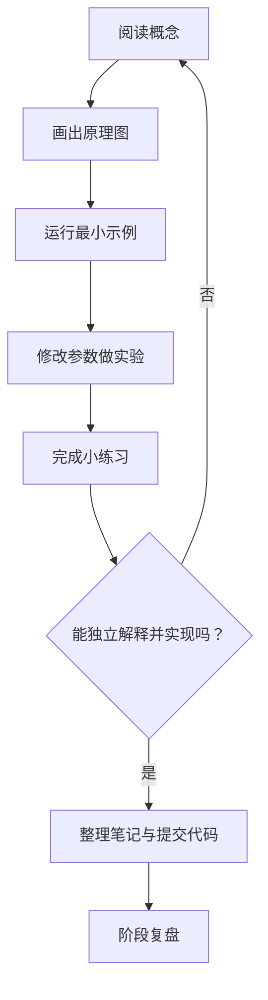

# 前端学习计划

> 配合 [README 学习导航](README.md) 使用。计划按阶段推进；可根据基础调整节奏，不必为了赶进度跳过练习。

## 学习流程



## 阶段安排

| 阶段 | 重点 | 实践产出 | 验收标准 |
|---|---|---|---|
| 1. Web 基础 | URL、DNS、HTTP/HTTPS、浏览器请求流程 | 请求分析记录 | 能解释从输入网址到页面显示的主要步骤 |
| 2. HTML | 文档结构、语义标签、链接、图片、表单 | 个人介绍页 | 结构语义合理，表单可访问 |
| 3. CSS | 层叠、盒模型、Flexbox、Grid、响应式 | 响应式作品集 | 手机和桌面布局正常 |
| 4. JavaScript 基础 | 类型、流程控制、函数、数组、对象 | 小型计算或列表工具 | 能独立编写并调试基础逻辑 |
| 5. DOM 与异步 | 事件、表单、Fetch、Promise、错误处理 | 待办清单与 API 展示页 | 覆盖成功、空数据和失败状态 |
| 6. 工程实践 | Git、调试、可访问性、性能、部署 | 可访问的学习导航站 | 能说明项目结构、提交历史和运行方式 |

## 每周节奏建议

- **第 1 天：** 阅读概念并整理术语。
- **第 2 天：** 复现最小示例，确认运行结果。
- **第 3 天：** 修改示例，观察边界行为。
- **第 4 天：** 完成独立练习。
- **第 5 天：** 整理错误记录并补充原理图。
- **第 6 天：** 将知识应用到小项目。
- **第 7 天：** 复盘、补漏、提交代码。

## 学习记录模板

复制以下模板到每个专题或每周记录中：

```markdown
## 本次学习

- 日期：
- 主题：
- 学习目标：
- 已完成内容：
- 关键概念：
- 原理图：
- 可运行示例：
- 遇到的问题：
- 我是如何定位问题的：
- 练习结果：
- 尚未理解：
- 下一步：
```

## 阶段复盘问题

1. 我能不看笔记解释这个概念吗？
2. 我能从空白文件写出最小可运行示例吗？
3. 我是否验证了错误输入、空数据或窄屏等边界？
4. 我能否解释代码为什么有效，而不只是知道它有效？
5. 这个知识点在项目中解决了什么问题？
6. 我是否把有价值的发现整理成可复用的笔记？

## 资源使用原则

优先使用 MDN、web.dev、标准文档和官方工具文档。遇到教程与标准不一致时，记录差异并优先核对标准或权威参考；不要只复制代码而不验证。
