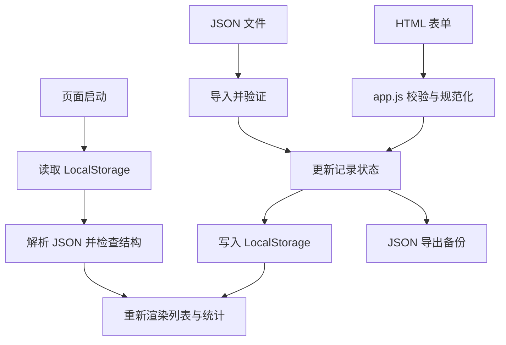

# 学习台｜个人学习记录与知识专题管理器

一个不依赖框架、构建工具或第三方库的原生前端项目，用来串联 HTML 表单、CSS 响应式布局、DOM、事件处理、数据校验、LocalStorage 和 JSON 导入导出。HTML、样式和应用逻辑已拆分为独立文件，方便维护。

## 运行方式

1. 确保 `index.html`、`styles.css` 和 `app.js` 保持在同一目录。
2. 使用任意静态 HTTP 服务器提供此目录（推荐），例如在本目录执行 `python -m http.server 8000`，再访问 `http://localhost:8000`。
3. 新建几条学习记录，刷新页面确认已保存的数据能够恢复。
4. 使用“导出 JSON”备份；需要恢复时点击“导入 JSON`。
5. 执行 `tests/manual-test-plan.md` 中的手动回归清单。

## 文件结构

```text
study-manager/
├── index.html                 # 页面结构与表单
├── styles.css                 # 主题、布局与响应式样式
├── app.js                     # 状态、校验、渲染、存储和导入导出
├── README.md                  # 项目说明
└── tests/
    └── manual-test-plan.md    # 手动回归测试清单
```

## 功能清单

- 创建、编辑、删除学习记录。
- 记录主题、分类、日期、学习时长和复盘内容。
- 搜索主题、分类和复盘文本；按分类筛选。
- 按日期、时长或主题排序。
- 统计记录总数、分类数量和累计学习分钟。
- LocalStorage 本地持久化，刷新后恢复。
- JSON 数据导入与导出，支持合并或替换导入。
- 深浅主题切换与主题偏好保存。
- 响应式布局、键盘焦点样式、实时状态提示和减少动态效果支持。
- 使用 `textContent` 渲染用户可见文本，避免把输入直接当作 HTML 执行。

## 数据流



## 验收清单

- [ ] 新增有效记录后，列表与统计立即更新。
- [ ] 空主题、非整数时长、超范围时长不能保存。
- [ ] 编辑记录不会产生重复项。
- [ ] 删除前会请求确认。
- [ ] 搜索、分类筛选和排序可用。
- [ ] 刷新后已保存记录仍然存在。
- [ ] 导出文件可重新导入。
- [ ] 导入无效 JSON 时显示错误，页面不崩溃。
- [ ] 窄屏下页面没有明显横向溢出。
- [ ] 浏览器存储不可用时显示提示。

## 数据格式

导出文件包含 `schemaVersion`、`exportedAt` 和 `records`。每条记录包含 `id`、`title`、`category`、`minutes`、`date`、`notes`、`createdAt` 和 `updatedAt`。导入会检查基本字段类型，但这不是复杂的数据迁移系统。

## 测试状态

已完成源码拆分和仓库文件回读检查；尚未在真实浏览器中执行完整自动化或手动回归。请按 `tests/manual-test-plan.md` 验证，并记录结果。

## 已知限制与安全

- 数据保存在当前浏览器的当前源，不会自动云同步或跨设备同步。
- 清除浏览器站点数据可能导致记录丢失；请定期导出备份。
- 不要将密码、访问令牌或其他敏感信息记录在应用中。
- 项目没有后端、账号系统或多用户权限控制。
- 目前完成仓库文件回读；仍应按验收清单在目标浏览器中手动测试。
